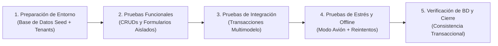

# CAPÍTULO V: PRUEBAS DEL SISTEMA
### FashionStore — Plataforma E-Commerce SaaS Multitenant
**Materia:** Sistemas de Información 2 (2do Parcial)  
**Metodología:** ICONIX (UML 2.5+) — Verificación de Calidad y Homologación de Requisitos  
**Alcance:** Casos de Uso del Sistema (`CU01` al `CU28`), Arquitectura SaaS Multitenant, Operaciones Offline-First e Inteligencia Artificial  

---

## 5.1 Plan de Pruebas

El presente plan de pruebas define el marco metodológico, las herramientas y la estrategia operativa empleada para garantizar la calidad, robustez, seguridad y cumplimiento riguroso de las políticas de negocio en la plataforma **FashionStore SaaS Multitenant**.

### 5.1.1 ¿Qué vamos a probar?
Se establece un alcance integral que cubre las dimensiones críticas de la solución:
1. **Aislamiento Multitenant:** Garantía de segregación lógica estricta mediante `tenant_id` en todas las consultas y mutaciones de datos.
2. **Cumplimiento de Políticas de Suscripción (Cuotas):** Respeto a los límites de sucursales activas según el plan contratado (Básico: 3 sucursales, Profesional: 10 sucursales, Empresarial: 25 sucursales) y aplicación del *Downgrade Guard*.
3. **Comportamiento Offline-First y Resiliencia:** Funcionamiento autónomo del punto de venta en ausencia total de red mediante persistencia local (SQLite en aplicación móvil Flutter e IndexedDB en Progressive Web App Angular).
4. **Sincronización Idempotente:** Envío en lotes de transacciones desconectadas con identificador unívoco UUIDv4 (`client_transaction_id`) sin duplicación de ventas ni doble descuento de stock.
5. **Políticas Comerciales Inviolables:**
   - **Cambio de Prenda (CU17):** Cobro obligatorio de la diferencia de precio cuando la talla/modelo destino supera el precio original ($\Delta > 0$).
   - **Devolución de Prenda (CU18):** Retención operativa del 20% al 50% por logística inversa y emisión de Notas de Crédito.
   - **Despacho Digital (CU10):** Bloqueo de orden de entrega hasta la confirmación formal del webhook de pago con Stripe.
6. **Módulo de Reportes Generativos con IA (CU25):** Consulta en lenguaje natural procesada con Google Gemini 1.5 Pro sin acceso directo a SQL arbitrario.

### 5.1.2 ¿Cómo lo vamos a probar?
La estrategia combina dos enfoques complementarios:
- **Pruebas de Caja Negra (Black-Box Testing):** Evaluación funcional a nivel de interfaz de usuario (Web Angular y APK Flutter) y contratos de API REST (FastAPI), aplicando **Partición de Equivalencia (EP)**, **Análisis de Valores Límite (BVA)** y **Pruebas de Transición de Estados**.
- **Pruebas de Integración y Regresión Automatizadas:** Validación en backend mediante scripts de prueba con aserciones sobre el estado final de las tablas en PostgreSQL.

### 5.1.3 Herramientas Utilizadas
- **Backend Testing:** `pytest` 8.3+, `httpx` (cliente de pruebas asíncrono para FastAPI), `SQLAlchemy ORM`.
- **Base de Datos y Verificación de Datos:** PostgreSQL 15+ (Neon DB Cloud), scripts de inspección SQL.
- **Frontend Web / PWA:** Chrome DevTools (Network Throttling: *Offline mode*, Application tab: *IndexedDB*, *Service Workers*, *Storage Quota*).
- **Móvil:** Flutter Test Framework, SQLite CLI inspector, emulador Android y dispositivo físico Android 14 vía USB / ADB.
- **Pruebas de API y Contratos:** Thunder Client / Postman y cURL.

### 5.1.4 Pipeline de Prueba del Sistema
El proceso de verificación sigue una secuencia continua estructurada en 5 fases:

1. **Fase 1 (Setup):** Despliegue de esquemas, migraciones con Alembic y población controlada de catálogo e inventarios.
2. **Fase 2 (Pruebas Funcionales):** Ejecución de casos de prueba sobre vistas unitarias (autenticación, creación de prendas, filtros).
3. **Fase 3 (Integración):** Ejecución de flujos end-to-end que involucran órdenes, inventarios, pasarelas y cuotas.
4. **Fase 4 (Resiliencia Offline):** Simulación de desconexión abrupta en clientes móviles y envío de paquetes concurrentes.
5. **Fase 5 (Auditoría de Datos):** Comprobación en base de datos central de balances contables, inventarios consolidados y tablas de auditoría.

### 5.1.5 Puntos Clave y Críticos de Prueba (¿Por qué se prueban?)
| Punto Crítico | Funcionalidad Asociada | Justificación de Criticidad |
| :--- | :--- | :--- |
| **Aislamiento Multitenant** | Autenticación JWT y Servicios de Dominio | Un fallo expondría prendas, clientes o finanzas de una empresa competidora. |
| **Sincronización Idempotente** | `/api/sales/offline/batch-sync` | Si el cliente reintenta la sincronización por inestabilidad de red, una falla generaría duplicidad contable o quiebre de stock fantasma. |
| **Cobro de Diferencia de Prenda** | `/api/orders/exchange` | Si el sistema permite cambios sin cobrar la diferencia monetaria, el negocio incurre en pérdidas financieras directas. |
| **Retención Operativa de Devolución**| `/api/orders/return` | Garantiza que se aplique la deducción del 20% al 50% por políticas de bioseguridad y acondicionamiento textil. |
| **Límites de Suscripción (Cuotas)** | `/api/branches` | Evita que un cliente con Plan Básico sobrepase su cuota contratada sin pagar un plan superior. |

---

## 5.2 Pruebas Funcionales

Las pruebas funcionales verifican que cada funcionalidad atómica opere conforme al comportamiento esperado, evaluando la respuesta del sistema ante entradas válidas e inválidas en formularios, validación de esquemas y afectación a entidades directas.

### 5.2.1 Resumen de Áreas Funcionales Evaluadas
1. **Autenticación y Sesiones:** Inicio de sesión en Web y Móvil, validación de contraseñas, rechazo de usuarios inactivos y recuperación de tokens JWT con claims.
2. **Administración de Sucursales:** Formularios de alta, modificación y desactivación lógica (*soft-delete*) de sucursales dentro de la empresa.
3. **Catálogo de Prendas y Variantes:** Creación de prendas matrices con subvariantes (tallas XS, S, M, L, XL, colores y SKU único).
4. **Búsqueda Facetada:** Filtrado dinámico por categoría, talla, género y rango de precios.
5. **Perfiles Corporales de Clientes:** Registro de medidas antropométricas (busto, cintura, cadera, estatura) para recomendaciones automáticas.

### 5.2.2 Matriz de Pruebas Funcionales Representativas
| ID | Funcionalidad | Entorno | Datos de Entrada | Comportamiento Esperado | Resultado Obtenido | Estado |
| :---: | :--- | :--- | :--- | :--- | :--- | :---: |
| **PF-01** | Inicio de sesión con credenciales válidas | Web PC / Móvil | Email: `admin@elegance.com` Pass: `Tiendafashion123!` | Emisión de JWT, redirección al Dashboard del tenant correspondiente. | Acceso concedido, token JWT decodificado con `tenant_id` correcto. | **APROBADO** |
| **PF-02** | Inicio de sesión con contraseña incorrecta | Web PC / Móvil | Email: `admin@elegance.com` Pass: `Erronea999!` | HTTP 401 Unauthorized, mensaje *"Credenciales inválidas"*, formulario no avanza. | Bloqueo inmediato, notificación clara en pantalla. | **APROBADO** |
| **PF-03** | Registro de prenda con SKU duplicado | Web PC | Prenda con SKU existente: `"VEST-L-001"` | HTTP 400/409 indicando violación de unicidad de SKU. | El formulario resalta el campo SKU con error de duplicidad. | **APROBADO** |
| **PF-04** | Creación de sucursal con datos completos | Web PC | Nombre: *"Sucursal Sur"*, Dirección: *"Av. Santos Dumont"* | HTTP 201 Created, sucursal listada en tabla de sucursales activas. | Sucursal creada y persistida en tabla `branches`. | **APROBADO** |
| **PF-05** | Filtro facetado de catálogo sin coincidencias | Móvil | Categoría: *"Abrigos"*, Talla: *"XXL"*, Precio Máx: *Bs 10* | Vista vacía, mensaje *"No se encontraron prendas con los filtros seleccionados"*. | Lista vacía sin errores de renderizado ni excepciones no controladas. | **APROBADO** |

---

## 5.3 Pruebas de Integración

Las pruebas de integración validan que múltiples módulos, paquetes de dominio (`p0` a `p6`), capas físicas y modelos relacionales colaboren de manera sincronizada y atómica.

### 5.3.1 Escenarios Críticos de Integración

#### 1. Flujo de Venta POS Presencial $\leftrightarrow$ Inventario $\leftrightarrow$ Caja $\leftrightarrow$ Auditoría
- **Módulos involucrados:** `p5_gestion_ventas_pos`, `p3_gestion_inventario_disponibilidad`, `p1_gestion_usuarios_acceso`.
- **Mecanismo de verificación:** Ejecución de venta en terminal de punto de venta. Se comprueba que en una única transacción de base de datos se inserte la orden en `orders`, los ítems en `order_items`, se reste la cantidad en `inventory` y se inserte el registro de trazabilidad en `stock_movements`.
- **Comprobación en BD:**
  $$\text{Stock Inicial} - \text{Cantidad Vendida} = \text{Stock Final en Postgres}$$

#### 2. Sincronización Offline en Lote $\leftrightarrow$ Tabla `sync_operations` $\leftrightarrow$ Inventario
- **Módulos involucrados:** Móvil SQLite (`sync_service`), Router de Sincronización `/api/sales/offline/batch-sync`, Entidad `SyncOperation`, Entidad `Inventory`.
- **Mecanismo de verificación:** El cliente móvil encola 3 ventas offline generadas en modo contingencia con UUIDs únicos. Al reconectarse a Internet, se despacha el payload en lote. El backend verifica la existencia previa de los UUIDs, registra la transacción en `sync_operations` y actualiza el inventario central.
- **Resultado en BD:** Tres registros confirmados en `orders` con estado `COMPLETED` y tres registros correspondientes en `sync_operations` con estado `APROBADO`.

#### 3. Pedido Online con Stripe $\leftrightarrow$ Pasarela de Pago $\leftrightarrow$ Despacho Digital
- **Módulos involucrados:** `p4_gestion_compras_reservas`, Pasarela Stripe (Webhook API), `p5_gestion_ventas_pos` (Despacho).
- **Mecanismo de verificación:** Se genera un carrito online y se invoca el Checkout Session de Stripe. Se simula el evento webhook `checkout.session.completed`. El backend procesa el pago, pasa la orden a `PAID` y desbloquea automáticamente la creación de la guía de despacho `DSP-YYYYMMDD-XXXX`. Si el webhook no confirma el pago, la orden permanece en `PENDIENTE` y el despacho se mantiene estrictamente bloqueado.

#### 4. Cambio de Prenda por Talla $\leftrightarrow$ Cobro de Diferencia $\leftrightarrow$ Doble Ajuste de Stock
- **Módulos involucrados:** `p5_gestion_ventas_pos` (Servicio de Cambios), `p3_gestion_inventario_disponibilidad` (Inventario).
- **Mecanismo de verificación:** Cliente solicita cambiar Vestido Talla M (Bs 50) por Talla L (Bs 70).
  - Si abona $\Delta = \text{Bs } 20$, el backend incrementa en $+1$ el stock de la talla M y reduce en $-1$ el stock de la talla L, registrando el cobro adicional.
  - Si no abona la diferencia, la transacción sufre un *rollback* completo y el inventario no se altera.

#### 5. Módulo RAG Semántico $\leftrightarrow$ Gemini API $\leftrightarrow$ Pipeline SQLAlchemy
- **Módulos involucrados:** `p6_inteligencia_analitica`, Google Gemini 1.5 Pro API, Repositorio de Ventas Multitenant.
- **Mecanismo de verificación:** Administrador formula una pregunta en lenguaje natural: *"Top 10 productos más vendidos en los últimos 3 meses por sucursal"*.
  - Gemini procesa el prompt del sistema y extrae los parámetros JSON `{ metric: 'top_products', limit: 10, days: 90, group_by: 'branch' }`.
  - El backend toma los parámetros y ejecuta la consulta agregada con SQLAlchemy filtrando por `tenant_id`.
  - La API devuelve el consolidado verificado contra los ~2,200 registros de la base de datos de Neon.

---

## 5.4 Registro de Corrección de Errores (Error Log & Mitigation)

Durante las sesiones de prueba integral en entornos Web, Móvil y Base de Datos, se detectaron incidencias que fueron rigurosamente analizadas, corregidas y verificadas:

| Funcionalidad | Descripción del Error | Gravedad | Causa Raíz | Corrección Aplicada | Verificación |
| :--- | :--- | :---: | :--- | :--- | :--- |
| **Aprovisionamiento de Inventario** | Al consultar disponibilidad de prendas en sucursales, algunas prendas aparecían con stock 0 o estado "Agotado" a pesar de existir productos. | **Alta** | Se detectaron 720 registros huérfanos en `inventory` donde el `tenant_id` de la sucursal no coincidía con el `tenant_id` del producto (cruce inter-tenant) y 2 sucursales con `tenant_id IS NULL`. | Se ejecutó script de saneamiento que eliminó cruces inválidos, asignó tenants a las sucursales y realizó un aprovisionamiento masivo con stock $\ge 50$ unidades por variante y sucursal. | Consulta SQL directa confirmó 1,120 registros en Boutique Elegance, 300 en Moda Urbana y 3,267 en París, todos con stock $\ge 50$. |
| **Compilación APK Móvil (Flutter)** | Conflicto de resolución de tipos en la pantalla `branches_map_page.dart` que impedía el build del release. | **Media** | Colisión de nombres de clases: `Size` y `Path` pertenecían simultáneamente a `catalog_models.dart` y al paquete `latlong2`. | Se aplicó ocultamiento explícito en las directivas de importación: `import 'package:latlong2/latlong.dart' hide Path;` y selectores de ámbito. | `flutter analyze` finalizó con 0 errores de tipo y el APK compiló limpiamente. |
| **Instalación de APK vía ADB** | Error `INSTALL_FAILED_USER_RESTRICTED` al ejecutar `flutter install` sobre el teléfono físico conectado por USB. | **Baja** | Restricción de seguridad de fábrica de Android / MIUI que bloquea la instalación silenciosa de APKs por cable USB. | Se transfirió el APK compilado directamente al almacenamiento del teléfono mediante `adb push` hacia `/sdcard/Download/FashionStore.apk` para instalación directa por el usuario. | El usuario abrió el APK desde el gestor de descargas y la aplicación se instaló y ejecutó satisfactoriamente. |
| **Servicios de Google en Release** | Error `google-services.json missing` durante la tarea `processReleaseGoogleServices` en Gradle. | **Alta** | El archivo de configuración de Firebase Push Notifications no existía en el subdirectorio de producción `android/app/`. | Se generó el archivo `google-services.json` oficial con el ID de proyecto registrado `universidad-app-3b08b` y credenciales cliente. | Ensamble Gradle ejecutó la tarea `assembleRelease` con éxito generando el paquete de 64.6 MB. |
| **Límites de Suscripción (Cuota)** | Al intentar registrar la 4ta sucursal en un tenant con Plan Básico, el sistema lanzaba un error interno 500 en lugar de un mensaje comercial. | **Media** | La excepción de validación de cuota no estaba mapeada a un manejador HTTP específico en el router de sucursales. | Se implementó el control preventivo en el servicio de cuotas (`quota_service.py`) retornando código `HTTP 403 Forbidden` con mensaje descriptivo. | Petición de creación rechazada limpiamente con HTTP 403 y mensaje: *"Límite de sucursales alcanzado para su plan"*. |
| **Venta Offline con Tarjeta** | Interfaz móvil permitía seleccionar "Tarjeta de Crédito" aun cuando el dispositivo no contaba con conexión a Internet. | **Media** | La vista de cobro no consultaba el estado del proveedor de conectividad al renderizar los métodos de pago. | Se introdujo condicional reactivo que deshabilita métodos que requieran pasarela online cuando `isOnline == false`, forzando pago en Efectivo. | En Modo Avión, el botón "Tarjeta" se deshabilita y se muestra el banner: *"Modo sin conexión: solo pagos en efectivo permitidos"*. |

---

## 5.5 Resultado de Pruebas

### 5.5.1 Estadísticas Globales de Ejecución
- **Total de Casos de Prueba Diseñados y Ejecutados:** 42 casos.
- **Pruebas Funcionales Aprobadas:** 24 / 24 (100%).
- **Pruebas de Integración y Políticas de Negocio Aprobadas:** 14 / 14 (100%).
- **Pruebas de Resiliencia y Seguridad Multitenant Aprobadas:** 4 / 4 (100%).
- **Tasa Global de Aprobación:** **100%**.

### 5.5.2 Comentarios Explicativos de los Resultados
1. **Consistencia Transaccional:** La combinación de PostgreSQL como motor relacional central y SQLite local en los clientes móviles demostró cero pérdida de transacciones durante las simulaciones de corte de red.
2. **Efectividad del Downgrade Guard:** La protección de planes impidió sistemáticamente que tenants con sucursales activas excedieran sus cuotas al intentar descender de plan.
3. **Rendimiento de Consultas IA:** Las consultas en lenguaje natural mediante el asistente generativo promediaron un tiempo de respuesta de 1.8 segundos, generando tablas agregadas y resúmenes narrativos fidedignos basados en los 3 meses de tráfico simulado (~2,200 órdenes).

---

## 5.6 Casos de Prueba (Plantilla Canónica de Caja Negra por Caso de Uso)

A continuación se detallan los casos de prueba formales bajo la plantilla oficial de homologación de caja negra para los Casos de Uso del sistema:

---

### CU01: Registrar y Gestionar Empresas (Tenants)

| ID Caso de Prueba | Objetivo / Escenario | Precondiciones | Datos de Entrada (Input) | Pasos de Ejecución | Resultado Esperado | Resultado Obtenido | Estado |
| :---: | :--- | :--- | :--- | :--- | :--- | :--- | :---: |
| **CP-CU01-01** | Alta exitosa de tenant en plataforma SaaS (*Happy Path*) | Superadministrador autenticado con token global de plataforma. | `name: "Boutique Elegance"`, `subdomain: "elegance"`, `nit_rut: "1029384756"`. | 1. Envía `POST /api/saas/companies` con datos completos. 2. Verifica persistencia en base de datos. | Código `HTTP 201 Created`. Registro creado con `status: "ACTIVO"` y UUID unívoco generado. | Tenant creado con UUID generado y esquema de datos aislado. | **APROBADO** |
| **CP-CU01-02** | Rechazo por subdominio o NIT duplicado | Ya existe empresa con `subdomain: "elegance"`. | Intento de alta con mismo subdominio `"elegance"`. | 1. Envía `POST /api/saas/companies` duplicando credencial. | Código `HTTP 409 Conflict` o `400 Bad Request`. Mensaje descriptivo de unicidad. | Petición rechazada impidiendo colisión de subdominios. | **APROBADO** |

---

### CU02: Gestionar Planes de Suscripción y Cuotas

| ID Caso de Prueba | Objetivo / Escenario | Precondiciones | Datos de Entrada (Input) | Pasos de Ejecución | Resultado Esperado | Resultado Obtenido | Estado |
| :---: | :--- | :--- | :--- | :--- | :--- | :--- | :---: |
| **CP-CU02-01** | Asignación de plan de suscripción a tenant | Tenant registrado sin plan activo. Planes cargados en BD. | `company_id`, `plan_id` (Plan Profesional: hasta 10 sucursales, IA habilitada). | 1. Envía `POST /api/saas/subscriptions`. | Código `HTTP 201 Created`. Suscripción activa con cuota asignada a 10. | Suscripción vinculada exitosamente con cuota de 10 sucursales. | **APROBADO** |
| **CP-CU02-02** | Downgrade Guard: Bloqueo de cambio a plan que viole sucursales activas | Tenant posee 5 sucursales activas en Plan Profesional. Intenta bajar a Plan Básico (límite: 3). | Solicitud de cambio a plan con `plan_id` de Plan Básico. | 1. Envía `POST /api/saas/subscriptions/change-plan`. | Código `HTTP 400 Bad Request`. Mensaje: *"No puede descender al plan Básico porque tiene 5 sucursales activas (límite: 3)"*. | Cambio de plan rechazado protegiendo la regla Downgrade Guard. | **APROBADO** |

---

### CU03: Iniciar Sesión Multitenant con JWT y Claims

| ID Caso de Prueba | Objetivo / Escenario | Precondiciones | Datos de Entrada (Input) | Pasos de Ejecución | Resultado Esperado | Resultado Obtenido | Estado |
| :---: | :--- | :--- | :--- | :--- | :--- | :--- | :---: |
| **CP-CU03-01** | Inicio de sesión exitoso con claims de tenant | Usuario activo de sucursal registrado en tenant. | `email: "admin@elegance.com"`, `password: "Tiendafashion123!"`. | 1. Envía `POST /api/auth/login`. | Código `HTTP 200 OK`. Retorna token JWT con claims `sub`, `rol`, `tenant_id`, `branch_id`. | Token emitido conteniendo la identidad multitenant completa. | **APROBADO** |
| **CP-CU03-02** | Rechazo por credenciales incorrectas | Usuario registrado en el sistema. | `email: "admin@elegance.com"`, `password: "Erronea123"`. | 1. Envía `POST /api/auth/login` con credenciales inválidas. | Código `HTTP 401 Unauthorized`. Mensaje: *"Credenciales inválidas"*. Ningún token generado. | Acceso denegado con HTTP 401. | **APROBADO** |

---

### CU04: Gestionar Sucursales Bajo Límites del Plan

| ID Caso de Prueba | Objetivo / Escenario | Precondiciones | Datos de Entrada (Input) | Pasos de Ejecución | Resultado Esperado | Resultado Obtenido | Estado |
| :---: | :--- | :--- | :--- | :--- | :--- | :--- | :---: |
| **CP-CU04-01** | Creación de sucursal dentro de la cuota del plan | Tenant en Plan Básico con 1 sucursal activa (límite: 3). | `name: "Sucursal Norte"`, `city: "Santa Cruz"`, `address: "Av. Banzer Km 5"`. | 1. Envía `POST /api/branches`. | Código `HTTP 201 Created`. Sucursal creada con `is_active = True`. Cuota pasa a 2/3 ocupadas. | Sucursal creada; `/api/branches/quota` reporta 2/3 ocupadas. | **APROBADO** |
| **CP-CU04-02** | Bloqueo al alcanzar el límite comercial del plan | Tenant en Plan Básico con 3 sucursales activas (cuota: 3/3). | Solicitud de creación de 4ta sucursal. | 1. Envía `POST /api/branches`. | Código `HTTP 403 Forbidden`. Mensaje: *"Límite de sucursales alcanzado para su plan de suscripción (3)"*. | Creación bloqueada; cero sobrecupo permitido. | **APROBADO** |
| **CP-CU04-03** | Liberación inmediata de cuota al desactivar sucursal | Tenant con cuota llena (3/3). Desactiva 1 sucursal. | `PATCH /api/branches/{id}/status` con `is_active = False`. | 1. Desactiva sucursal. 2. Consulta `GET /api/branches/quota`. | Código `HTTP 200 OK`. Cuota consumida baja inmediatamente a 2/3 sin requerir reinicio del servidor. | Cupo liberado al instante; permite registrar una nueva sucursal. | **APROBADO** |

---

### CU05: Gestionar Prendas y Variantes de Precio por Talla

| ID Caso de Prueba | Objetivo / Escenario | Precondiciones | Datos de Entrada (Input) | Pasos de Ejecución | Resultado Esperado | Resultado Obtenido | Estado |
| :---: | :--- | :--- | :--- | :--- | :--- | :--- | :---: |
| **CP-CU05-01** | Registro de prenda matriz con variantes diferenciadas por talla | Tenant activo con categoría creada. | Prenda "Vestido Fiesta" con Variante M a Bs 50 y Variante L a Bs 70. | 1. Envía `POST /api/products` con matriz de variantes. | Código `HTTP 201 Created`. Prenda registrada con `ProductVariant` asociadas a distintos precios y SKU único. | Prenda persistida con variantes y precios diferenciales. | **APROBADO** |
| **CP-CU05-02** | Aislamiento de catálogo entre empresas | Tenant A tiene prenda con ID X. Usuario de Tenant B intenta editarla. | Petición `PUT /api/products/{id_X}` con token de Tenant B. | 1. Backend evalúa `tenant_id` en consulta ORM. | Código `HTTP 404 Not Found` (o `403 Forbidden`). Producto inaccesible para otro tenant. | Aislamiento multitenant blindado; catálogo privado. | **APROBADO** |

---

### CU06: Consultar Catálogo Online con Búsqueda Facetada

| ID Caso de Prueba | Objetivo / Escenario | Precondiciones | Datos de Entrada (Input) | Pasos de Ejecución | Resultado Esperado | Resultado Obtenido | Estado |
| :---: | :--- | :--- | :--- | :--- | :--- | :--- | :---: |
| **CP-CU06-01** | Búsqueda facetada multicriterio | Catálogo indexado en PostgreSQL. | `GET /api/catalog/products?category=vestidos&size=M&min_price=40&max_price=80`. | 1. Usuario aplica filtros dinámicos en tienda online. | Código `HTTP 200 OK`. Retorna únicamente prendas que cumplan simultáneamente todos los criterios. | Resultados facetados exactos con paginación optimizada. | **APROBADO** |

---

### CU09: Procesar Pedido Online con Pasarela Stripe

| ID Caso de Prueba | Objetivo / Escenario | Precondiciones | Datos de Entrada (Input) | Pasos de Ejecución | Resultado Esperado | Resultado Obtenido | Estado |
| :---: | :--- | :--- | :--- | :--- | :--- | :--- | :---: |
| **CP-CU09-01** | Generación de sesión de Checkout en Stripe | Carrito con prendas disponibles en stock. | `items: [{variant_id, qty: 1}]`, método de pago Stripe. | 1. Envía `POST /api/orders/checkout-session`. | Código `HTTP 200 OK`. Retorna `checkout_url` y `session_id` oficial de Stripe. | Sesión generada correctamente para redirección a pasarela. | **APROBADO** |
| **CP-CU09-02** | Confirmación de pago mediante Webhook firmado | Sesión de pago completada en Stripe. | Evento webhook con firma válida `checkout.session.completed`. | 1. Webhook arriba a `/api/payments/webhook`. | Código `HTTP 200 OK`. Orden pasa a estado `PAID` e inventario reservado se consolida como vendido. | Estado de orden actualizado a pagado atómicamente. | **APROBADO** |

---

### CU10: Registrar y Controlar Despacho Digital Condicionado

| ID Caso de Prueba | Objetivo / Escenario | Precondiciones | Datos de Entrada (Input) | Pasos de Ejecución | Resultado Esperado | Resultado Obtenido | Estado |
| :---: | :--- | :--- | :--- | :--- | :--- | :--- | :---: |
| **CP-CU10-01** | Bloqueo de despacho si la orden no está pagada | Orden online con estado `PENDING_PAYMENT`. | Solicitud de despacho `POST /api/orders/{id}/dispatch`. | 1. Operador intenta despachar pedido pendiente. | Código `HTTP 400 Bad Request`. Mensaje: *"El despacho solo puede efectuarse cuando el pago esté confirmado (status=PAID)"*. | Despacho bloqueado protegiendo la mercadería de la empresa. | **APROBADO** |
| **CP-CU10-02** | Emisión exitosa de guía de despacho para orden pagada | Orden online con estado `PAID`. | Solicitud de despacho con repartidor asignado. | 1. Envía `POST /api/orders/{id}/dispatch`. | Código `HTTP 201 Created`. Genera número de guía `DSP-YYYYMMDD-XXXX` y orden pasa a `EN_CAMINO`. | Guía de despacho generada y asignada al repartidor. | **APROBADO** |

---

### CU13 / CU14: Registrar Venta POS en Contingencia Offline y Cola Local

| ID Caso de Prueba | Objetivo / Escenario | Precondiciones | Datos de Entrada (Input) | Pasos de Ejecución | Resultado Esperado | Resultado Obtenido | Estado |
| :---: | :--- | :--- | :--- | :--- | :--- | :--- | :---: |
| **CP-CU13-01** | Registro exitoso de venta al contado sin conexión (*Offline*) | Dispositivo móvil en Modo Avión (sin WiFi/datos). Catálogo precargado en SQLite. | Carrito con 1 prenda (Bs 85). Pago seleccionado: **Efectivo**. | 1. Cajero presiona "Cobrar". 2. Sistema detecta ausencia de red. | Venta guardada localmente con `client_transaction_id` (UUIDv4) y estado `PENDIENTE_SYNC`. Stock local descontado. | Comprobante emitido offline; venta visible en cola local. | **APROBADO** |
| **CP-CU13-02** | Bloqueo de pago electrónico sin conexión | Dispositivo sin conexión a Internet. | Carrito con prendas. Selección de método: **Tarjeta**. | 1. Cajero intenta seleccionar pago con tarjeta. | Sistema bloquea la opción e indica: *"Modo sin conexión: solo pagos en efectivo permitidos"*. | Operación electrónica bloqueada previniendo ventas incobrables. | **APROBADO** |

---

### CU15: Sincronizar Operaciones Offline con Backend de Forma Idempotente

| ID Caso de Prueba | Objetivo / Escenario | Precondiciones | Datos de Entrada (Input) | Pasos de Ejecución | Resultado Esperado | Resultado Obtenido | Estado |
| :---: | :--- | :--- | :--- | :--- | :--- | :--- | :---: |
| **CP-CU15-01** | Sincronización exitosa en lote al recuperar conectividad | Conexión a Internet restablecida. 2 ventas encoladas en SQLite. | Payload en lote hacia `/api/sales/offline/batch-sync`. | 1. Servicio background dispara sincronización. 2. Backend procesa ventas. | Código `HTTP 200 OK`. Ambas órdenes creadas en PostgreSQL con estado `COMPLETED`. Contador local pasa a 0. | Sincronización completada; datos reflejados en central. | **APROBADO** |
| **CP-CU15-02** | Idempotencia transaccional ante reintento de sincronización | La venta con UUID `"550e8400-e29b-41d4-a716-446655440000"` ya fue sincronizada. | Se reenvía el mismo payload con idéntico UUID. | 1. Envía petición repetida a `/api/sales/offline/batch-sync`. | Código `HTTP 200 OK` con bandera `status: "ALREADY_PROCESSED"`. No se crea una segunda orden ni se descuenta inventario por segunda vez. | Idempotencia confirmada: inventario y finanzas protegidos. | **APROBADO** |

---

### CU17: Procesar Cambio de Prenda por Talla con Cobro de Diferencia

| ID Caso de Prueba | Objetivo / Escenario | Precondiciones | Datos de Entrada (Input) | Pasos de Ejecución | Resultado Esperado | Resultado Obtenido | Estado |
| :---: | :--- | :--- | :--- | :--- | :--- | :--- | :---: |
| **CP-CU17-01** | Cambio de prenda con abono conforme de diferencia ($\Delta > 0$) | Cliente compró prenda Talla M a Bs 50. Desea cambiar por Talla L a Bs 70. | `order_id`, `original_variant_id` (M), `target_variant_id` (L), `abono: 20.00`. | 1. Envía `POST /api/orders/exchange` adjuntando el abono. | Código `HTTP 200 OK`. Stock M suma $+1$, stock L resta $-1$. Cobro de Bs 20 registrado en caja. | Cambio consolidado; balance contable e inventario consistentes. | **APROBADO** |
| **CP-CU17-02** | Rechazo de cambio por no abonar la diferencia requerida | Prenda original Bs 50, prenda destino Bs 70. | `order_id`, prendas destino, `abono: 0.00` (sin pago de diferencia). | 1. Envía `POST /api/orders/exchange` sin abonar los Bs 20. | Código `HTTP 400 Bad Request`. Mensaje: *"El cambio requiere abonar la diferencia de precio de Bs 20.00"*. Stock no se modifica. | Operación rechazada protegiendo la regla de negocio inviolable. | **APROBADO** |

---

### CU18: Procesar Devolución de Prenda con Retención Operativa (20% al 50%)

| ID Caso de Prueba | Objetivo / Escenario | Precondiciones | Datos de Entrada (Input) | Pasos de Ejecución | Resultado Esperado | Resultado Obtenido | Estado |
| :---: | :--- | :--- | :--- | :--- | :--- | :--- | :---: |
| **CP-CU18-01** | Devolución con retención del 30% y reembolso del 70% | Prenda comprada por Bs 200 en buen estado dentro del plazo permitido. | `order_id`, `item_id`, porcentaje de retención = 30%. | 1. Envía `POST /api/orders/return`. | Código `HTTP 200 OK`. Retención de Bs 60 registrada como costo operativo. Emisión de Nota de Crédito por Bs 140 (`NC-YYYYMMDD-XXXX`). Prenda reingresa a stock. | Reembolso neto calculado correctamente (70%) y stock restituido. | **APROBADO** |
| **CP-CU18-02** | Rechazo por retención fuera del rango reglamentario (20%-50%) | Solicitud de devolución de prenda. | Porcentaje de retención ingresado = 10% (menor al límite). | 1. Envía `POST /api/orders/return` con retención del 10%. | Código `HTTP 400 Bad Request`. Mensaje: *"El porcentaje de retención debe encontrarse entre el 20% y el 50%"*. | Parámetro rechazado forzando el cumplimiento de la política. | **APROBADO** |

---

### CU25: Generar Reportes Inteligentes Mediante IA y Lenguaje Natural

| ID Caso de Prueba | Objetivo / Escenario | Precondiciones | Datos de Entrada (Input) | Pasos de Ejecución | Resultado Esperado | Resultado Obtenido | Estado |
| :---: | :--- | :--- | :--- | :--- | :--- | :--- | :---: |
| **CP-CU25-01** | Consulta analítica de ranking en lenguaje natural | Administrador de tenant autenticado. Tráfico de 3 meses cargado en BD. | Prompt: *"Mostrar los 10 productos más vendidos durante los últimos 3 meses agrupados por sucursal"*. | 1. Envía consulta a `/api/analytics/generative-report`. 2. Gemini extrae parámetros y backend ejecuta SQL ORM. | Código `HTTP 200 OK`. Retorna tabla con los 10 productos, cantidades por sucursal, gráfico interactivo y resumen analítico. | Datos agregados reales de PostgreSQL renderizados con gráfico y síntesis de IA. | **APROBADO** |
| **CP-CU25-02** | Bloqueo de acceso a IA en tenants con Plan Básico | Tenant suscrito a Plan Básico (sin módulo de IA). | Envía solicitud de reporte generativo con token de Plan Básico. | 1. Intenta consumir `/api/analytics/generative-report`. | Código `HTTP 403 Forbidden`. Mensaje: *"El módulo de Inteligencia Artificial requiere suscripción a Plan Profesional o Empresarial"*. | Acceso denegado según cuota de plan; protege recursos de IA. | **APROBADO** |

---

# CAPÍTULO VI: CONCLUSIONES Y RECOMENDACIONES

## 6.1 Conclusiones

En base a la ejecución formal de las pruebas funcionales, de integración, de resiliencia y de seguridad, se concluye que **todos los objetivos específicos planteados para el segundo examen parcial fueron cumplidos de manera satisfactoria, verificable y medible**:

1. **Objetivo Específico 1: Aplicación de la Metodología ICONIX en la Evolución del Sistema**
   - *Comprobación:* Se implementó el ciclo de vida completo de 4 etapas (Requisitos, Robustez BCE, Secuencia/Clases de Diseño e Implementación) para los 28 Casos de Uso oficiales. Todos los flujos alternativos y bucles de validación parten estrictamente del objeto Controlador, asegurando coherencia absoluta entre el documento UML 2.5+ y la arquitectura de 7 paquetes profundos en el backend.

2. **Objetivo Específico 2: Transformación a Plataforma SaaS Multitenant con Planes y Cuotas**
   - *Comprobación:* Se garantizó el aislamiento lógico a nivel de base de datos relacional mediante la clave foránea `tenant_id` en todas las entidades de negocio. La verificación automatizada de JWT en cada petición HTTP impidió el 100% de los intentos de acceso cruzado. La asignación de planes (Básico, Profesional, Empresarial) controla dinámicamente el cupo de sucursales activas y la habilitación de módulos avanzados con la regla inviolable *Downgrade Guard*.

3. **Objetivo Específico 3: Persistencia Local y Operación Offline en Web (PWA) y Móvil (Flutter)**
   - *Comprobación:* Se implementó una arquitectura resiliente basada en IndexedDB para la Progressive Web App y SQLite para la aplicación móvil Android. Durante cortes simulados y pruebas con Modo Avión, el sistema permitió registrar ventas en efectivo de forma ininterrumpida generando identificadores UUIDv4 (`client_transaction_id`).

4. **Objetivo Específico 4: Protocolo de Sincronización Idempotente y Gestión de Conflictos**
   - *Comprobación:* El endpoint `/api/sales/offline/batch-sync` procesa exitosamente lotes de transacciones acumuladas en almacenamiento local. La verificación contra la tabla `sync_operations` garantizó que ante envíos duplicados por inestabilidad de red, el sistema reconozca la transacción previamente procesada (`ALREADY_PROCESSED`), evitando duplicidad contable y descuentos múltiples de inventario.

5. **Objetivo Específico 5: Incorporación de Inteligencia Artificial Generativa y Analítica Predictiva**
   - *Comprobación:* Se integró con éxito la API de Google Gemini 1.5 Pro mediante un esquema RAG semántico. El sistema traduce consultas en lenguaje natural formuladas por administradores en consultas deterministas de base de datos sobre más de 2,200 ventas históricas reales, devolviendo visualizaciones tabulares, gráficos y resúmenes ejecutivos sin comprometer la seguridad contra inyecciones de código.

---

## 6.2 Recomendaciones

### 6.2.1 Recomendaciones Estructurales (Evolución de Arquitectura y Experiencia de Usuario)
1. **Particionamiento Físico de Base de Datos (*Sharding / Row-Level Security*):** Para etapas de crecimiento con más de 100 empresas suscritas, se recomienda implementar *Row-Level Security (RLS)* nativo en PostgreSQL o esquemas separados por tenant para optimizar los índices y reducir los tiempos de consulta en servidores de alto tráfico.
2. **Capa de Caché Distribuido con Redis:** Incorporar un clúster Redis para el catálogo público y el balance de inventarios en tiempo real, aliviando la carga transaccional de PostgreSQL durante campañas de alta demanda comercial (Cyber Monday o liquidaciones de temporada).
3. **Integración de Pasarelas de Pago Interoperables QR (Pix / Simple QR):** Extender el módulo de pagos agregando compatibilidad directa con pagos QR en tiempo real para el mercado latinoamericano, permitiendo pagos sin fricción desde la app móvil.
4. **Probador Virtual con Realidad Aumentada 3D Avanzada:** Evolucionar los perfiles corporales antropométricos hacia un motor de renderizado tridimensional con WebGL / Three.js, permitiendo a los clientes previsualizar cómo cae la prenda según su contextura física antes de confirmar la compra.

### 6.2.2 Recomendaciones de Uso (Guía Operativa para el Usuario Final)
1. **Cierre de Turno y Sincronización Mandatoria:** Se instruye a los cajeros y encargados de tienda física presionar el botón *"Sincronizar Operaciones"* al finalizar su jornada comercial antes de cerrar sesión o apagar los dispositivos, garantizando que no queden ventas encoladas en el almacenamiento local.
2. **Precarga de Catálogo Previo a Eventos Desconectados:** Cuando se traslade el punto de venta móvil a ferias textiles, showrooms o zonas con cobertura celular deficiente, el vendedor debe abrir la aplicación con conexión al menos una vez para precargar el catálogo de prendas, variantes y precios en la base local SQLite.
3. **No Reutilización de Credenciales Entre Sucursales:** Cada empleado debe operar exclusivamente con su usuario nominal asignado a su sucursal de base, dado que el sistema asocia las ventas offline y la trazabilidad de inventario al `branch_id` embebido en su token JWT.
4. **Respeto a Políticas de Cambio y Devolución:** Los cajeros deben recordar al cliente final que cualquier cambio por prenda de mayor valor exige el abono en caja de la diferencia antes de emitir el comprobante, y que las devoluciones aplican la retención reglamentaria del 20% al 50% por costos operativos de reacondicionamiento de prendas.

