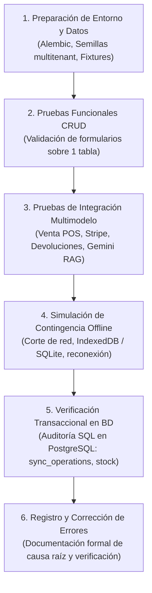

# CAPÍTULO I. ASPECTOS GENERALES

## 1.1. Introducción

A nivel mundial, la comercialización minorista de indumentaria ha experimentado una evolución acelerada impulsada por la adopción de tecnologías digitales omnicanal y arquitecturas de software basadas en la nube. Las grandes empresas del sector retail de moda han dejado de operar mediante sistemas monolíticos aislados en cada sucursal para adoptar plataformas centralizadas bajo el modelo de Software como Servicio (SaaS), permitiendo una coordinación integral entre múltiples tiendas físicas, plataformas web y aplicaciones móviles. Paralelamente, la proliferación de Progressive Web Apps (PWA) y bases de datos locales embebidas ha permitido que el sector comercial mantenga su operatividad transaccional incluso en escenarios con interrupciones temporales de conectividad a la red.

En el contexto de Bolivia, el comercio de prendas de vestir representa uno de los sectores más representativos de la actividad económica en las principales ciudades del eje troncal (Santa Cruz de la Sierra, La Paz y Cochabamba). En el país conviven diversas empresas comerciales, desde cadenas consolidadas hasta medianas boutiques de moda, que gestionan inventarios organizados por categorías, temporadas y colecciones. No obstante, las empresas del medio local enfrentan dificultades comunes asociadas a la inestabilidad de la conectividad a Internet en puntos de venta físicos, la dispersión geográfica de sus sucursales y la falta de acceso a plataformas modernas que les permitan competir en canales digitales sin incurrir en elevados costos de desarrollo de software a medida.

En este escenario se sitúa la plataforma de comercio electrónico FashionStore, originalmente concebida para la gestión integral de tiendas de moda y que, en el marco del presente proyecto, evoluciona hacia una solución tecnológica SaaS multitenant. Mediante esta transformación, FashionStore deja de ser un sistema de uso exclusivo para una sola cadena y se convierte en una plataforma de servicios en la nube comercializable a múltiples empresas independientes del rubro textil. Cada empresa suscriptora dispone de su propio entorno lógico de trabajo con aislamiento garantizado de sus datos comerciales, sucursales, inventarios y ventas, complementado con capacidades de operación offline en clientes web y móviles, sincronización bidireccional y analítica avanzada con inteligencia artificial.

## 1.2. Planteamiento del problema

Al operar en el entorno comercial real del retail textil en Bolivia y analizar el funcionamiento diario de múltiples empresas dedicadas a la venta de prendas de vestir, se identifican las siguientes situaciones críticas:

* 1. Paralización operativa por interrupción de conectividad: Cuando se producen cortes del servicio de Internet o fluctuaciones en la red local de una sucursal comercial, los terminales de caja y atención al cliente quedan completamente imposibilitados de registrar ventas de contado, consultar existencias locales de prendas o verificar precios. Esto provoca la suspensión temporal de las ventas presenciales, largas filas de espera de clientes en tienda y la pérdida directa de ventas en momentos de alta afluencia comercial.
* 2. Dificultad de adopción tecnológica y altos costos de software independiente: Las empresas comerciales independientes que operan en el mercado local deben adquirir o desarrollar sistemas informáticos de forma individual y aislada. Esto ocasiona altos costos de infraestructura tecnológica, duplicidad de esfuerzos de mantenimiento y barreras económicas insalvables para medianas empresas que desean gestionar catálogos modernos, carritos de compras y reservas digitales bajo estándares seguros.
* 3. Inconsistencias de inventario por sincronización no controlada de operaciones offline: Al intentar registrar transacciones de venta o reservas de productos en terminales que han operado de manera desconectada, surgen discrepancias severas entre el inventario físico disponible en la sucursal y el inventario registrado en la base de datos central al restablecerse la conexión. La falta de mecanismos automáticos de resolución de conflictos genera inconsistencias contables y compromisos de stock duplicados que perjudican la credibilidad del negocio frente al cliente.
* 4. Lentitud y rigidez en la generación de información estratégica y toma de decisiones: La administración central de cada empresa comercial carece de herramientas automatizadas y ágiles para consultar el desempeño comercial consolidado entre sus distintas sucursales. La obtención de reportes de rotación de prendas, volúmenes de venta por categoría o alertas de quiebre de stock requiere procesos manuales de extracción de datos que toman horas o días, impidiendo tomar decisiones oportunas de reabastecimiento o liquidación comercial.

## 1.3. Objetivos del proyecto

### 1.3.1. Objetivo general

Desarrollar la plataforma Saas Fashion Store multitenant de comercio electrónico con operación offline, realidad aumentada e inteligencia analítica para empresas del sector textil y de la moda.

### 1.3.2. Objetivos específicos

* Aplicar la metodología ICONIX para estructurar el análisis y diseño del sistema mediante casos de uso, diagramas de robustez (análisis Boundary-Control-Entity) y diagramas de secuencia trazables hacia la implementación.
* Transformar la arquitectura de base de datos y servicios backend en un esquema SaaS multitenant con aislamiento lógico estricto por empresa (tenant), impidiendo accesos cruzados entre empresas independientes.
* Implementar un módulo de gestión de planes de suscripción (Básico y Profesional) que regule dinámicamente los límites de sucursales activas y el acceso a módulos avanzados como reportes de inteligencia artificial.
* Evolucionar la aplicación web construida en Angular hacia una Progressive Web App (PWA) con Service Workers, Web App Manifest y persistencia local en IndexedDB para la consulta de catálogo y registro de ventas/reservas sin conexión a Internet.
* Incorporar persistencia local con SQLite en la aplicación móvil desarrollada con Flutter y Dart, permitiendo almacenar el catálogo local y capturar operaciones comerciales offline.
* Diseñar e implementar un motor de sincronización de operaciones comerciales offline con asignación de identificadores universales únicos (UUID) e idempotencia transaccional en el servidor central.
* Desarrollar un mecanismo de detección y resolución administrativa de conflictos de inventario surgidos por ventas offline concurrentes sobre las mismas referencias de prendas.
* Incorporar un módulo de reportes generativos con inteligencia artificial capaz de recibir solicitudes en lenguaje natural escrito o por voz, validando parámetros seguros y construyendo reportes tabulares y gráficos dinámicos exportables a Excel y PDF.
* Desarrollar un módulo de analítica inteligente mediante Machine Learning que contemple generación de datos sintéticos, entrenamiento de modelos supervisados (predicción de demanda) y no supervisados (segmentación y patrones), visualizados en un dashboard analítico.
* Implementar pruebas funcionales, de integración y verificación de reglas críticas de negocio (aislamiento de datos, idempotencia de sync y consistencia de inventario) para asegurar la calidad del software.

## 1.4. Justificación

### a. Justificación Técnica:
El proyecto integra tecnologías de vanguardia en desarrollo web y móvil: FastAPI ofrece alto rendimiento asíncrono y tipado estricto en Python; Angular proporciona una arquitectura robusta basada en componentes reactivos y Service Workers para capacidades PWA; Flutter asegura un único código base multiplataforma de alto rendimiento con persistencia relacional en SQLite; y PostgreSQL garantiza integridad referencial, transaccionalidad ACID y soporte avanzado para consultas multitenant. La adopción de la metodología ICONIX aporta un puente ágil y directo entre los requisitos y el código, eliminando la sobrecarga documental y enfocándose en la robustez y consistencia arquitectónica.

### b. Justificación Económica y Operativa:
Bajo el modelo SaaS, las empresas contratantes reducen sus costos de inversión inicial en servidores, licencias y desarrollo a medida, accediendo a una plataforma moderna mediante suscripciones predecibles. Operativamente, la capacidad de continuar facturando al contado y reservando prendas en modo offline garantiza que las tiendas no pierdan ingresos ante caídas de telecomunicaciones, salvaguardando la continuidad del negocio.

### c. Justificación Social y Comercial:
Se democratiza el acceso a tecnología de inteligencia artificial y analítica avanzada para empresas textiles nacionales que tradicionalmente no cuentan con equipos internos de ciencia de datos, permitiéndoles competir en condiciones modernas de mercado y optimizar la experiencia de compra de sus consumidores.

## 1.5. Alcance y limitaciones

### a. Alcance del Sistema

El alcance del proyecto comprende el análisis, diseño bajo la metodología ICONIX, modelado en UML 2.5+ e implementación de la evolución de FashionStore: una plataforma integral de comercio electrónico bajo el modelo SaaS Multi Tenant, orientada a empresas y boutiques de comercialización textil. El sistema opera en entornos híbridos (online y contingencia offline sin conexión), integrando persistencia local estructurada, sincronización por lotes con idempotencia transaccional, geolocalización de tiendas físicas con trazado vial, probador virtual en Realidad Aumentada y analítica avanzada con Inteligencia Artificial generativa y predictiva.

A continuación, se detalla el alcance funcional organizado por módulos:

#### 1. MÓDULO DE ADMINISTRACIÓN SAAS, USUARIOS Y CONTROL DE ACCESO
Este módulo administra la infraestructura multitenant de la plataforma, regulando el alta de empresas contratantes (tenants), la asignación de planes comerciales y el gobierno centralizado de identidades con aislamiento lógico estricto.

Funcionalidades:
Registro y administración global de empresas (tenants) con datos comerciales, razón social, NIT/RUT, logotipo y subdominio/slug único en el portal master.
Gestión de tres niveles de planes de suscripción (Básico, Profesional y Empresarial), con parametrización de vigencias, tarifas y estados (activo, suspendido, cancelado).
Regulación y control estricto de cuotas en backend según el plan: hasta 3 sucursales en Plan Básico, hasta 10 sucursales con módulo de IA en Plan Profesional, y hasta 25 sucursales con copias de seguridad continuas en Plan Empresarial.
Autenticación centralizada de usuarios mediante credenciales encriptadas con algoritmos seguros (bcrypt) y expedición de tokens criptográficos JWT.
Inyección obligatoria de claims de contexto (tenant_id, rol de usuario y sucursal asignada) en el token de sesión para forzar la segregación de información en cada petición API.
Control de acceso basado en roles (RBAC): Superadministrador, Administrador de Tienda (Tenant Admin), Encargado de Sucursal, Cajero/Vendedor y Cliente.
Registro, edición y georreferenciación de sucursales físicas (nombre, dirección, teléfono y coordenadas GPS latitud/longitud), validando el tope máximo del plan.
Consulta y actualización de datos de perfil, preferencias operativas y cambio seguro de contraseñas de los usuarios autenticados.

#### 2. MÓDULO DE CATÁLOGO Y GESTIÓN DE PRENDAS
Este módulo gestiona el catálogo de productos de cada boutique textil, permitiendo una parametrización jerárquica de prendas y variantes comerciales adaptadas al rubro de la moda.

Funcionalidades:
Administración integral (alta, edición, descontinuación y baja lógica) de prendas de vestir, categorías, colecciones y materiales textiles.
Creación de variantes jerárquicas por prenda: combinación de color, código SKU único y tallas normalizadas (XS, S, M, L, XL, XXL).
Diferenciación de precios por variante: Parametrización de precios base y precios diferenciados por talla (ej. prendas de tallas grandes o materiales especiales con sobreprecio), habilitando el cálculo automatizado de diferencias en cambios posteriores.
Carga y administración de galería de imágenes y tabla de medidas de cada prenda.
Catálogo online interactivo con renderizado responsivo para clientes web y móviles.
Búsqueda facetada avanzada: Filtrado combinado y en tiempo real por categoría, rango de precios, talla, color y disponibilidad en tienda física.

#### 3. MÓDULO DE INVENTARIO MULTISEDE Y PERSISTENCIA OFFLINE
Este módulo administra las existencias físicas de mercadería en múltiples sucursales, controla traslados intertiendas y paquetiza el catálogo comercial para su consumo sin conexión a Internet.

Funcionalidades:
Control de inventario físico desagregado en tiempo real por empresa, sucursal, modelo de prenda y variante de talla.
Consulta de disponibilidad de stock multisede, permitiendo al cliente y personal de ventas verificar en qué sucursales existe inventario de una talla específica.
Registro y seguimiento de órdenes de traslado de mercadería entre sucursales, con validación de existencias en origen y estados de tránsito (EN_TRANSITO, COMPLETADO).
Confirmación de recepción en sucursal destino con actualización automática de saldos de inventario.
Empaquetado de catálogo para contingencia offline: Endpoint en backend (/api/catalog/offline-pack) que genera un payload optimizado con productos, variantes, precios y existencias locales de la sucursal.
Persistencia local estructurada: Almacenamiento local del catálogo descargado en IndexedDB (en la aplicación Web PWA) y en SQLite (en la aplicación móvil Flutter).
Navegación en modo desconectado: Consulta íntegra de prendas, descripciones, tallas y precios en modo desconectado, con aviso visual de información en memoria local.

#### 4. MÓDULO DE COMPRAS DIGITALES Y RESERVAS CON VENCIMIENTO
Este módulo permite a los clientes adquirir prendas a través de comercio electrónico con pasarelas de pago internacionales o apartar prendas para retiro y prueba presencial en sucursales físicas.

Funcionalidades:
Gestión de carrito de compras digital con cálculo dinámico de subtotales, impuestos y costos de envío según modalidad de entrega.
Integración con la pasarela de pagos Stripe mediante formularios seguros (Stripe Elements), tokenización y confirmación de cobros.
Política Inviolable de Despacho Condicionado: Autorización de empaque, despacho o retiro de prendas únicamente cuando el pago esté liquidado y confirmado (payment_status = 'paid') mediante webhooks criptográficos de Stripe.
Generación de código formal de seguimiento y guía de transporte (DSP-YYYYMMDD-XXXX) y stepper visual de 5 etapas de pedido.
Módulo de Reservas de Prendas (Online y Offline): Selección de prendas y tallas para prueba física en sucursal, bloqueando temporalmente el stock disponible por un plazo máximo de 7 días.
Asignación de código alfanumérico amigable (RES-XXXXXXXX), código QR digital y temporizador con fecha/hora límite de validez (24 horas posteriores a la fecha agendada).
Resolución automática de caducidad: Proceso que detecta reservas vencidas sin retirar, liberando de inmediato las unidades apartadas al inventario disponible de la tienda.
Consolidación presencial de reservas en mostrador para su derivación directa al cobro en caja.

#### 5. MÓDULO DE PUNTO DE VENTA (POS), SINCRONIZACIÓN Y POLÍTICAS COMERCIALES
Este módulo proporciona la terminal de punto de venta (POS) para cajeros, garantizando la continuidad operativa de cobro ante caídas de red y asegurando la aplicación estricta de las políticas comerciales.

Funcionalidades:
POS Online: Registro de ventas presenciales en tiempo real con lector de código de barras o búsqueda manual, cálculo de vuelto, facturación digital y rebaja inmediata de existencias en PostgreSQL.
POS Offline en Contingencia Desconectada: Registro de ventas durante interrupciones de red leyendo existencias locales desde IndexedDB o SQLite.
Restricción comercial offline: Obligatoriedad de cobro únicamente en efectivo (contado) ante la ausencia de pasarelas electrónicas en vivo.
Generación de identificador único universal (UUIDv4) por cada ticket de venta offline emitido.
Bandeja de operaciones pendientes de sincronización (Outbox Pattern) en el cliente con contador visual y monitor de estados (PENDIENTE_SYNC, SINCRONIZADO, EN_CONFLICTO).
Sincronización por lotes con Idempotencia Transaccional: Envío automático o manual de ventas locales al restablecerse la red; el backend valida el UUID contra la tabla de auditoría sync_operations para evitar duplicación de transacciones o rebajas dobles de stock.
Gestión y Resolución de Conflictos Offline: Detección y tratamiento de sobreventas o quiebres de inventario central ocurridos durante la desconexión, permitiendo la asignación de mercadería de respaldo o emisión de nota de crédito.
Política Inviolable de Cambio de Prendas: Gestión de cambio por otra talla o modelo; el sistema liquida la diferencia de precio y consolida el cambio únicamente si el cliente abona la diferencia de precio en caja (cancelando la operación si no se cubre el pago).
Política Inviolable de Devolución de Prendas: Tramitación de devoluciones con aplicación de retención operativa del 20% al 50% y liquidación del saldo neto (50% al 80%) en efectivo o mediante la emisión de una Nota de Crédito Digital (NC-YYYYMMDD-XXXX).

#### 6. MÓDULO DE GEOLOCALIZACIÓN Y REALIDAD AUMENTADA
Este módulo enriquece la aplicación móvil Flutter con capacidades geoespaciales abiertas y experiencias inmersivas de compra interactiva.

Funcionalidades:
Georreferenciación de sucursales sobre mapa vectorial interactivo en la app móvil mediante OpenStreetMap y la librería flutter_map.
Detección de la ubicación del cliente vía GPS y cálculo de distancia hacia cada sucursal de la empresa.
Trazado de rutas y trayectos: Integración con la API de OpenRouteService para trazar la polilínea del trayecto óptimo de navegación (a pie o vehículo) y calcular el tiempo estimado de llegada hacia la tienda física elegida.
Probador Virtual con Realidad Aumentada (AR): Activación de la cámara del dispositivo móvil para detectar la silueta del usuario.
Superposición de prendas de vestir en tiempo real sobre el cuerpo del cliente, permitiendo conmutar tallas y colores para evaluar visualmente la caída de la tela antes de la compra.

#### 7. MÓDULO DE INTELIGENCIA ARTIFICIAL, ANALÍTICA Y REPORTES GENERATIVOS
Este módulo dota a la plataforma de capacidades analíticas avanzadas, integrando procesamiento de lenguaje natural y modelos predictivos de Machine Learning para optimizar la toma de decisiones empresariales.

Funcionalidades:
Reportes Generativos Asistidos por Voz: Asistente ejecutivo que recibe consultas en lenguaje natural mediante texto o comandos de voz (Web Speech API).
Arquitectura RAG (Retrieval-Augmented Generation) con la API de Google Gemini, que extrae métricas reales del tenant autenticado para formular respuestas contextualmente precisas.
Respuestas multimodales: Síntesis de voz hablada (Text-to-Speech) y renderizado dinámico de tablas comparativas y gráficos estadísticos.
Exportación de Balances: Generación formal de reportes de facturación, retenciones por devolución y estado de existencias en formato PDF institucional y hojas de cálculo Excel (.xlsx).
Generador de Datos Sintéticos: Script estocástico que genera datasets realistas de comercio textil modelando estacionalidad climática (verano/invierno), quincenas y distribución de demanda por talla.
Machine Learning Supervisado: Modelo de regresión (RandomForestRegressor) entrenado en Python (Scikit-Learn) para proyectar la demanda futura de prendas por categoría y talla a 4 semanas.
Machine Learning No Supervisado (K-Means): Algoritmo de agrupamiento que segmenta a los clientes en 4 perfiles comerciales basados en Recencia, Frecuencia, Valor Monetario (RFM) y tasa de devoluciones.
Dashboard Ejecutivo con KPIs: Tablero de control con métricas en tiempo real de volumen de facturación, saldo retenido por devoluciones, porcentaje de sincronización offline exitosa y prendas en nivel crítico.

### b. Limitaciones del Sistema

Para el desarrollo, evaluación y despliegue del prototipo correspondiente al Segundo Examen Parcial, se establecen las siguientes limitaciones y restricciones operativas:

Restricción de Pagos en Modo Desconectado (Offline): Las transacciones comerciales ejecutadas en contingencia sin conexión a Internet quedan restringidas exclusivamente a la modalidad de pago en efectivo (al contado). El cobro electrónico mediante tarjetas de crédito o débito requiere validación en línea de fondos, autenticación 3D Secure y tokenización bancaria ante los servidores de Stripe, procesos técnicamente inviables en modo offline.
Resiliencia e Interrupción de Conexión en Pagos en Línea: Si se produce una desconexión de red en el dispositivo cliente durante una compra online con Stripe, la confirmación de la venta y liberación de despacho no queda truncada; depende de la recepción asíncrona de webhooks criptográficos en el backend para prevenir cobros dobles o pedidos fantasmas.
Gestión Administrativa de Suscripciones SaaS: La contratación, renovación y cambio de planes de suscripción (Básico, Profesional y Empresarial) se gestiona de forma administrativa mediante simulación desde el portal master del Superadministrador y controladores del backend. No se incluye en este alcance la integración con pasarelas de facturación recurrente automatizada de cobro periódico a tarjetas de crédito (Stripe Billing o similar).
Política de Inspección Física de Prendas: Los cambios de talla y devoluciones de mercadería están estrictamente condicionados a la revisión física por parte del cajero. No aplican cambios ni devoluciones sobre prendas que presenten desgaste evidente por uso, manchas, alteraciones o que carezcan de sus etiquetas y precintos originales de fábrica.
Aislamiento Multitenant Lógico (Base de Datos Compartida): La segregación de información entre empresas se implementa bajo un esquema de aislamiento lógico con base de datos PostgreSQL compartida, forzando la discriminación por la clave foránea tenant_id en todas las consultas y entidades. No se contempla una arquitectura de bases de datos físicas independientes ni esquemas PostgreSQL aislados por cliente (Schema-per-tenant).
Alcance del Probador Virtual de Realidad Aumentada: El probador virtual integrado en la aplicación móvil Flutter se basa en la superposición de modelos y texturas sobre la silueta del usuario detectada por la cámara. No contempla modelado biométrico tridimensional volumétrico complejo, simulación física avanzada de fluidos textiles ni soporte en navegadores web de escritorio, requiriendo dispositivos móviles compatibles con sensores ARCore/ARKit.
Dependencia de Red para Servicios de Inteligencia Artificial y Rutas: El asistente generativo por voz (Google Gemini RAG) y el trazado de trayectos viales con cálculo de tiempos (OpenRouteService) requieren obligatoriamente conectividad activa a Internet para consumir sus respectivas APIs externas; estos componentes no operan en modo desconectado.
Entorno de Entrenamiento de Machine Learning: Los modelos de predicción de demanda y segmentación de clientes K-Means son entrenados y evaluados utilizando el dataset sintético generado con parámetros del comercio textil local. Su precisión predictiva está sujeta a los supuestos estadísticos incorporados en la generación sintética y no reemplaza históricos reales de venta plurianuales de grandes cadenas comerciales.

## 1.6. Metodología de desarrollo ICONIX

Para el desarrollo y documentación del segundo examen parcial se adopta formalmente la metodología ICONIX, un proceso de desarrollo de software ágil y dirigido por casos de uso que cubre la brecha entre el análisis de requisitos y el diseño detallado de clases e implementación. A diferencia del Proceso Unificado de Desarrollo de Software (PUDS) utilizado en el primer parcial, ICONIX es un enfoque simplificado ('just enough design') compuesto por cuatro fases iterativas interconectadas:

1. Requisitos:
Definición del modelo de dominio inicial con las entidades del negocio (Tenant, Branch, Product, Sale, SyncOperation) y captura de los casos de uso descritos en texto conciso.
2. Análisis preliminar (Robustez):
Uso del Análisis de Robustez inventado por Ivar Jacobson. Se traduce cada especificación de caso de uso a objetos Frontera (Boundary / Interfaz), Controladores (Control / Lógica de aplicación) y Entidades (Entity / Datos de dominio). Permite identificar objetos y métodos faltantes antes de codificar.
3. Diseño:
Construcción de diagramas de secuencia a partir de los diagramas de robustez, asignando responsabilidades formales a las clases de diseño y refinando el diagrama de clases estático.
4. Implementación y Pruebas:
Escritura de código en FastAPI, Angular y Flutter directamente mapeado a las clases y controladores identificados en los pasos anteriores, validado mediante pruebas unitarias y de integración.

# CAPÍTULO II. ANÁLISIS DE REQUISITOS

## 2.1. Descripción del sistema propuesto

FashionStore es una plataforma de comercio electrónico desarrollada bajo el modelo de negocio SaaS (Software as a Service) B2B2C, diseñada para atender las necesidades operativas de empresas dedicadas a la comercialización de prendas de vestir, calzado y confección textil. La plataforma permite que múltiples empresas independientes (tenants) contraten el servicio mediante planes de suscripción y gestionen de forma aislada, segura y centralizada la totalidad de sus operaciones comerciales: catálogos de productos, sucursales físicas, inventarios multisede, puntos de venta presenciales, reservas de prendas, compras digitales con pasarelas de pago internacionales, y analítica empresarial con inteligencia artificial.

El sistema se concibe como la evolución del prototipo funcional construido durante el primer examen parcial, que operaba bajo un esquema mono-tienda para una sola cadena. En el segundo parcial, la plataforma trasciende hacia una arquitectura multiempresa que incorpora tres capacidades estructurales nuevas: operación comercial resiliente ante caídas de conectividad (offline-first), sincronización transaccional idempotente entre terminales desconectadas y el servidor central, y reportes ejecutivos generados mediante inteligencia artificial con entrada de voz y lenguaje natural.

### 2.1.1. Enfoque Arquitectónico SaaS Multitenant y Resiliencia Offline

La arquitectura del sistema se sustenta en dos pilares técnicos fundamentales:

Aislamiento Multitenant con Base de Datos Compartida. Todas las empresas contratantes coexisten en una única instancia de PostgreSQL, donde la segregación de información se garantiza mediante la columna discriminadora tenant_id (UUID) presente en cada tabla transaccional del sistema. El backend valida criptográficamente en cada petición HTTP que el identificador de empresa contenido en el token JWT del usuario coincida con los recursos solicitados, impidiendo cualquier acceso cruzado entre empresas. Este modelo de aislamiento lógico permite escalar horizontalmente la cantidad de clientes SaaS sin multiplicar la complejidad operativa de la infraestructura de bases de datos.

Resiliencia Desconectada (Offline-First) con Idempotencia Transaccional. Dado que las sucursales físicas de moda frecuentemente operan en centros comerciales o zonas con cobertura de Internet inestable, la plataforma incorpora un esquema de operación de contingencia donde las aplicaciones cliente (Web PWA con IndexedDB y App Móvil Flutter con SQLite) almacenan localmente el catálogo de prendas, registran ventas de contado en efectivo con identificadores únicos universales (UUIDv4) y mantienen una bandeja de transacciones pendientes. Al restablecerse la conectividad, el motor de sincronización despacha los lotes de ventas hacia el servidor central, donde una tabla de auditoría (sync_operations) garantiza que ninguna transacción se registre más de una vez, incluso ante reintentos por cortes intermitentes de red.

### 2.1.2. Alcance por Entregas Acumulativas bajo ICONIX

El desarrollo del sistema sigue la metodología ICONIX, un proceso iterativo e incremental dirigido por casos de uso que mantiene trazabilidad directa entre los requisitos capturados, los diagramas de robustez, los diagramas de secuencia y el código implementado.

El alcance total del segundo parcial unifica 28 Casos de Uso oficiales (12 modificados del primer parcial y 16 nuevos), organizados en 7 paquetes lógicos de dominio y distribuidos en tres entregas acumulativas sin ciclos RUP:

Presentación 1 (25/10/2026): Infraestructura SaaS multi tenant, control de suscripciones y cuotas, autenticación JWT, catálogo con variantes de precio por talla y descarga de datos para operación offline. Abarca los Casos de Uso CU01 al CU10 (10 CU).
Presentación 2 (01/11/2026): Motor comercial completo con ventas POS online y offline, sincronización idempotente, reservas con caducidad, compras con Stripe, políticas de cambio y devolución, geo-localización de sucursales con trazado de rutas y probador virtual en Realidad Aumentada. Abarca acumuladamente los Casos de Uso CU01 al CU22 (22 CU).
Presentación 3 (08/11/2026): Capa de inteligencia artificial con reportes generativos por voz (Google Gemini), exportación a PDF y Excel, dataset sintético, modelo supervisado de predicción de demanda, segmentación K-Means y dashboard ejecutivo con KPIs. Abarca la totalidad de los 28 Casos de Uso (CU01 al CU28).

### 2.1.3. Lista de Casos de Uso (ICONIX)

| ID | Caso de Uso | Prioridad | Estado | Riesgo | Actores Principales | Plataforma | RF que cubre |
| --- | --- | --- | --- | --- | --- | --- | --- |
| CU01 | Registrar y Gestionar Empresas (Tenants) | Alta | Implementado | Medio | Superadministrador | Web | RF-01, RF-02 |
| CU02 | Gestionar Planes de Suscripción y Cuotas | Alta | Implementado | Medio | Superadministrador | Web | RF-03, RF-04 |
| CU03 | Iniciar Sesión Multitenant con JWT y Claims | Crítica | Implementado | Alto | Todos los Actores | Ambas | RF-05, RF-06, RF-09, RF-10 |
| CU04 | Gestionar Sucursales Bajo Límites del Plan | Alta | Implementado | Medio | Tenant Admin | Web | RF-07, RF-08, RF-21, RF-22 |
| CU05 | Gestionar Prendas y Variantes de Precio por Talla | Crítica | Implementado | Alto | Tenant Admin, Encargado Sucursal | Web | RF-11, RF-12, RF-20 |
| CU06 | Consultar Catálogo Online con Búsqueda Facetada | Alta | Implementado | Bajo | Cliente | Ambas | RF-13, RF-14, RF-19, RF-45, RF-46 |
| CU07 | Sincronizar y Descargar Catálogo Local (PWA / SQLite) | Crítica | Implementado | Alto | Cliente, Cajero POS | Ambas | RF-15, RF-16 |
| CU08 | Consultar Catálogo Offline en Modo Desconectado | Alta | Implementado | Medio | Cliente, Cajero POS | Ambas | RF-17, RF-18, RF-19 |
| CU09 | Comprar Prendas con Stripe y Despacho Condicionado | Crítica | Implementado | Crítico | Cliente, Encargado Sucursal | Ambas | RF-23, RF-24 |
| CU10 | Crear Reserva Online de Prendas con Vencimiento | Alta | Implementado | Alto | Cliente, Encargado Sucursal | Web | RF-25, RF-26 |
| CU11 | Registrar Reserva Offline en Modo Desconectado | Alta | En desarrollo | Alto | Cliente | Ambas | RF-27, RF-28 |
| CU12 | Atender y Resolver Conflictos de Reservas Expiradas | Media | En desarrollo | Medio | Encargado Sucursal | Web | RF-29, RF-30 |
| CU13 | Registrar Venta POS Desconectada en Efectivo UUIDv4 | Crítica | En desarrollo | Crítico | Cajero / Vendedor POS | Ambas | RF-31, RF-32 |
| CU14 | Gestionar Bandeja Local de Operaciones (Outbox Pattern) | Alta | En desarrollo | Alto | Cajero / Vendedor POS | Ambas | RF-33, RF-34 |
| CU15 | Sincronizar Lotes de Ventas con Idempotencia Central | Crítica | En desarrollo | Crítico | Cajero, Motor Sync | Ambas | RF-35, RF-36 |
| CU16 | Resolver Conflictos de Ventas Offline y Quiebres | Alta | En desarrollo | Alto | Encargado Sucursal, Cajero | Web | RF-37, RF-38 |
| CU17 | Cambio de Prenda por Talla y Cobro de Diferencia | Alta | En desarrollo | Medio | Cajero / Vendedor POS | Ambas | RF-39, RF-40 |
| CU18 | Devolución con Retención (20%-50%) y Nota de Crédito | Alta | En desarrollo | Medio | Cajero / Vendedor POS | Ambas | RF-41, RF-42 |
| CU19 | Localizar Sucursales y Trazar Rutas (OSM / ORS) | Media | Planificado | Bajo | Cliente | Móvil | RF-43, RF-44, RF-45, RF-46 |
| CU20 | Reportes Ejecutivos por Voz (Gemini RAG) | Alta | Planificado | Alto | Tenant Admin, Superadmin | Web | RF-47, RF-48 |
| CU21 | Exportar Reportes Empresariales a PDF y Excel | Media | Planificado | Bajo | Tenant Admin, Superadmin | Web | RF-49, RF-50 |
| CU22 | Generar Dataset Sintético de Ventas y Estacionalidad | Media | Planificado | Medio | Superadmin, Tenant Admin | Web | RF-51, RF-52 |
| CU23 | Predecir Demanda de Ropa (ML Supervisado) | Alta | Planificado | Alto | Tenant Admin | Web | RF-53, RF-54 |
| CU24 | Segmentar Clientes con K-Means (ML No Supervisado) | Alta | Planificado | Alto | Tenant Admin | Web | RF-55 |
| CU25 | Visualizar Dashboard Ejecutivo con KPIs y Métricas | Alta | Planificado | Medio | Tenant Admin, Superadmin | Web | RF-56 |

## 2.2. Identificación de Actores

### 2.2.1. Actores Principales

Superadministrador (Superadmin): Administrador global de la plataforma SaaS. Registra y suspende empresas (tenants), configura planes comerciales y supervisa la infraestructura en el portal master.
Administrador de Tienda (Tenant Admin): Gerente general del tenant. Configura los datos de su empresa, crea sucursales respetando la cuota del plan, administra el catálogo de prendas con precios por talla y supervisa la analítica.
Encargado de Sucursal (Branch Manager): Responsable operativo de una tienda física. Administra el inventario local, autoriza traslados de mercadería entre tiendas y atiende la resolución de reservas.
Cajero / Vendedor (Cashier): Personal de atención en mostrador. Opera el POS en modo online y offline, efectúa cobros de contado, gestiona la bandeja de sincronización, ejecuta cambios de prenda cobrando la diferencia de precio y emite devoluciones con retención del 20%-50%.
Cliente (Customer): Comprador final. Navega el catálogo online/offline, compra prendas con tarjeta mediante Stripe, reserva prendas en tiendas físicas, visualiza sucursales en OpenStreetMap y usa el probador virtual en AR.

### 2.2.2. Actores Secundarios / del Sistema

| Actor | Naturaleza | Función en el Sistema |
| --- | --- | --- |
| Backend API | Servidor Central | Ejecuta las reglas de negocio, fuerza el aislamiento multitenant validando el tenant_id del token JWT en cada petición, calcula diferencias de precio en cambios de prendas, verifica la idempotencia de operaciones sincronizadas y persiste todas las transacciones en PostgreSQL. |
| Motor de Sincronización (Sync Engine) | Proceso en Segundo Plano (Cliente) | Tarea asíncrona ejecutada en el dispositivo cliente (Service Worker en la PWA o proceso background en Flutter) que detecta la recuperación de conectividad a Internet y despacha automáticamente los lotes de ventas pendientes (PENDIENTE_SYNC) hacia el backend para su validación y consolidación. |
| Pasarela de Pagos Stripe | Servicio Externo | Procesa cobros con tarjeta de crédito y débito en tiempo real, tokeniza las credenciales financieras del cliente de forma segura y notifica la confirmación definitiva del pago (paid) al backend mediante webhooks con validación criptográfica de firma, habilitando así el despacho de mercadería. |
| Servicio de Mapas y Rutas (OpenStreetMap / OpenRouteService) | API Externa | Provee teselas de mapas abiertos y gratuitos para el renderizado cartográfico en la app móvil Flutter, y resuelve el trazado de rutas de navegación física (a pie o vehículo) con estimación de distancia y tiempo de llegada desde la posición del cliente hacia la sucursal más cercana. |
| Módulo de Inteligencia Artificial (AI & ML Service) | Motor Analítico | Procesa audio y texto mediante la API de Google Gemini para responder consultas ejecutivas por voz bajo una arquitectura RAG (Retrieval-Augmented Generation) con datos reales del tenant, y ejecuta algoritmos de Machine Learning (modelo supervisado de predicción de demanda y agrupamiento no supervisado K-Means) sobre datasets sintéticos mediante Scikit-Learn. |

## 2.3. Requisitos funcionales y no funcionales

### 2.3.1. Requisitos Funcionales (RF)

| ID | Módulo / Categoría | Descripción del Requisito Funcional | CU Relacionado |
| --- | --- | --- | --- |
| RF-01 | SaaS y Multitenancy | El sistema debe permitir registrar y administrar empresas contratantes (tenants) con sus datos comerciales, NIT/RUT y subdominio/slug único. | CU01 |
| RF-02 | SaaS y Multitenancy | El sistema debe garantizar el aislamiento lógico estricto de la información de cada empresa asociando la clave foránea tenant_id en todas las operaciones y registros relacionales. | CU01 |
| RF-03 | Planes y Suscripciones | El sistema debe permitir configurar y asignar planes de suscripción (Básico, Profesional y Empresarial), regulando vigencias, tarifas mensuales y estados de suscripción. | CU02 |
| RF-04 | Planes y Suscripciones | El sistema debe restringir el acceso a módulos avanzados (ej. IA Generativa, analítica predictiva) y verificar las cuotas de recursos asignadas a cada empresa según su plan. | CU02 |
| RF-05 | Seguridad y Acceso | El sistema debe autenticar a los usuarios mediante credenciales encriptadas (BCrypt) y expedir tokens de sesión seguros y firmados criptográficamente (JWT). | CU03 |
| RF-06 | Seguridad y Acceso | El sistema debe incluir los claims de tenant_id, rol de usuario (rol) y sucursal asignada (branch_id) dentro del token JWT para autorización estricta en el backend. | CU03 |
| RF-07 | Sucursales Físicas | El sistema debe permitir el registro, actualización y georreferenciación (latitud y longitud) de las sucursales físicas operadas por la empresa. | CU04 |
| RF-08 | Sucursales Físicas | El sistema debe validar que la cantidad de sucursales activas no sobrepase el cupo contratado en el plan (hasta 3 en Básico, hasta 10 en Profesional y hasta 25 en Empresarial). | CU04 |
| RF-09 | Gestión de Usuarios | El sistema debe permitir a los usuarios consultar y actualizar su información de perfil y preferencias operativas dentro de su empresa. | CU03 (Módulo Identidad / Base 1P) |
| RF-10 | Gestión de Usuarios | El sistema debe permitir la gestión y actualización segura de contraseñas de acceso de las cuentas de usuario mediante mecanismos de hashing unidireccional. | CU03 (Módulo Identidad / Base 1P) |
| RF-11 | Catálogo de Prendas | El sistema debe permitir la administración integral (alta, edición y baja) del catálogo de prendas de vestir, categorías y colecciones de temporada. | CU05 |
| RF-12 | Catálogo de Prendas | El sistema debe permitir parametrizar variantes de prendas diferenciando precios por talla (ej. tallas especiales XL/XXL con recargo) y material textil. | CU05 |
| RF-13 | Catálogo Online | El sistema debe permitir a los clientes consultar el catálogo online con visualización de modelos, imágenes, colores, tallas y descripciones detalladas. | CU06 |
| RF-14 | Catálogo Online | El sistema debe proporcionar búsqueda facetada mediante filtros combinados indexados por categoría, rango de precios, talla y disponibilidad. | CU06 |
| RF-15 | Operación Offline | El sistema debe permitir la descarga y empaquetado optimizado del catálogo comercial (offline-pack) desde el backend para habilitar el funcionamiento desconectado. | CU07 |
| RF-16 | Operación Offline | El sistema debe almacenar el catálogo localmente de forma persistente utilizando IndexedDB en la Web PWA y SQLite (sqflite) en la app móvil Flutter. | CU07 |
| RF-17 | Operación Offline | El sistema debe permitir la consulta y navegación interactiva de prendas, precios y existencias locales en modo completamente desconectado de Internet. | CU08 |
| RF-18 | Operación Offline | El sistema debe indicar visualmente al usuario (mediante banner o badge de contingencia) cuando la información consultada provenga de la memoria caché local sujeta a sincronización. | CU08 |
| RF-19 | Inventario Multisede | El sistema debe permitir consultar el stock físico de una prenda de forma consolidada entre las diversas sucursales físicas activas de la empresa. | CU06 / CU08 |
| RF-20 | Inventario Multisede | El sistema debe desglosar las existencias físicas en tiempo real indicando la cantidad disponible por variante de talla y color en cada sucursal seleccionada. | CU05 / CU06 |
| RF-21 | Traslados de Inventario | El sistema debe permitir registrar solicitudes de traslado de prendas entre sucursales validando la existencia de stock disponible en la sucursal de origen. | CU04 (Módulo Stock / Base 1P) |
| RF-22 | Traslados de Inventario | El sistema debe permitir confirmar la recepción física de la mercadería transferida en la sucursal destino, incrementando su inventario de forma atómica. | CU04 (Módulo Stock / Base 1P) |
| RF-23 | Compras Digitales | El sistema debe permitir gestionar el carrito de compras digital calculando subtotales, impuestos y costos de entrega según la dirección del cliente. | CU09 |
| RF-24 | Compras Digitales | El sistema debe procesar pagos con tarjeta vía Stripe y condicionar la orden de despacho a la confirmación efectiva del pago (payment_status = 'paid'). | CU09 |
| RF-25 | Reservas de Prendas | El sistema debe permitir a los clientes apartar prendas online mediante reservas para prueba presencial en una sucursal específica con bloqueo temporal de stock. | CU10 |
| RF-26 | Reservas de Prendas | El sistema debe asignar un código alfanumérico amigable (RES-XXXXXXXX), código QR digital y temporizador con fecha/hora límite de caducidad (máx. 7 días) a cada reserva. | CU10 |
| RF-27 | Reservas Desconectadas | El sistema debe permitir a los clientes registrar solicitudes de reserva en modo desconectado (offline) almacenándolas en el cliente con UUIDv4 local. | CU11 |
| RF-28 | Reservas Desconectadas | El sistema debe encolar las reservas offline en una cola de contingencia local y despacharlas automáticamente hacia el servidor al recuperar la conexión. | CU11 |
| RF-29 | Expiración de Reservas | El sistema debe liberar automáticamente al inventario disponible aquellas reservas de prendas que hayan excedido su tiempo límite sin haber sido retiradas. | CU12 |
| RF-30 | Conflictos de Reservas | El sistema debe permitir al encargado de tienda gestionar colisiones y excepciones de reservas vencidas, permitiendo su reasignación o cancelación formal. | CU12 |
| RF-31 | Ventas Offline (POS) | El sistema debe permitir a los cajeros registrar ventas en el punto de venta (POS) en modo desconectado ante cortes de energía o caídas del servicio de Internet. | CU13 |
| RF-32 | Ventas Offline (POS) | El sistema debe generar un identificador único universal (UUIDv4) para la venta offline y restringir obligatoriamente el cobro a la modalidad de efectivo de contado. | CU13 |
| RF-33 | Sincronización de Datos | El sistema debe proveer una bandeja de operaciones locales (Outbox Pattern) que almacene y liste las ventas desconectadas pendientes de sincronización. | CU14 |
| RF-34 | Sincronización de Datos | El sistema debe mostrar un indicador visual reactivo y contador en tiempo real del estado de sincronización de las operaciones pendientes en el cliente POS. | CU14 |
| RF-35 | Sincronización de Datos | El sistema debe detectar la restitución de la conexión y sincronizar por lotes (batch sync) las ventas locales hacia el servidor central. | CU15 |
| RF-36 | Sincronización de Datos | El sistema debe garantizar la idempotencia transaccional validando el UUID contra la tabla sync_operations para evitar duplicación de ventas o inventario. | CU15 |
| RF-37 | Conflictos de Ventas Offline | El sistema debe detectar discrepancias o quiebres de inventario central cuando las ventas offline sincronizadas colisionen con el stock físico disponible. | CU16 |
| RF-38 | Conflictos de Ventas Offline | El sistema debe permitir al encargado de sucursal resolver los conflictos de sincronización asignando stock sustituto o emitiendo una nota de crédito. | CU16 |
| RF-39 | Políticas de Negocio (Cambios) | El sistema debe permitir tramitar el cambio de prendas de vestir por otra talla o modelo dentro del plazo de garantía comercial (15 a 30 días según tenant). | CU17 |
| RF-40 | Políticas de Negocio (Cambios) | El sistema debe liquidar la diferencia de precio ($\Delta$) y condicionar la consolidación del cambio al abono estricto de la diferencia por el cliente, rechazando prendas sin etiqueta. | CU17 |
| RF-41 | Políticas de Negocio (Devolución) | El sistema debe permitir tramitar devoluciones de prendas de vestir previa inspección física obligatoria del estado de la prenda y ticket original de compra. | CU18 |
| RF-42 | Políticas de Negocio (Devolución) | El sistema debe retener entre el 20% y 50% por costos operativos y liquidar el saldo neto (50%-80%) mediante la emisión de una Nota de Crédito Digital o efectivo. | CU18 |
| RF-43 | Geolocalización Móvil (Extra) | El sistema debe geolocalizar y renderizar las sucursales de la empresa en un mapa interactivo utilizando OpenStreetMap (flutter_map) en la aplicación móvil Flutter. | CU19 |
| RF-44 | Geolocalización Móvil (Extra) | El sistema debe trazar la ruta óptima de navegación vial o peatonal y estimar distancia y tiempo de llegada hacia la tienda mediante la API de OpenRouteService. | CU19 |
| RF-45 | Realidad Aumentada (Extra) | El sistema debe acceder a la cámara del dispositivo móvil para detectar la silueta del cliente y permitir la prueba interactiva de prendas en el probador virtual. | CU06 / CU19 (Módulo Móvil AR / Base 1P) |
| RF-46 | Realidad Aumentada (Extra) | El sistema debe superponer prendas en Realidad Aumentada (AR) sobre la imagen del usuario para evaluar caída, color y proporciones de talla antes de la compra. | CU06 / CU19 (Módulo Móvil AR / Base 1P) |
| RF-47 | IA Generativa y Voz | El sistema debe interpretar consultas ejecutivas en lenguaje natural y generar reportes dinámicos de ventas e inventario mediante Google Gemini API (RAG contextual). | CU20 |
| RF-48 | IA Generativa y Voz | El sistema debe procesar solicitudes mediante comandos de voz en tiempo real y sintetizar respuestas habladas (Text-to-Speech) acompañadas de tablas y gráficos. | CU20 |
| RF-49 | Reportes y Balances | El sistema debe permitir la exportación de reportes analíticos consolidados y balances financieros a documentos PDF formales listos para impresión. | CU21 |
| RF-50 | Reportes y Balances | El sistema debe permitir exportar los registros tabulares de ventas, inventario y devoluciones a hojas de cálculo en formato Excel (.xlsx). | CU21 |
| RF-51 | Datos Sintéticos | El sistema debe generar datasets sintéticos masivos (10,000+ registros) con parámetros estocásticos realistas del comercio textil (estacionalidad, curvas de tallas). | CU22 |
| RF-52 | Datos Sintéticos | El sistema debe parametrizar y simular patrones estacionales y quincenas de ventas para nutrir y entrenar los modelos de aprendizaje automático. | CU22 |
| RF-53 | Machine Learning Supervisado | El sistema debe entrenar y evaluar modelos de Machine Learning supervisados (RandomForestRegressor) para predecir la demanda futura de prendas de vestir. | CU23 |
| RF-54 | Machine Learning Supervisado | El sistema debe emitir proyecciones de demanda a 4 semanas por categoría y talla con cálculo de métricas de precisión ($R^2 \ge 0.80$, MAE). | CU23 |
| RF-55 | ML No Supervisado | El sistema debe segmentar a los compradores mediante el algoritmo de agrupamiento no supervisado K-Means sobre variables RFM y tasas de devolución. | CU24 |
| RF-56 | Dashboard y Analítica | El sistema debe presentar un cuadro de mando (Dashboard) ejecutivo con KPIs en tiempo real (ingresos, retenciones por devoluciones, stock crítico y métricas ML). | CU25 |

### 2.3.2. Requisitos No Funcionales (RNF)

| ID | Categoría / Criterio | Descripción del Requisito No Funcional |
| --- | --- | --- |
| RNF-01 | Seguridad | Los mecanismos de autenticación y autorización deben proteger todos los recursos y operaciones del sistema mediante tokens JWT firmados criptográficamente y contraseñas hasheadas con bcrypt. |
| RNF-02 | Aislamiento de Datos | Ninguna operación o consulta en el backend debe permitir acceder, alterar o exponer información perteneciente a otro tenant; la segregación lógica con tenant_id debe ser obligatoria e inviolable en la base de datos. |
| RNF-03 | Persistencia Offline | Las transacciones y catálogos registrados sin conexión deben sobrevivir de forma íntegra al cierre del navegador, cierre de sesión o reinicio del dispositivo físico, utilizando IndexedDB en la Web PWA y SQLite en la app Flutter. |
| RNF-04 | Integridad Transaccional | Las operaciones de venta, movimientos de inventario, cambios y devoluciones deben ejecutarse bajo transacciones atómicas (ACID en PostgreSQL), asegurando consistencia inmediata entre existencias y saldos contables. |
| RNF-05 | Idempotencia | El reenvío o reintento de una operación previamente procesada no debe generar registros duplicados ni aplicar descuentos dobles en el inventario, validando el identificador único (UUIDv4) contra la tabla sync_operations. |
| RNF-06 | Recuperación ante Fallos | Las operaciones pendientes de sincronización deben conservarse en el almacenamiento local ante fallos de red o caídas del servidor, reintentando el envío automáticamente sin pérdida de datos. |
| RNF-07 | Mantenibilidad y Modularidad | La base de código debe organizarse en una arquitectura desacoplada de módulos profundos (deep modules) estructurada en 7 paquetes backend (p0 a p6), separando presentación, lógica de dominio, persistencia y sincronización. |
| RNF-08 | Compatibilidad Multiplataforma | La aplicación Web PWA debe funcionar de manera reactiva e instalable en navegadores modernos (Chrome, Edge, Firefox, Safari); la aplicación móvil Flutter debe mantener un desempeño nativo fluido tanto en Android como en iOS. |
| RNF-09 | Rendimiento | Las consultas de catálogo, filtros facetados y balances deben optimizarse mediante indexación compuesta en PostgreSQL y paginación en backend, manteniendo tiempos de respuesta inferiores a 500 ms en operaciones de lectura típicas. |
| RNF-10 | Observabilidad y Auditoría | Los procesos de sincronización por lotes y transacciones comerciales deben generar registros de auditoría detallados (marcas temporales, estado APLICADO/RECHAZADO, motivo de conflicto) sin exponer datos financieros sensibles. |
| RNF-11 | Calidad y Verificación | El software debe contar con pruebas automatizadas (Pytest) que certifiquen el cumplimiento incondicional de las reglas críticas de negocio (descuento de existencias, retención en devoluciones, abono de diferencia en cambios y límites de sucursales). |
| RNF-12 | Coherencia Documental | Todos los diagramas de modelado (diagramas de robustez ICONIX, diagramas de secuencia y clases UML 2.5+) deben reflejar con exactitud la arquitectura y comportamiento del código fuente efectivamente implementado. |
| RNF-13 | Privacidad y Gobernanza de IA | Las solicitudes al módulo de Inteligencia Artificial (Google Gemini API) no deben otorgar acceso directo a la base de datos; el backend debe sanear el contexto, restringirlo al tenant autenticado y evitar la exposición de credenciales del sistema. |
| RNF-14 | Disponibilidad y Despliegue en la Nube | La plataforma debe estar desacoplada y contener manifiestos para despliegue en la nube accesible externamente mediante conexión cifrada y segura vía protocolo HTTPS/TLS. |

## 2.4. Reglas de Negocio

Las siguientes reglas de negocio regulan las operaciones comerciales y transaccionales de la plataforma FashionStore. Su cumplimiento es obligatorio e inviolable a nivel de controladores del backend, y constituyen el fundamento de los flujos alternativos en los diagramas de robustez ICONIX.

### 2.4.1. Políticas de Suscripción y Cuotas de Recursos SaaS

| ID | Regla de Negocio | CU Relacionado |
| --- | --- | --- |
| RN-01 | Cuotas de Sucursales por Plan: El Plan Básico permite un máximo de 3 sucursales físicas activas por empresa; el Plan Profesional permite hasta 10; y el Plan Empresarial hasta 25. El backend bloquea de forma atómica toda creación de sucursales que exceda el cupo contratado. | CU02, CU04 |
| RN-02 | Restricción de Módulos por Plan: El acceso al asistente de IA Generativa por voz (Gemini RAG) y a la analítica predictiva de Machine Learning queda reservado exclusivamente a los tenants con Plan Profesional o Empresarial activo. | CU02, CU20, CU23 |
| RN-03 | Degradación de Plan con Exceso de Cuota: Si una empresa intenta descender de Plan Profesional a Básico y posee más de 3 sucursales activas, el sistema bloquea el cambio hasta que el administrador desactive las sucursales excedentes. | CU02 |

### 2.4.2. Políticas Comerciales de Cambio y Devolución de Prendas

| ID | Regla de Negocio | CU Relacionado |
| --- | --- | --- |
| RN-04 | Cambio de Prenda con Diferencia de Precio: Al cambiar una prenda por otra talla o modelo de mayor precio, el cambio se consolida únicamente si el cliente abona la diferencia de precio ($\Delta$) en caja. Si el cliente no acepta abonar la diferencia, la operación se cancela y se restituye la prenda original sin alterar el inventario. | CU17 |
| RN-05 | Cambio por Prenda de Menor Precio: Si la prenda nueva cuesta menos que la original, la boutique emite una Nota de Crédito Digital a favor del cliente por la diferencia resultante para futuras compras en la tienda. | CU17 |
| RN-06 | Devolución con Retención Operativa: En toda devolución de prenda, la tienda retiene entre el 20% y el 50% del valor abonado por concepto de costos operativos y reacondicionamiento, reembolsando al cliente entre el 50% y el 80% restante en efectivo o mediante Nota de Crédito Digital. El porcentaje de retención es parametrizado por cada boutique dentro de ese rango. | CU18 |
| RN-07 | Condición Física Obligatoria para Cambios y Devoluciones: Solo se aceptan cambios o devoluciones de prendas que conserven sus etiquetas originales intactas, no presenten signos de uso ni desgaste, y se encuentren dentro del plazo hábil establecido por la empresa (15 a 30 días posteriores a la compra). | CU17, CU18 |

### 2.4.3. Políticas de Operación Offline e Idempotencia Transaccional

| ID | Regla de Negocio | CU Relacionado |
| --- | --- | --- |
| RN-08 | Venta Offline Exclusivamente en Efectivo: Durante el modo desconectado (caída de Internet en la sucursal), la única forma de pago habilitada es efectivo de contado. Las opciones de tarjeta y pago digital quedan desactivadas ante la imposibilidad de validar fondos en vivo. | CU13 |
| RN-09 | Identificación Única de Operaciones Offline: Toda transacción generada sin conexión (ventas o reservas) debe portar un identificador único universal (UUIDv4) generado en el cliente antes de persistirse en la base local, garantizando su trazabilidad. | CU11, CU13, CU15 |
| RN-10 | Idempotencia en Sincronización: Al sincronizar ventas pendientes con el servidor central, si el UUID de una operación ya fue previamente registrado en la tabla sync_operations, el backend confirma la recepción sin duplicar registros ni descontar inventario dos veces. | CU15 |
| RN-17 | Resolución de Conflictos de Inventario Offline: Si una venta offline sincronizada colisiona por quiebre de stock en el servidor central (sobreventa concurrente durante la desconexión), el backend marca la venta en estado EN_CONFLICTO y exige al encargado asignar stock de respaldo o emitir una Nota de Crédito. | CU16 |

### 2.4.4. Políticas de Despacho Digital y Caducidad de Reservas

| ID | Regla de Negocio | CU Relacionado |
| --- | --- | --- |
| RN-11 | Despacho Condicionado a Pago Confirmado: El empaque, envío o entrega de prendas adquiridas digitalmente se autoriza exclusivamente cuando el pago está confirmado por la pasarela Stripe (payment_status = 'paid'). Ninguna orden en estado pendiente, fallido o cancelado puede generar guía de despacho. | CU09 |
| RN-12 | Caducidad Automática de Reservas: Toda reserva física de prenda cuenta con un tiempo límite de vigencia (máximo 7 días para retiro y 24 horas de tolerancia posterior). Si el cliente no acude a la sucursal a consolidar la compra dentro del plazo, el sistema libera automáticamente las unidades apartadas al inventario disponible. | CU10, CU12 |

### 2.4.5. Políticas de Inventario, Catálogo y Crédito Comercial

| ID | Regla de Negocio | CU Relacionado |
| --- | --- | --- |
| RN-13 | Stock Mínimo para Transacciones: Ninguna venta, reserva o despacho puede concretarse sobre un producto cuyo stock disponible sea menor o igual a cero, bloqueando la operación hasta que se restituyan existencias. | CU05, CU09, CU10, CU13 |
| RN-14 | Unicidad de SKU por Empresa: Todo código comercial (SKU) de variante de prenda debe ser estrictamente único dentro del catálogo de la empresa contratante. El sistema rechaza la creación de variantes con SKU duplicado. | CU05 |
| RN-15 | Precio Positivo Obligatorio: Toda variante de prenda debe tener un precio de venta estrictamente mayor a cero. El sistema bloquea el registro de precios nulos o negativos. | CU05 |
| RN-16 | Compatibilidad de Realidad Aumentada: Solo las prendas con activos y texturas validados por el administrador estarán disponibles en la modalidad de Probador Virtual AR desde la aplicación móvil. | CU06, CU19 |
| RN-18 | Liquidación mediante Nota de Crédito Digital: Toda devolución aprobada bajo la Modalidad B genera un comprobante contable digital rastreable con nomenclatura NC-YYYYMMDD-XXXX por el importe neto reembolsable, el cual queda acreditado en el backend como saldo a favor del cliente para compras posteriores. | CU18 |

## 2.5. Diagrama UML de casos de uso

### 2.5.1. Diagrama General de Casos de Uso

### 2.5.2. Identificación de paquetes

A continuación, la correspondencia oficial de arquitectura:

| Paquete | Descripción de Responsabilidad | Casos de Uso que Abarca |
| --- | --- | --- |
| P0: Plataforma SaaS y Suscripciones | Administración multitenant global del SaaS: aprovisionamiento de tenants, parametrización de planes (Básico, Profesional, Empresarial) y gobierno de cuotas de recursos. | CU01, CU02 |
| P1: Gestión de Usuarios y Acceso | Identidad, autenticación JWT con claims de segregación (tenant_id, rol, sucursal), RBAC y administración de sucursales físicas bajo el cupo del plan contratado. | CU03, CU04 |
| P2: Gestión de Catálogo Textil | Catálogo maestro de moda textil: gestión de prendas, categorías y variantes comerciales con diferenciación de precios por talla. Búsqueda facetada online. | CU05, CU06 |
| P3: Inventario y Disponibilidad Offline | Control de existencias físicas por sucursal y mecanismo de descarga/caché de catálogo local a IndexedDB (Web PWA) y SQLite (Mobile Flutter). | CU07, CU08 |
| P4: Compras Digitales y Reservas | Pasarela de pagos con Stripe y despacho digital condicionado a estado paid. Ciclo de reservas de prendas con expiración temporal (online y offline) y resolución de conflictos. | CU09, CU10, CU11, CU12 |
| P5: Ventas POS y Sincronización | Punto de venta (POS) offline en efectivo con UUIDv4, bandeja de salida outbox, sincronización idempotente por lotes y políticas de cambio (pago de diferencia) y devoluciones (retención 20%-50% y nota de crédito). | CU13, CU14, CU15, CU16, CU17, CU18 |
| P6: Inteligencia Analítica y Geolocalización | Geolocalización de tiendas y cálculo de rutas óptimas (OpenStreetMap / ORS), reportes ejecutivos por voz con IA Generativa (Gemini), exportación a PDF/Excel, síntesis de datasets, modelos de Machine Learning (supervisado/no supervisado) y dashboard gerencial. | CU19, CU20, CU21, CU22, CU23, CU24, CU25 |

### 2.5.3. Relacionar Paquetes y Casos de Uso

#### P0: Plataforma SaaS y Suscripciones

#### P1: Gestión de Usuarios y Acceso

#### P2: Gestión de Catálogo Textil

#### P3: Inventario y Disponibilidad Offline

#### P4: Compras Digitales y Reservas

#### P5: Ventas POS y Sincronización

#### P6: Inteligencia Analítica y Geolocalización

### 2.5.4. Vista de Paquetes - Casos de Uso

## 2.6. Especificación de casos de uso

### CU01: Registrar y Gestionar Empresas (Tenants)

| Campo | Especificación |
| --- | --- |
| Nombre | CU01 - Registrar y Gestionar Empresas (Tenants) |
| Autor | Raysa Sofía Rodríguez |
| Fecha | 22/10/2026 |
| Descripción | Permite al Superadministrador dar de alta y administrar a las empresas contratantes (tenants) de la plataforma SaaS, registrando su razón social, NIT/RUT, subdominio único y datos de contacto, garantizando la creación de su entorno lógico aislado en la base de datos compartida. |
| Actores | Principal: Superadministrador (Superadmin) Secundario: Sistema Central de Plataforma (Backend API) |
| Precondiciones | El Superadministrador cuenta con sesión activa en el Portal Master SaaS. |
| Flujo Normal | 1. El Superadministrador accede al módulo de administración de empresas del Portal Master. 2. Presiona la opción de registrar nueva empresa contratante. 3. Ingresa la información comercial requerida: nombre comercial, razón social, NIT/RUT, subdominio o identificador comercial único (slug), logotipo y datos de contacto del representante. 4. El Superadministrador acepta los Términos del Servicio SaaS y las cuotas de infraestructura. 5. El sistema verifica la unicidad del NIT/RUT y del subdominio en la plataforma global. 6. El sistema genera un identificador universal único (tenant_id) y registra la empresa en estado activo. 7. El sistema notifica la creación exitosa y habilita el entorno lógico de trabajo para la empresa. |
| Flujos Alternativos | 5.a. Subdominio o NIT ya registrado: Si el subdominio o NIT ya pertenece a otra empresa, el sistema bloquea el registro, notifica la colisión y solicita ingresar valores diferentes. 4.a. Omisión de términos de servicio: Si no se confirma la aceptación de términos y cuotas, el sistema mantiene inhabilitado el guardado. |
| Poscondiciones | La empresa queda dada de alta con su tenant_id propio, quedando preparada para la asignación de planes y la creación de sus sucursales. |

### CU02: Gestionar Planes de Suscripción y Cuotas

| Campo | Especificación ICONIX |
| --- | --- |
| Nombre | CU02 - Gestionar Planes de Suscripción (Básico, Pro, Empresarial) y Cuotas |
| Autor | Raysa Sofía Rodríguez |
| Fecha | 22/10/2026 |
| Descripción | Permite al Superadministrador parametrizar el catálogo de planes de suscripción y asignar o actualizar el contrato comercial de una empresa entre los planes Básico (límite de 3 sucursales, sin IA), Profesional (hasta 10 sucursales, con IA generativa) y Empresarial (sucursales ilimitadas y soporte analítico completo), regulando vigencias y cuotas en el backend. |
| Actores | Principal: Superadministrador (Superadmin) |
| Precondiciones | La empresa se encuentra registrada y el Superadministrador está autenticado en la plataforma global. |
| Flujo Normal | 1. El Superadministrador selecciona una empresa contratante en el portal master y pulsa gestionar plan de suscripción. 2. El sistema presenta los planes disponibles con sus cuotas: Básico (máximo 3 sucursales físicas activas, sin módulo de IA), Profesional (hasta 10 sucursales activas, acceso a IA Generativa y Machine Learning) y Empresarial (sucursales ilimitadas y copias de seguridad continuas). 3. El Superadministrador selecciona el plan acordado y la modalidad de facturación (mensual o anual). 4. El sistema calcula la fecha de vigencia y actualiza la cuota máxima permitida de sucursales y los permisos de módulos habilitados para la empresa. 5. El sistema confirma la asignación y deja vigentes los nuevos límites a nivel de backend. |
| Flujos Alternativos | 4.a. Intento de degradación de plan con exceso de sucursales activas (Downgrade Guard): Si la empresa tiene más sucursales activas que las permitidas por el nuevo plan (ej. posee 5 sucursales e intenta bajar al Plan Básico que admite máximo 3), el sistema bloquea la operación y notifica que el administrador de la empresa debe dar de baja las sucursales excedentes antes de proceder con el cambio. 3.a. Suscripción en mora o cancelada: El Superadministrador puede suspender temporalmente el contrato comercial, lo que bloquea el acceso de los usuarios de esa empresa en el próximo inicio de sesión. |
| Poscondiciones | Los límites de sucursales y la habilitación de módulos avanzados quedan actualizados y forzados por el backend para el tenant_id correspondiente. |

### CU03: Iniciar Sesión Multitenant con JWT y Claims de Tenant

| Campo | Especificación ICONIX |
| --- | --- |
| Nombre | CU03 - Iniciar Sesión Multitenant con JWT y Claims de Tenant |
| Autor | Raysa Sofía Rodríguez |
| Fecha | 22/10/2026 |
| Descripción | Permite a cualquier usuario de la plataforma (Superadministrador, Administrador de Tienda, Encargado, Cajero o Cliente) autenticarse mediante sus credenciales, recibiendo un token de sesión criptográfico (JWT) que contiene embebidos e inmutables su identidad, rol operativo y el tenant_id de su empresa para forzar el aislamiento de datos en cada petición. |
| Actores | Principal: Usuario de cualquier rol (Superadmin, Tenant Admin, Branch Manager, Cashier, Customer) Secundario: Sistema de Autenticación Central (Backend API) |
| Precondiciones | El usuario se encuentra registrado con cuenta activa y la empresa asociada mantiene una suscripción en estado activo. |
| Flujo Normal | 1. El usuario accede a la pantalla de inicio de sesión e ingresa su correo electrónico y contraseña. 2. El sistema busca la cuenta del usuario y comprueba la exactitud de la contraseña mediante verificación de hash criptográfico seguro (BCrypt). 3. El sistema verifica que la empresa a la que pertenece el usuario se encuentre en estado activo con suscripción vigente. 4. El sistema genera un token de acceso firmado digitalmente (JWT) que incorpora de forma inmutable los claims de contexto: identificador de usuario (sub), rol (rol), empresa contratante (tenant_id) y sucursal asignada (branch_id). 5. La aplicación almacena el token en almacenamiento seguro del cliente y redirige al usuario a la vista correspondiente a sus privilegios. |
| Flujos Alternativos | 2.a. Credenciales inválidas: Si el correo no existe o la contraseña no coincide, el sistema rechaza el acceso con mensaje de credenciales incorrectas, sin indicar cuál campo falló por seguridad. 3.a. Empresa suspendida o dada de baja: Si la empresa contratante tiene la suscripción vencida o suspendida, el sistema bloquea el ingreso y notifica que el servicio de su empresa no se encuentra disponible. 2.b. Usuario inactivo: Si la cuenta individual del empleado fue desactivada, el sistema deniega el acceso e informa el estado de su cuenta. |
| Poscondiciones | El usuario mantiene una sesión de trabajo segura donde cada interacción subsecuente lleva inyectado su tenant_id para garantizar el aislamiento estricto de datos. |

### CU04: Gestionar Sucursales Bajo Límites del Plan

| Campo | Especificación ICONIX |
| --- | --- |
| Nombre | CU04 - Gestionar Sucursales Bajo Límites del Plan |
| Autor | Raysa Sofía Rodríguez |
| Fecha | 23/10/2026 |
| Descripción | Permite al Administrador de Tienda registrar, editar o georreferenciar las tiendas físicas de su empresa, verificando estrictamente en el backend que la cantidad de sucursales activas no sobrepase la cuota contratada en su plan de suscripción (hasta 3 en Plan Básico, hasta 10 en Plan Profesional). |
| Actores | Principal: Administrador de Tienda (Tenant Admin) Secundario: Sistema Central de Gestión (Backend API) |
| Precondiciones | El Administrador de Tienda cuenta con sesión activa en su empresa contratante. |
| Flujo Normal | 1. El Administrador ingresa a la sección de sucursales físicas de su empresa. 2. Presiona la opción de registrar nueva sucursal. 3. Ingresa la información de la tienda: nombre, ciudad, dirección, coordenadas geográficas (latitud y longitud), teléfono y horario de atención. 4. El sistema contabiliza las sucursales físicas activas actuales de la empresa en la base de datos. 5. El sistema compara la cantidad contra la cuota máxima permitida por el plan de suscripción de la empresa (3 en Básico, 10 en Profesional o ilimitadas en Empresarial). 6. Al confirmar que la empresa dispone de cupo libre, el sistema registra la sucursal asignándole el tenant_id correspondiente. 7. El sistema presenta la lista de sucursales actualizada y refresca el indicador de consumo de cuota (ej. 2 de 3 sucursales utilizadas). |
| Flujos Alternativos | 5.a. Cuota de sucursales copada por el plan: Si la empresa ya alcanzó el límite contratado (ej. 3 sucursales activas en Plan Básico) y se intenta registrar una más, el sistema bloquea inmediatamente la creación en el backend y emite una alerta indicando que debe actualizar su plan a Profesional para dar de alta nuevas tiendas. 3.a. Coordenadas geográficas inválidas: Si la latitud o longitud ingresada no corresponden a rangos válidos, el sistema solicita su corrección sobre el mapa. |
| Poscondiciones | La sucursal física queda registrada con sus coordenadas para geolocalización, respetando la cuota comercial del contrato SaaS. |

### CU05: Gestionar Prendas y Variantes de Precio por Talla

| Campo | Especificación ICONIX |
| --- | --- |
| Nombre | CU05 - Gestionar Prendas y Variantes de Precio por Talla |
| Autor | Raysa Sofía Rodríguez |
| Fecha | 23/10/2026 |
| Descripción | Permite al Administrador de Tienda crear y administrar el catálogo de prendas de vestir de su empresa, estructurando la matriz de variantes por talla y color, y definiendo precios diferenciados por talla (ej. Talla M a Bs 50 frente a Talla L a Bs 70 por uso de mayor tela o corte especial), habilitando el cálculo de diferencias en cambios posteriores. |
| Actores | Principal: Administrador de Tienda (Tenant Admin) Secundario: Sistema Central de Catálogo (Backend API) |
| Precondiciones | El usuario cuenta con sesión activa y privilegios de administración de catálogo en su empresa. |
| Flujo Normal | 1. El Administrador ingresa a la sección de prendas del catálogo y selecciona crear nueva prenda (o editar una existente). 2. Ingresa los datos generales del modelo: nombre comercial, categoría textil (vestidos, pantalones, blusas), descripción, material de confección y fotografías. 3. Agrega las variantes de la prenda combinando talla (XS, S, M, L, XL, XXL) y color, asignando a cada una su código comercial compuesto (SKU) y su precio de venta específico por talla (permitiendo precios superiores en tallas especiales). 4. El Administrador confirma el registro presionando guardar prenda. 5. El sistema valida que los códigos SKU sean únicos dentro del catálogo de la empresa y que todos los precios asignados sean mayores a cero. 6. El sistema registra la prenda y sus variantes asociadas al tenant_id de la empresa. 7. El sistema presenta la prenda en el catálogo con su matriz de variantes y tabla de precios por talla visible. |
| Flujos Alternativos | 5.a. Código SKU duplicado: Si se detecta que un SKU ya existe en otra prenda de la misma empresa, el sistema bloquea el guardado e indica el código en colisión para su modificación. 5.b. Precio de variante nulo o negativo: Si alguna talla tiene precio cero o negativo, el sistema impide la publicación e instruye ingresar precios válidos mayores a cero. |
| Poscondiciones | La prenda queda dada de alta con precios diferenciados por talla, lista para ser consultada en la tienda online, descargada para operación offline y referenciada en políticas de cambio de prenda. |

### CU06: Consultar Catálogo Online con Búsqueda Facetada

| Campo | Especificación |
| --- | --- |
| Nombre | CU06 - Consultar Catálogo Online con Búsqueda Facetada |
| Autor | Raysa Sofía Rodríguez |
| Fecha | 24/10/2026 |
| Descripción | Permite al cliente explorar las prendas comercializadas en la tienda virtual de la boutique, aplicando múltiples filtros combinados (facetas) en tiempo real por categoría, talla, color y rango de precios, optimizando la búsqueda mediante consultas dinámicas indexadas en el servidor. |
| Actores | Principal: Cliente (Customer) Secundario: Sistema Central de Catálogo (Backend API) |
| Precondiciones | La tienda pública de la empresa está accesible y cuenta con prendas activas en el catálogo. |
| Flujo Normal | 1. El cliente ingresa a la tienda virtual de la boutique y navega hacia la sección de catálogo de prendas. 2. El sistema presenta las prendas activas organizadas por categorías con fotos, tallas disponibles y rangos de precio. 3. El cliente aplica filtros facetados seleccionando simultáneamente: categoría de prenda (ej. Vestidos de Noche), talla requerida (ej. Talla M) y rango de precios deseado (ej. Bs 50 a Bs 120). 4. El sistema evalúa los criterios combinados y ejecuta una consulta filtrada sobre los productos activos del tenant. 5. El sistema actualiza dinámicamente la grilla mostrando únicamente las prendas que satisfacen todos los filtros aplicados. 6. El cliente selecciona una prenda para visualizar su ficha detallada, fotos ampliadas y opciones de reserva o compra con despacho. |
| Flujos Alternativos | 4.a. Búsqueda sin coincidencias: Si ninguna prenda cumple simultáneamente con los filtros seleccionados, el sistema despliega un mensaje informativo indicando que no se hallaron prendas con esos criterios y provee un botón para limpiar o relajar los filtros aplicados. |
| Poscondiciones | El cliente visualiza el subconjunto de prendas que coinciden con su preferencia para continuar hacia el carrito de compras o la reserva en tienda. |

### CU07: Sincronizar y Descargar Catálogo a Almacenamiento Local (PWA / SQLite)

| Campo | Especificación ICONIX |
| --- | --- |
| Nombre | CU07 - Sincronizar y Descargar Catálogo a Almacenamiento Local (PWA / SQLite) |
| Autor | Raysa Sofia Rodriguez |
| Fecha | 24/10/2026 |
| Descripción | Permite empaquetar y transferir las prendas activas, variantes de talla, color, precios y existencias locales de una sucursal desde el backend hacia el almacenamiento local del dispositivo cliente (IndexedDB en Web PWA o SQLite en App Móvil Flutter), preparando a la aplicación para operar sin conexión a Internet. |
| Actores | Principal: Cliente (Customer), Cajero (Cashier) |
| Precondiciones | El dispositivo cuenta con conexión a Internet activa y se ha seleccionado una sucursal física operativa. |
| Flujo Normal | 1. La aplicación inicia o el usuario presiona la opción de sincronizar catálogo offline. 2. La aplicación verifica la disponibilidad de conexión a Internet y obtiene la sucursal de trabajo activa. 3. La aplicación solicita al servidor central el paquete estructurado de catálogo de la sucursal. 4. El servidor central compila las prendas, variantes con precios por talla, fotografías y existencias disponibles de la sucursal en un paquete optimizado. 5. La aplicación en el cliente recibe el paquete y ejecuta una transacción atómica local en: a. Web PWA: Almacén de objetos en IndexedDB (catalog_products, catalog_variants). b. App Móvil: Tablas relacionales en SQLite (local_products, local_variants). 6. La aplicación actualiza la marca temporal y versión de sincronización. 7. El sistema notifica al usuario: "Catálogo sincronizado exitosamente para uso sin conexión". |
| Flujos Alternativos | 2.a. Sin conexión al momento de solicitar: Si el dispositivo carece de Internet al intentar sincronizar, el sistema informa la imposibilidad de descargar y conserva intacta la versión local previa en caché. 4.a. Corte de red durante la transferencia: Si la conexión se interrumpe a mitad de la descarga, la aplicación cancela la transacción atómica local, descartando datos parciales y manteniendo la versión íntegra anterior. 5.a. Almacenamiento local insuficiente: Si la memoria del navegador o dispositivo no permite almacenar el lote, el sistema emite una advertencia sin corromper la base local. |
| Poscondiciones | La base de datos local del cliente contiene el catálogo y existencias listos para ser consultados en modo desconectado (CU08) y utilizados para ventas o reservas offline. |

### CU08: Consultar Catálogo Offline en Modo Desconectado

| Campo | Especificación |
| --- | --- |
| Nombre | CU08 - Consultar Catálogo Offline en Modo Desconectado |
| Autor | Raysa Sofía Rodríguez |
| Fecha | 24/10/2026 |
| Descripción | Permite a los clientes y cajeros navegar y consultar prendas, tallas, precios y existencias en la Web PWA o App Móvil durante una interrupción de Internet (modo avión o falla de red local), leyendo los datos almacenados en la base local (IndexedDB o SQLite) e indicando visualmente que se opera con datos en caché. |
| Actores | Principal: Cliente (Customer), Cajero (Cashier) Secundario: Sistema de Almacenamiento Local (PWA / SQLite) |
| Precondiciones | El dispositivo carece de conexión a Internet y cuenta con datos sincronizados previamente en la base local (mediante CU07). |
| Flujo Normal | 1. El usuario accede a la sección de catálogo de prendas o a la pantalla del punto de venta en su dispositivo. 2. La aplicación detecta la ausencia de conectividad a Internet. 3. La aplicación desvía la consulta hacia la base de datos local del dispositivo (IndexedDB en la PWA o SQLite en Flutter). 4. La aplicación recupera las prendas, variantes de talla, precios y existencias almacenadas en caché. 5. La aplicación renderiza el catálogo mostrando una insignia visual destacada: "Modo Sin Conexión - Precios y Stock en Caché", junto con la fecha y hora de la última sincronización. 6. El usuario examina las prendas, filtra por categorías y puede seleccionarlas para agregarlas a ventas offline en efectivo o reservas de contingencia. |
| Flujos Alternativos | 3.a. Base de datos local vacía (nunca se sincronizó CU07): Si el usuario nunca descargó el catálogo antes de perder la conexión, el sistema informa cordialmente: "No hay catálogo disponible sin conexión. Conéctese a Internet para descargar el catálogo por primera vez" y bloquea la navegación desconectada. 2.a. Reconexión de red durante la navegación: Si la conectividad regresa mientras el usuario consulta, el sistema detecta el evento de red, actualiza la insignia a modo conectado y ofrece la opción de refrescar los datos en tiempo real. |
| Poscondiciones | El usuario consulta prendas y precios sin interrupción operativa ante caídas de red, manteniendo degradación elegante de la interfaz. |

### CU09: Comprar Prendas con Stripe y Despacho Condicionado

| Campo | Especificación ICONIX |
| --- | --- |
| Nombre | CU09 - Comprar Prendas con Stripe y Despacho Condicionado |
| Autor | Raysa Sofía Rodríguez |
| Fecha | 25/10/2026 |
| Descripción | Permite al cliente formalizar la compra de las prendas contenidas en su carrito digital mediante pasarela segura Stripe, seleccionando entrega a domicilio o retiro presencial, condicionando la generación de la guía y código de despacho estrictamente a la confirmación efectiva del pago por parte de la entidad financiera. |
| Actores | Principal: Cliente (Customer) Secundario: Pasarela Stripe (Stripe Gateway), Sistema Central (Backend API) |
| Precondiciones | El cliente cuenta con sesión activa, conexión a Internet y prendas con stock libre confirmado en su carrito. |
| Flujo Normal | 1. El cliente ingresa a la vista de Checkout, selecciona la modalidad de entrega (ENVIO_DOMICILIO o RETIRO_TIENDA) y marca la casilla de aceptación obligatoria de políticas comerciales y de despacho. 2. El cliente introduce los datos de su tarjeta de crédito o débito a través del componente seguro de la pasarela Stripe. 3. El cliente confirma la orden presionando realizar pago. 4. El sistema registra la orden en estado pendiente de pago e inicia la transacción con Stripe. 5. La pasarela Stripe procesa la operación y notifica al sistema central la confirmación del cobro exitoso mediante comunicación segura. 6. El sistema valida la autenticidad del mensaje bancario y actualiza el estado de la orden a pagada. 7. El sistema genera automáticamente el código de despacho formal (DSP-XXXXXXXX) y pasa el pedido a estado listo para despacho. 8. La aplicación presenta el comprobante digital de compra y activa el seguimiento visual del pedido en cinco etapas. |
| Flujos Alternativos | 1. A1 [Políticas no aceptadas]: Si el cliente no marca la casilla de aceptación de políticas de cambio, devolución y despacho, el sistema mantiene deshabilitado el botón de pago. 5. A1 [Tarjeta rechazada o fondos insuficientes]: Si la pasarela bancaria deniega el cobro, el sistema mantiene la orden en estado pendiente de pago, bloquea estrictamente la generación de la orden de despacho e invita al cliente a ingresar otro medio de pago. 4. A1 [Quiebre de stock concurrente]: Si durante el proceso de pago otra transacción agota las existencias de alguna prenda del carrito, el sistema aborta la operación, cancela la retención temporal y notifica al cliente para que ajuste su pedido. |
| Poscondiciones | Venta digital asentada contablemente y despacho logístico condicionado exclusivamente a la confirmación real del cobro. |

### CU10: Crear Reserva Online de Prendas con Vencimiento y Bloqueo

| Campo | Especificación |
| --- | --- |
| Nombre | CU10 - Crear Reserva Online de Prendas con Vencimiento y Bloqueo |
| Autor | Raysa Sofía Rodríguez |
| Fecha | 25/10/2026 |
| Descripción | Permite al cliente apartar prendas específicas en una sucursal física mediante la tienda virtual para probárselas antes de comprar, ejecutando un bloqueo atómico sobre las existencias disponibles de la tienda y asignando una ventana de vigencia con vencimiento automático (de 24 a 48 horas a partir de la fecha de visita). |
| Actores | Principal: Cliente (Customer) Secundario: Sistema Central de Reservas (Backend API) |
| Precondiciones | Prenda con existencias libres en la sucursal seleccionada y cliente autenticado en la plataforma. |
| Flujo Normal | 1. El cliente consulta la ficha de una prenda, selecciona talla, color y sucursal física de retiro. 2. El cliente selecciona la opción de reservar para probar en tienda y define la fecha estimada de su visita presencial (dentro de un rango de 1 a 7 días). 3. El sistema verifica que la sucursal disponga de unidades libres no comprometidas. 4. El sistema realiza un bloqueo atómico de inventario, reduciendo las existencias disponibles de la sucursal e incrementando las existencias reservadas. 5. El sistema calcula la fecha y hora exacta de vencimiento (expires_at = fecha_visita + 24h) y genera el código alfanumérico identificador (RES-XXXXXXXX) y el código QR de retiro. 6. La aplicación presenta el comprobante digital de reserva con el temporizador visible y recomendaciones para su visita a la sucursal. |
| Flujos Alternativos | 3. A1 [Existencias agotadas en sucursal]: Si al confirmar la reserva la variante ya no cuenta con unidades libres, el sistema alerta que el stock fue comprometido y ofrece reservar en otra tienda física de la boutique. 2. A1 [Límite de reservas simultáneas excedido]: Si el cliente acumula más reservas activas que el cupo máximo permitido por la política comercial de la empresa, el sistema solicita acudir a retirar o cancelar reservas previas antes de generar una nueva. 2. A2 [Fecha de visita fuera de rango]: Si el cliente ingresa una fecha posterior al horizonte permitido (más de 7 días), el sistema solicita seleccionar una fecha dentro del periodo habilitado. |
| Poscondiciones | Prenda físicamente apartada de la venta general con temporizador de caducidad activo y comprobante digital en posesión del cliente. |

### CU11: Registrar Reserva de Prendas Offline en Modo Desconectado (PWA / SQLite)

| Campo | Especificación |
| --- | --- |
| Nombre | CU11 - Registrar Reserva de Prendas Offline en Modo Desconectado (PWA / SQLite) |
| Autor | Raysa Sofía Rodríguez |
| Fecha | 29/10/2026 |
| Descripción | Permite al cliente o cajero registrar el apartado de una prenda desde la interfaz de la aplicación cuando no se dispone de conexión a Internet, almacenando la operación en la base local con un identificador universal único (UUIDv4) y descontando provisionalmente el stock local para su posterior sincronización. |
| Actores | Principal: Cliente (Customer), Cajero (Cashier) Secundario: Sistema de Almacenamiento Local (PWA / SQLite) |
| Precondiciones | El dispositivo carece de conexión a Internet y posee el catálogo de existencias sincronizado en la base local. |
| Flujo Normal | 1. El usuario selecciona la prenda y talla deseada desde el catálogo local en modo sin conexión y pulsa apartar prenda. 2. El sistema genera un identificador único universal (client_reservation_id UUIDv4) para la transacción offline. 3. El sistema guarda la reserva en el almacén local del dispositivo con estado pendiente de sincronización. 4. El sistema descuenta la unidad del inventario local en caché para evitar que la misma terminal vuelva a reservar o vender la misma prenda. 5. La aplicación emite el comprobante de contingencia con el código UUID visible y la advertencia: "Reserva Offline - Sujeta a confirmación al restablecerse la conexión a Internet". |
| Flujos Alternativos | 1. A1 [Stock local en caché agotado]: Si la base local marca existencias en cero para la variante seleccionada, el sistema impide la reserva e informa que no hay unidades conocidas en la sucursal. 3. A1 [Fallo en almacenamiento local]: Si ocurre un error de cuota o corrupción en el almacenamiento local del dispositivo, el sistema cancela la operación y mantiene íntegro el inventario previo. |
| Poscondiciones | Reserva almacenada de forma inmutable en el dispositivo cliente esperando el restablecimiento de red para su subida al servidor. |

### CU12: Atender y Resolver Conflictos de Reservas Expiradas

| Campo | Especificación |
| --- | --- |
| Nombre | CU12 - Atender y Resolver Conflictos de Reservas Expiradas |
| Autor | Raysa Sofía Rodríguez |
| Fecha | 29/10/2026 |
| Descripción | Permite liberar automáticamente el inventario de aquellas reservas que superaron su fecha límite de validez sin ser retiradas, y faculta al Encargado de Sucursal para resolver administrativamente reclamos presenciales de clientes que se presentan con reservas expiradas mediante reasignación de stock, sustitución de prenda o anulación formal con nota de auditoría. |
| Actores | Principal: Encargado de Sucursal (Branch Manager) Secundario: Proceso Central de Expiración (Backend API), Cliente (Customer) |
| Precondiciones | Existen reservas registradas cuya fecha y hora límite ha vencido (expires_at < now()). |
| Flujo Normal | 1. El proceso programado en el servidor inspecciona las reservas activas y detecta registros cuya fecha límite ha expirado. 2. El sistema actualiza el estado de la reserva a expirada, cancela el apartado y devuelve automáticamente las unidades al stock disponible público de la sucursal. 3. Si un cliente asiste tardíamente a la tienda reclamando una reserva vencida, el Encargado abre la sección de resolución de conflictos de reserva e introduce el código. 4. El sistema muestra los datos de la reserva, la hora de expiración y las existencias actuales de la prenda en la tienda. 5. El Encargado evalúa la situación con el cliente y selecciona una vía de resolución: a. Si aún hay existencias disponibles en tienda, revalida la reserva y la transfiere directamente a la caja para cobro. b. Si la prenda ya fue vendida a otro comprador, propone una talla alternativa o modelo similar. c. Si el cliente no acepta alternativas, confirma la anulación definitiva de la reserva. 6. El Encargado registra la justificación en una nota de auditoría y el sistema asienta la resolución cerrando el conflicto. |
| Flujos Alternativos | 4. A1 [Código de reserva no localizado o de otra sucursal]: Si el código presentado no existe o corresponde a otra sede, el sistema alerta al Encargado para que oriente al cliente a su tienda de origen. 5. A1 [Cliente desiste tras prueba]: Si el cliente asiste dentro de plazo pero desiste de comprar la prenda tras medírsela en el probador, el Encargado cancela la reserva en el sistema y el stock regresa a venta libre de inmediato. |
| Poscondiciones | Ningún inventario queda retenido indefinidamente; el stock no reclamado se restituye a venta pública y las atenciones tardías quedan documentadas con trazabilidad. |

### CU13: Registrar Venta POS Desconectada en Efectivo con Contingencia UUIDv4

| Campo | Especificación |
| --- | --- |
| Nombre | CU13 - Registrar Venta POS Desconectada en Efectivo con Contingencia UUIDv4 |
| Autor | Raysa Sofía Rodríguez |
| Fecha | 30/10/2026 |
| Descripción | Permite al cajero continuar cobrando y emitiendo ventas presenciales en el punto de venta durante caídas de Internet, forzando obligatoriamente el cobro en efectivo al contado (Política 5), generando un identificador único universal (UUIDv4) y guardando la transacción localmente para garantizar la continuidad operativa de la sucursal. |
| Actores | Principal: Cajero / Vendedor (Cashier) Secundario: Sistema POS Local (IndexedDB / SQLite) |
| Precondiciones | La terminal de punto de venta no dispone de conexión a Internet y posee el catálogo local cargado en IndexedDB o SQLite. |
| Flujo Normal | 1. El cajero escanea o selecciona las prendas solicitadas por el cliente desde la interfaz de contingencia del POS. 2. El sistema calcula subtotales e impuestos basándose en los precios de las variantes almacenadas en la base local. 3. El sistema impone la regla comercial offline: restringe los medios de pago permitiendo únicamente cobro en efectivo al contado, manteniendo deshabilitadas las opciones electrónicas. 4. El cajero ingresa el importe de dinero recibido y el sistema calcula el cambio a entregar. 5. El cajero confirma la venta offline. 6. El sistema genera un identificador universal único (operation_uuid versión UUIDv4) para la transacción. 7. El sistema guarda la venta en el almacenamiento local del dispositivo con estado pendiente de sincronización. 8. El sistema descuenta el stock en la base local para no volver a ofrecer las mismas prendas en cobros posteriores en esa terminal. 9. El sistema emite e imprime el comprobante de venta de contingencia con el código UUID visible y la advertencia de operación offline. |
| Flujos Alternativos | 3. A1 [Intento de cobro con tarjeta o medio electrónico]: Si el cajero intenta seleccionar pago con tarjeta o transferencia digital, el sistema bloquea la acción y emite una alerta indicando que por política de seguridad sin red solo se admite efectivo. 4. A1 [Efectivo entregado menor al total]: Si el dinero ingresado no cubre el monto total de la venta, el sistema no permite confirmar la operación hasta ingresar el monto completo. 1. A1 [Stock local en cero]: Si el inventario local marca cero unidades de la prenda, el sistema advierte el posible desabastecimiento antes de registrar. |
| Poscondiciones | Venta presencial asentada de forma inmutable en el almacenamiento local del dispositivo con UUIDv4 propio, lista para ser enviada al servidor al reanudar la red. |

### CU14: Gestionar Bandeja Local de Operaciones Pendientes (Outbox PWA / SQLite)

| Campo | Especificación |
| --- | --- |
| Nombre | CU14 - Gestionar Bandeja Local de Operaciones Pendientes (Outbox PWA / SQLite) |
| Autor | Raysa Sofía Rodríguez |
| Fecha | 31/10/2026 |
| Descripción | Permite al cajero o personal de tienda consultar, inspeccionar y monitorear la bandeja de salida (outbox) de todas las ventas y reservas offline emitidas en el dispositivo que aún no han sido transferidas al servidor central, visualizando el contador de operaciones pendientes y pudiendo forzar el envío manual al restablecerse la red. |
| Actores | Principal: Cajero / Vendedor (Cashier) Secundario: Sistema de Almacenamiento Local (PWA / SQLite) |
| Precondiciones | Se han registrado una o más operaciones en modo desconectado en el dispositivo. |
| Flujo Normal | 1. El cajero ingresa a la pestaña de "Operaciones Pendientes (Outbox)" desde el panel del punto de venta. 2. El sistema recupera de la base local la lista de transacciones offline y presenta en pantalla: código UUID, fecha y hora de emisión, importe total y estado actual (PENDIENTE_SYNC). 3. El sistema despliega un indicador visual en color ámbar con la cantidad total de tickets en espera de sincronización. 4. El cajero selecciona una transacción para inspeccionar el detalle de prendas, tallas y desglose de cobro. 5. Al verificar que la conexión a Internet ha regresado, el cajero puede presionar la opción de forzar sincronización manual para despachar el lote inmediatamente. |
| Flujos Alternativos | 2. A1 [Bandeja vacía sin operaciones pendientes]: Si no existen ventas pendientes de subida, el sistema presenta la bandeja limpia con un indicador verde que confirma que todos los registros locales están sincronizados con la nube. 5. A1 [Dispositivo aún sin red al forzar envío]: Si el usuario presiona forzar sincronización pero la red continúa caída, el sistema notifica que el dispositivo sigue desconectado y conserva las transacciones en la bandeja sin alterarlas. |
| Poscondiciones | El personal de tienda mantiene control visual de los comprobantes locales emitidos que aún están pendientes de consolidación central. |

### CU15: Sincronizar Lotes de Ventas con Idempotencia Central (sync_operations)

| Campo | Especificación |
| --- | --- |
| Nombre | CU15 - Sincronizar Lotes de Ventas con Idempotencia Central (sync_operations) |
| Autor | Raysa Sofía Rodríguez |
| Fecha | 31/10/2026 |
| Descripción | Permite transmitir en lotes hacia el backend las ventas registradas localmente en contingencia cuando se restablece la conexión a Internet, aplicando un protocolo de idempotencia transaccional mediante validación del UUID contra la tabla de auditoría sync_operations para impedir que una transacción se procese o descuente inventario más de una vez ante reintentos de red. |
| Actores | Principal: Motor de Sincronización (Sync Engine), Cajero (Cashier) Secundario: Sistema Central (Backend API) |
| Precondiciones | El dispositivo recupera la conexión a Internet y existen ventas con estado PENDIENTE_SYNC en la base local. |
| Flujo Normal | 1. El motor de sincronización detecta el evento de reconexión a Internet y empaqueta las ventas locales pendientes de la sucursal. 2. La aplicación despacha el lote de operaciones hacia el endpoint central de sincronización del backend. 3. El sistema central procesa cada venta del lote bajo control transaccional estricto: a. Consulta la tabla de auditoría de sincronización buscando el código universal (operation_uuid). b. Al verificar que el UUID no existe previamente, inserta la venta definitiva, registra el detalle de prendas vendidas, descuenta las unidades del inventario central de la sucursal y asienta el UUID en la tabla de auditoría con estado aplicado. 4. El sistema central retorna un acuse de recibo confirmando la recepción y aceptación de las operaciones procesadas. 5. La aplicación en el cliente actualiza el estado de las ventas locales a sincronizadas y vacía la bandeja outbox, cambiando el indicador visual a color verde. |
| Flujos Alternativos | 3. A1 [Operación duplicada por reintento de red - Garantía de Idempotencia]: Si por una pérdida intermitente de señal el cliente reenvía un lote que el servidor ya había recibido y aplicado, el sistema central detecta que el UUID ya existe en la tabla de auditoría; confirma inmediatamente el éxito al cliente sin volver a insertar la venta ni descontar existencias por segunda vez. 3. A2 [Venta con quiebre de stock central detectado]: Si al momento de aplicar la venta offline las existencias centrales de la prenda ya fueron agotadas por ventas online concurrentes, el sistema central marca la transacción en estado en conflicto para resolución gerencial (CU16) y continúa procesando el resto del lote. 2. A1 [Falla de comunicación durante la subida]: Si la conexión se interrumpe antes de recibir el acuse de recibo del servidor, el cliente mantiene todas las operaciones en la bandeja outbox para reintentar en el siguiente ciclo. |
| Poscondiciones | Ventas e ingresos consolidados en la base de datos central sin duplicaciones contables y con inventario central actualizado. |

### CU16: Gestionar y Resolver Conflictos de Ventas Offline y Quiebres de Stock

| Campo | Especificación |
| --- | --- |
| Nombre | CU16 - Gestionar y Resolver Conflictos de Ventas Offline y Quiebres de Stock |
| Autor | Raysa Sofía Rodríguez |
| Fecha | 01/11/2026 |
| Descripción | Permite al Encargado de Sucursal inspeccionar, conciliar y resolver aquellas ventas emitidas offline que entraron en estado de conflicto durante la sincronización debido a quiebres de inventario central (sobreventa concurrente durante la desconexión), permitiendo autorizar stock negativo con reposición, coordinar sustitución de prenda o emitir una Nota de Crédito al cliente. |
| Actores | Principal: Encargado de Sucursal (Branch Manager) Secundario: Cajero (Cashier) |
| Precondiciones | Existen ventas offline sincronizadas marcadas con estado EN_CONFLICTO en la sucursal. |
| Flujo Normal | 1. El sistema alerta al Encargado de Sucursal sobre una venta offline que colisionó por falta de existencias centrales al sincronizarse. 2. El Encargado accede a la sección de resolución de conflictos de venta e inspecciona el ticket emitido, el cajero responsable y la prenda afectada. 3. El Encargado evalúa la situación física de la tienda y selecciona una de las tres vías de resolución reglamentarias: a. Resolución por Reposición: Autoriza la venta asentando saldo temporal negativo en inventario y genera una orden de reposición prioritaria desde otra sucursal. b. Resolución por Sustitución: Contacta al cliente para acordar el cambio por otra prenda o talla disponible de igual valor. c. Resolución Contable con Nota de Crédito: Anula contablemente la venta del ítem y emite una Nota de Crédito formal a favor del cliente. 4. El Encargado redacta una nota de auditoría justificando la decisión tomada. 5. El sistema actualiza el registro de la venta a estado resuelto, asienta los movimientos de inventario correspondientes y cierra la incidencia. |
| Flujos Alternativos | 3. A1 [Discrepancia física en tienda]: Si el Encargado constata que la prenda física aún se encuentra en mostrador por error de despacho, cancela el conflicto y ajusta el inventario central manualmente. 4. A1 [Omisión de nota de justificación]: El sistema bloquea el cierre del conflicto si el Encargado no introduce la justificación obligatoria de auditoría. |
| Poscondiciones | Consistencia eventual de inventario y balances restaurada con registro de auditoría completo y sin descuadres en la caja física. |

### CU17: Procesar Cambio de Prenda por Talla con Cobro de Diferencia y Estado

| Campo | Especificación |
| --- | --- |
| Nombre | CU17 - Procesar Cambio de Prenda por Talla con Cobro de Diferencia y Estado |
| Autor | Raysa Sofía Rodríguez |
| Fecha | 01/11/2026 |
| Descripción | Permite tramitar el cambio de una prenda previamente adquirida por otra talla o modelo dentro del plazo de garantía; si la prenda nueva tiene un precio de venta superior, el cambio se consolida única y exclusivamente cuando el cliente abona la diferencia de precio en caja (Política 1), exigiendo además que la prenda devuelta conserve su etiqueta original y no presente signos de uso. |
| Actores | Principal: Cajero / Vendedor (Cashier), Cliente (Customer) Secundario: Sistema POS Central (Backend API) |
| Precondiciones | El cliente presenta el comprobante de venta original y la solicitud se encuentra dentro del plazo comercial establecido por la empresa (ej. 15 o 30 días). |
| Flujo Normal | 1. El cajero introduce el número de ticket o código UUID de la venta original en el sistema. 2. El sistema recupera los ítems de la compra y el cajero selecciona la prenda que el cliente desea cambiar (ej. Vestido Talla M, pagado originalmente a Bs 50). 3. El cajero realiza la inspección física de la prenda, confirmando que mantiene su etiqueta textil original y no presenta señales de lavado ni desgaste. 4. El cajero selecciona la nueva prenda o talla solicitada dentro del catálogo de la boutique (ej. Vestido Talla L a precio de lista Bs 70). 5. El sistema calcula la diferencia de precio: Importe Prenda Nueva menos Importe Abonado Original (Bs 70 - Bs 50 = Bs 20 a cobrar). 6. El sistema solicita el cobro de la diferencia de precio e instruye al cajero solicitar el abono correspondiente. 7. El cliente entrega el dinero en caja y el cajero registra el pago del saldo de Bs 20. 8. El sistema consolida la operación de cambio: reingresa la prenda devuelta al stock disponible, descuenta la nueva prenda entregada y asienta el ingreso adicional en la caja. 9. El sistema emite el comprobante oficial de cambio detallando la transacción y entrega la nueva prenda al cliente. |
| Flujos Alternativos | 3. A1 [Prenda sin etiqueta o con señales de uso]: Si el cajero constata que la prenda carece de etiqueta textil o fue usada, marca la condición física como no conforme; el sistema bloquea inmediatamente la operación y se devuelve la prenda al cliente sin cambio. 7. A1 [Cliente no abona la diferencia de precio - Regla Inviolable]: Si el cliente se niega a pagar los Bs 20 de diferencia comercial, el sistema aborta la transacción de inmediato; no se modifica el inventario de ninguna talla y el cliente conserva su prenda original. 5. A1 [Prenda nueva de menor valor]: Si la prenda de reemplazo cuesta menos que la original (ej. de Bs 70 a Bs 50), el sistema calcula el saldo a favor del cliente y genera una Nota de Crédito digital por la diferencia (Bs 20) para compras futuras. 1. A1 [Ticket vencido fuera de plazo]: Si han transcurrido más días que los permitidos por la política de la empresa desde la compra, el sistema rechaza el inicio del trámite. |
| Poscondiciones | Cambio formalmente consolidado respetando el cobro obligatorio de la diferencia de precio, con inventarios y caja de la sucursal balanceados. |

### CU18: Procesar Devolución de Prenda con Retención Operativa y Nota de Crédito

| Campo | Especificación |
| --- | --- |
| Nombre | CU18 - Procesar Devolución de Prenda con Retención Operativa y Nota de Crédito |
| Autor | Raysa Sofía Rodríguez |
| Fecha | 01/11/2026 |
| Descripción | Permite tramitar la devolución formal de una prenda de vestir dentro del plazo hábil, aplicando la política comercial de retención operativa configurada por la empresa (entre el 20% y el 50% sobre el importe abonado) por concepto de desinfección textil e inspección logística, y emitiendo el reembolso neto (entre el 50% y el 80%) preferentemente mediante una Nota de Crédito Digital para compras futuras. |
| Actores | Principal: Cajero / Vendedor (Cashier), Cliente (Customer) Secundario: Sistema POS Central (Backend API) |
| Precondiciones | El cliente presenta comprobante de compra válido dentro del plazo de devolución del tenant (ej. 7 a 15 días posteriores a la venta). |
| Flujo Normal | 1. El cajero localiza la venta original en el sistema mediante el código de ticket. 2. El cajero selecciona la prenda que el cliente devuelve y verifica que conserve su etiqueta original sin indicios de uso. 3. El sistema consulta el porcentaje de retención operativa configurado para la empresa (tasa RRR entre 20% y 50%) y calcula el desglose financiero: a. Importe pagado originalmente: Bs 100. b. Retención operativa de la boutique (ej. 30%): Bs 30 (queda a favor de la empresa). c. Reembolso neto a entregar al cliente (70%): Bs 70. 4. El sistema presenta el desglose en pantalla y el cliente elige la modalidad de reembolso deseada: a. Modalidad A: Emisión de Nota de Crédito Digital (NC-YYYYMMDD-XXXX) utilizable en cualquier sucursal. b. Modalidad B: Devolución de dinero en efectivo de la caja. 5. El cajero confirma la operación y entrega el comprobante de la Nota de Crédito o el dinero al cliente. 6. El sistema registra la devolución, reincorpora la prenda al inventario de la sucursal y asienta el egreso y retención contable. 7. El sistema imprime la constancia de devolución para respaldo de ambas partes. |
| Flujos Alternativos | 2. A1 [Prenda usada o sin etiquetas]: Si la prenda presenta signos de uso o fue alterada, el cajero rechaza la solicitud según la política de sanidad textil de la empresa. 4. A1 [Cliente rechaza la retención porcentual]: Si el cliente no acepta el descuento de retención operativa establecido por la boutique, se cancela la devolución y el cliente conserva la prenda sin alterar el inventario ni la caja. 1. A1 [Plazo de devolución expirado]: Si la solicitud se realiza fuera del periodo estipulado por el tenant, el sistema bloquea el procesamiento de la devolución. |
| Poscondiciones | Devolución asentada aplicando la retención porcentual reglamentaria, con reingreso de la prenda al inventario y emisión de Nota de Crédito o egreso de caja documentado. |

### CU19: Localizar Sucursales y Trazar Rutas (OpenStreetMap / ORS)

| Campo | Especificación |
| --- | --- |
| Nombre | CU 19 - Localizar Sucursales y Trazar Rutas (OpenStreetMap / ORS) |
| Autor | Raysa Sofía Rodriguez |
| Fecha | 03/11/2026 |
| Descripción | Permite al cliente localizar geográficamente las sucursales físicas de la empresa contratante (tenant) sobre un mapa interactivo renderizado con OpenStreetMap en la aplicación móvil Flutter, consultar sus detalles (dirección, horario, teléfono) y trazar la ruta óptima de navegación (a pie o en vehículo) desde su ubicación GPS actual mediante el motor de rutas OpenRouteService (ORS), visualizando distancia kilométrica y tiempo estimado de llegada. |
| Actores | Principal: Cliente (Customer), Secundario: Servicio de Mapas y Ruteo (OpenStreetMap / OpenRouteService API), Sistema Central (Backend API) |
| Precondiciones | El cliente cuenta con la aplicación móvil instalada, conexión a Internet para descarga de teselas cartográficas y permisos de geolocalización concedidos en el dispositivo. Las sucursales del tenant están registradas con coordenadas válidas (latitude, longitude). |
| Flujo Normal | 1. El cliente pulsa la opción "Nuestras Tiendas / Sucursales" en el menú principal de la aplicación móvil. 2. La aplicación solicita la posición geográfica actual del dispositivo mediante el sensor GPS. 3. El sistema consulta al backend la lista de sucursales activas de la empresa contratante (GET /api/v1/branches/). 4. El sistema dibuja el mapa interactivo utilizando teselas vectoriales/raster de OpenStreetMap centrado en la posición del usuario. 5. El sistema renderiza los marcadores (markers) de cada sucursal en el mapa indicando nombre, dirección y estado operativo. 6. El cliente pulsa sobre el marcador de una sucursal para desplegar su tarjeta informativa con fotografía, horario de atención y botón "¿Cómo llegar?". 7. El cliente presiona "¿Cómo llegar?" y selecciona el perfil de transporte deseado (caminando foot-walking o en vehículo driving-car). 8. La aplicación envía las coordenadas de origen (GPS del usuario) y destino (sucursal) al servicio de OpenRouteService (ORS). 9. El servicio ORS calcula la geometría del trayecto, distancia total y tiempo estimado de viaje. 10. La aplicación dibuja la polilínea interactiva de la ruta sobre el mapa y despliega un panel flotante con la distancia en kilómetros y el tiempo estimado de llegada. |
| Flujos Alternativos | 2. A1 [Permiso de ubicación GPS denegado por el usuario]: Si el cliente rechaza los permisos de geolocalización, el sistema centra el mapa en la sucursal principal por defecto de la boutique y muestra un aviso solicitando ingresar una ubicación manual o activar el GPS para cálculo de trayectos. 3. A1 [Sucursales sin coordenadas configuradas]: Si alguna sucursal carece de latitud/longitud válida, el sistema la lista en modo texto pero omite su marcador en el mapa para evitar inconsistencias visuales. 8. A1 [Falla de conectividad o límite de cuota en OpenRouteService]: Si el servicio de ORS no responde o se excede la cuota de peticiones, el sistema traza una línea recta geodésica indicando la distancia radial euclidiana aproximada y abre la opción de redirigir a la app externa de mapas del sistema operativo (Google Maps / Apple Maps). |
| Poscondiciones | Ruta de navegación física proyectada en el mapa móvil, facilitando el retiro presencial de compras, atención de reservas o prueba de prendas en tienda física. |

### CU20: Generar Reportes Ejecutivos por Voz y Lenguaje Natural (Gemini RAG)

| Campo | Especificación |
| --- | --- |
| Nombre | CU20 - Generar Reportes Ejecutivos por Voz y Lenguaje Natural (Gemini RAG) |
| Autor | Raysa Sofía Rodriguez |
| Fecha | 03/11/2026 |
| Descripción | Permite al Administrador de Tienda o Superadministrador formular consultas gerenciales en lenguaje natural mediante voz (micrófono) o texto desde el portal directivo; el sistema ejecuta una recuperación contextual aumentada (RAG) consultando en tiempo real las métricas de ventas, inventario y retenciones de su empresa bajo estricto aislamiento multitenant (tenant_id), sintetizando un reporte ejecutivo procesado por Google Gemini que se entrega en pantalla mediante gráficos/tablas y en formato auditivo (Text-to-Speech). |
| Actores | Principal: Administrador de Tienda (Tenant Admin). Secundario: Servicio de Inteligencia Artificial (Google Gemini API), Sistema Central (Backend API) |
| Precondiciones | Usuario autenticado con rol directivo (tenant_admin o superadmin), empresa con suscripción activa que incluye módulo de IA (Plan Profesional o Empresarial) y micrófono habilitado en el navegador/dispositivo. |
| Flujo Normal | 1. El administrador accede al asistente analítico del panel directivo y pulsa el botón del micrófono para dictar su consulta (ej. "¿Cuáles fueron las 3 prendas más vendidas y cuánto se retuvo por devoluciones en la sucursal Norte este mes?"). 2. El frontend captura el flujo de audio y lo transmite al backend para su procesamiento y transcripción a texto (Speech-to-Text). 3. El sistema backend identifica la intención de negocio, extrae las entidades temporales y geográficas (fechas, sucursal) y ejecuta consultas analíticas parametrizadas en PostgreSQL filtradas rigurosamente por el claim tenant_id del token JWT. 4. El sistema ensambla un contexto estructurado en formato JSON con las cifras reales recuperadas de la base de datos (ventas, existencias, devoluciones). 5. El sistema inyecta el contexto auditado en un prompt del sistema y lo envía a la API de Google Gemini para síntesis ejecutiva. 6. Google Gemini genera una respuesta analítica concisa con conclusiones estratégicas y recomendaciones operativas. 7. El backend sintetiza el flujo de audio con voz natural (Text-to-Speech) y estructura los datos tabulares/gráficos correspondientes. 8. El frontend reproduce la respuesta por los altavoces y renderiza simultáneamente las tarjetas de métricas, tablas y gráficos comparativos en el panel. |
| Flujos Alternativos | 1. A1 [Plan de suscripción sin acceso a módulo de IA]: Si la empresa se encuentra en el Plan Básico (sin IA), el sistema bloquea el micrófono y muestra un modal advirtiendo que los reportes por voz requieren actualizar al Plan Profesional. 3. A1 [Intento de consulta cruzada entre empresas - Violación de Aislamiento]: Si la formulación lingüística intenta consultar datos de otro tenant o sucursales no pertenecientes a la empresa, el backend neutraliza la petición limitando el contexto exclusivamente al tenant_id autenticado. 2. A1 [Audio inaudible o ruido ambiente excesivo]: Si el motor de reconocimiento no logra decodificar la voz con un nivel mínimo de confianza, solicita al usuario repetir la pregunta o ingresarla mediante el teclado. 5. A1 [Indisponibilidad o timeout de la API de Gemini]: Si el servicio de Gemini excede el tiempo límite de espera, el sistema presenta un reporte tradicional con tablas y gráficos SQL predefinidos sin la interpretación generativa. |
| Poscondiciones | Reporte gerencial multicanal (voz, texto y visual) generado respetando el aislamiento estricto de datos del tenant, optimizando la toma de decisiones directivas sin requerir conocimientos técnicos de SQL. |

### CU21: Exportar Reportes Empresariales a Formatos PDF y Excel

| Campo | Especificación |
| --- | --- |
| Nombre | CU21 - Exportar Reportes Empresariales a Formatos PDF y Excel |
| Autor | Raysa Sofía Rodriguez |
| Fecha | 03/11/2026 |
| Descripción | Permite al Administrador de Tienda, Encargado de Sucursal o Superadministrador parametrizar filtros (rango de fechas, sucursal, producto, variante, tipo de movimiento) y generar documentos formales descargables de auditoría en formatos PDF de alta fidelidad tipográfica (ReportLab) y hojas de cálculo Excel estructuradas (OpenPyXL) para tres dominios analíticos: Ventas Consolidadas, Inventario y Disponibilidad, y Kardex de Movimientos, garantizando aislamiento multitenant estricto (tenant_id) y streaming binario sin consumo excesivo de memoria. |
| Actores | Principal: Administrador de Tienda (Tenant Admin), Encargado de Sucursal (Branch Manager), Superadministrador (Superadmin) Secundario: Motor de Generación Documental (Backend API - ReportLab / OpenPyXL), Base de Datos Relacional (PostgreSQL) |
| Precondiciones | Usuario autenticado con rol administrativo o gerencial (administrador, encargado, superadmin). En caso del Encargado, su ámbito de datos se restringe forzosamente a su sucursal asignada (branch_id). |
| Flujo Normal | 1. El usuario accede a la sección de Reportes y Exportación Empresarial en la Web PWA. 2. El sistema presenta las tres pestañas de reporte: Ventas (con desglose de tienda física POS y online Stripe), Inventario (existencias físicas, apartados y disponible) y Movimientos (kardex de entradas, salidas, cambios y devoluciones). 3. El usuario configura los filtros deseados: rango de fechas (desde/hasta), sucursal (si es administrador) o producto/SKU específico. 4. El sistema consulta y despliega la vista previa reactiva en pantalla con métricas de resumen (total de ventas brutas, unidades movidas, stock crítico). 5. El usuario pulsa el botón de exportación deseado: "Exportar a PDF" o "Exportar a Excel (.xlsx)". 6. El frontend despacha la solicitud con los filtros al endpoint correspondiente (GET /api/reports/{domain}/export/pdf o /export/excel). 7. El controlador backend valida los privilegios del rol e inyecta el tenant_id y branch_id (si es encargado). 8. El servicio de dominio ejecuta la agregación en PostgreSQL y transfiere los registros estructurados al generador documental: a. Motor PDF (ReportLab): Compila una plantilla con membrete de la empresa, paleta corporativa, metadatos, tabla con estilo de celda alternado y pie de página con paginación legal. b. Motor Excel (OpenPyXL): Construye un libro de cálculo con cabecera estilizada, tipos de datos numéricos/moneda reales, anchos de columna autoajustados y fórmulas de totales. 9. El backend transmite el archivo en streaming binario (StreamingResponse) con cabeceras Content-Disposition: attachment; filename="...". 10. El navegador descarga automáticamente el documento generado listo para impresión o auditoría contable. |
| Flujos Alternativos | 7. A1 [Encargado intenta exportar datos de otra sucursal]: Si el token pertenece a un Encargado y los filtros especifican otra sucursal distinta a su branch_id, el backend sobreescribe el parámetro fijando su propia sede o rechaza con HTTP 403 Forbidden. 8. A1 [Conjunto de datos vacío / Sin registros para el rango]: Si la consulta no arroja movimientos en las fechas seleccionadas, el generador emite el documento con la estructura y encabezados completos indicando "Sin registros para el periodo seleccionado" con total cero, sin arrojar excepción de servidor. 6. A1 [Petición sin tenant_id en token JWT]: El backend deniega la solicitud inmediatamente con HTTP 401 Unauthorized para proteger el aislamiento de empresas. 9. A1 [Interrupción de red durante descarga streaming]: El cliente puede reintentar la solicitud de forma idempotente sin alterar ningún estado transaccional en la base de datos. |
| Poscondiciones | Archivo digital (.pdf o .xlsx) generado y entregado al usuario con firma de auditoría temporal, reflejando el estado contable de la empresa sin permitir fugas de información entre tenants. |

### CU22: Generar Dataset Sintético de Ventas y Estacionalidad

| Campo | Especificación |
| --- | --- |
| Nombre | CU22 - Generar Dataset Sintético de Ventas y Estacionalidad |
| Autor | Raysa Sofía Rodriguez |
| Fecha | 03/11/2026 |
| Descripción | Permite al Administrador de Tienda o Superadministrador parametrizar y disparar un generador estocástico en el backend (scripts/generate_synthetic_data.py) que modela matemáticamente los patrones de compra, estacionalidad climática (verano/invierno), quincenas, picos promocionales y distribuciones gaussianas de tallas del sector textil, produciendo más de 10,000 registros transaccionales hiperrealistas persistidos en PostgreSQL para servir de insumo de entrenamiento a los modelos de Machine Learning (Supervisado de demanda y No Supervisado K-Means). |
| Actores | Principal: Administrador de Tienda (Tenant Admin). Secundario: Motor Estocástico de Simulación (Backend Script - NumPy / Pandas), Base de Datos Relacional (PostgreSQL) |
| Precondiciones | Usuario con rol administrativo autenticado en el portal directivo de la plataforma. La empresa cuenta con categorías y variantes de prendas activas para su parametrización. |
| Flujo Normal | 1. El administrador accede al módulo de Analítica Avanzada e Inteligencia de Negocios en el panel web. 2. Selecciona la opción "Generador de Datos de Simulación / Entrenamiento ML". 3. El sistema presenta el formulario de parametrización con valores recomendados: volumen de transacciones (5,000 a 20,000 registros), rango temporal histórico (12 a 24 meses), tasa base de devoluciones (8% a 15%) y ponderadores de estacionalidad climática. 4. El usuario ajusta los parámetros deseados o selecciona la configuración estándar de la industria textil y presiona "Iniciar Generación de Dataset". 5. El sistema backend inicia la rutina estocástica aplicando distribuciones de probabilidad reales: a. Asigna mayor densidad de demanda a tallas intermedias (distribución normal centrada en tallas M y L). b. Modela picos de ventas en los días de quincena (días 15 y 30 de cada mes) y campañas de liquidación de temporada. c. Introduce ruido gaussiano controlado y casos de prueba para políticas de cambio de talla ($\Delta>0$) y devoluciones con retención del 30%. 6. El motor valida la coherencia referencial y escribe el lote de transacciones simuladas en la base de datos con etiqueta de auditoría is_synthetic = TRUE bajo el tenant_id de la empresa. 7. El backend calcula estadísticas descriptivas del conjunto generado (distribución de frecuencias, promedios de ticket, correlaciones) y confirma la finalización exitosa. 8. La interfaz despliega un resumen gráfico del dataset (histogramas de ventas por mes, proporciones por categoría) y habilita los botones para entrenamiento y calibración de modelos predictivos. |
| Flujos Alternativos | 4. A1 [Parámetros de simulación fuera de rango estadístico]: Si el usuario ingresa un volumen de registros excesivo que comprometa la memoria del servidor o un rango de fechas inválido, el sistema restringe el formulario a los límites operativos seguros (máximo 50,000 registros por lote). 5. A1 [Catálogo sin variantes suficientes para simular]: Si la empresa tiene menos de 3 categorías o variantes registradas, el sistema cancela la generación y solicita dar de alta variantes básicas antes de sintetizar transacciones. 6. A1 [Falla de persistencia por tiempo de ejecución]: Si la base de datos experimenta un bloqueo durante la inserción masiva, el script revierte la transacción atómica (rollback), dejando la base limpia sin registros truncados. |
| Poscondiciones | Conjunto de datos estructurado y coherente persistido en la base de datos central, etiquetado y disponible para alimentar el entrenamiento de modelos de regresión y clustering. |

### CU23: Predecir Demanda de Ropa (ML Supervisado)

| Campo | Especificación |
| --- | --- |
| Nombre | CU23 - Predecir Demanda de Ropa (ML Supervisado) |
| Autor | Raysa Sofía Rodriguez |
| Fecha | 03/11/2026 |
| Descripción | Permite al Administrador de Tienda proyectar cuantitativamente la cantidad estimada de unidades que demandará cada modelo y talla de prenda en las próximas 4 semanas para una sucursal específica, ejecutando un modelo de regresión de aprendizaje supervisado (RandomForestRegressor con $R^2 \ge 0.82$) entrenado con características de calendario, estacionalidad, tallas y rezagos de ventas, alertando preventivamente sobre posibles desabastecimientos de inventario. |
| Actores | Principal: Administrador de Tienda (Tenant Admin) Secundario: Módulo Analítico de Machine Learning (Scikit-Learn), Sistema Central (Backend API) |
| Precondiciones | La empresa cuenta con historial transaccional (real o sintético validado en CU22), modelo de regresión calibrado y registrado en el servidor, y el tenant cuenta con Plan Profesional o Empresarial activo. |
| Flujo Normal | 1. El administrador ingresa a la sección "Proyecciones de Demanda y Reabastecimiento" del panel de analítica. 2. El sistema presenta los filtros de inferencia: selección de sucursal física, categoría de prenda (ej. Abrigos y Chaquetas), modelo específico y horizonte de predicción (1 a 4 semanas). 3. El administrador selecciona la sucursal Norte, categoría de temporada y presiona "Calcular Proyección de Demanda". 4. El backend compila el vector de características (features) para el periodo futuro: codificación ordinal de talla, índice numérico de categoría, mes del año, indicador de estacionalidad climática (temporada fría/cálida) y series de rezago (lags) de las dos semanas previas. 5. El modelo supervisado RandomForestRegressor procesa el vector y genera la inferencia determinista de unidades estimadas de venta desagregadas por cada variante de talla. 6. El sistema cruza las unidades proyectadas contra el inventario disponible actual de la sucursal seleccionada. 7. El sistema calcula la brecha de stock ($\Delta_{\text{stock}} = \text{Inventario Actual} - \text{Demanda Proyectada}$) y emite semáforos de advertencia: a. Verde: Existencias suficientes para cubrir la demanda estimada. b. Amarillo: Stock ajustado con riesgo de quiebre en semanas finales. c. Rojo: Alerta crítica de desabastecimiento con sugerencia de reposición inmediata. 8. La interfaz renderiza el gráfico interactivo de curvas de demanda temporal y presenta una tabla con las órdenes de compra o traslados intersucursales sugeridos. |
| Flujos Alternativos | 3. A1 [Tenant con Plan Básico - Módulo Bloqueado]: Si la empresa posee Plan Básico, el sistema bloquea el motor predictivo informando que los modelos avanzados de Machine Learning requieren suscripción Profesional. 4. A1 [Modelo no entrenado o artefacto no localizado]: Si no existe un modelo pre-entrenado para el tenant o sus pesos no están serializados, el sistema ejecuta un reentrenamiento en segundo plano utilizando el dataset sintético base y notifica que la predicción estará lista en segundos. 7. A1 [Demanda nula proyectada]: Si el modelo proyecta cero unidades para una prenda descontinuada o fuera de temporada, el sistema lo indica visualmente recomendando no generar pedidos a proveedores. |
| Poscondiciones | Proyección cuantitativa de demanda generada y visible en pantalla, proporcionando sustento empírico para la planificación de compras a proveedores y traslados preventivos entre tiendas físicas. |

### CU24: Segmentar Clientes con K-Means (ML No Supervisado)

| Campo | Especificación |
| --- | --- |
| Nombre | CU24 - Segmentar Clientes con K-Means (ML No Supervisado) |
| Autor | Raysa Sofía Rodriguez |
| Fecha | 03/11/2026 |
| Descripción | Permite al Administrador de Tienda agrupar y categorizar automáticamente a la cartera de clientes de su empresa en cuatro perfiles comerciales diferenciados mediante el algoritmo de agrupamiento no supervisado K-Means, evaluando vectores multidimensionales de comportamiento: Recencia, Frecuencia, Valor Monetario (modelo RFM) y Tasa de Devoluciones/Cambios de prenda, identificando clientes embajadores, compradores estacionales, cazadores de ofertas y perfiles de alto riesgo de logística inversa. |
| Actores | Principal: Administrador de Tienda (Tenant Admin) Secundario: Módulo de Clustering de Inteligencia Artificial (Scikit-Learn K-Means), Sistema Central (Backend API) |
| Precondiciones | Existen registros de compras de clientes asociados al tenant y la empresa cuenta con suscripción a Plan Profesional o Empresarial. |
| Flujo Normal | 1. El administrador accede a la sección "Segmentación y Comportamiento de Clientes" del módulo analítico. 2. El sistema presenta el panel con la última fecha de segmentación y el botón "Ejecutar Segmentación K-Means". 3. El administrador presiona ejecutar agrupamiento. 4. El backend extrae de la base de datos las métricas agregadas de cada cliente bajo el tenant_id: a. Recencia (R): días desde la última compra realizada. b. Frecuencia (F): total de órdenes concretadas en el último año. c. Valor Monetario (M): monto acumulado gastado en bolivianos (Bs). d. Tasa de Cambios/Devoluciones (D): porcentaje de compras que derivaron en cambio de talla o devolución con retención. 5. El sistema normaliza las variables utilizando escalado estándar (StandardScaler) para equilibrar pesos relativos. 6. El algoritmo K-Means ($k=4$, inicialización k-means++) procesa las observaciones y converge en cuatro centroides estables. 7. El sistema clasifica cada grupo en su arquetipo comercial oficial: a. Cluster 0 - Clientes VIP / Embajadores: Alta frecuencia, gasto elevado y mínima tasa de devoluciones. b. Cluster 1 - Compradores de Temporada: Compras concentradas en cambios de estación con ticket medio. c. Cluster 2 - Cazadores de Ofertas: Frecuencia baja-moderada, compras ligadas a promociones y saldos. d. Cluster 3 - Perfil de Alto Retorno: Frecuencia moderada con tasa de cambio/devolución superior al 40%. 8. La interfaz renderiza un gráfico de dispersión bidimensional interactivo con los centroides destacados y tablas de clientes pertenecientes a cada cluster. 9. El sistema genera recomendaciones comerciales automáticas para cada segmento (campañas de fidelización, preventas exclusivas o asistencia reforzada en probador virtual para reducir cambios). |
| Flujos Alternativos | 4. A1 [Volumen insuficiente de clientes para agrupar]: Si el tenant cuenta con menos de 10 clientes registrados, el sistema advierte que el agrupamiento requiere una muestra mayor y sugiere utilizar el dataset sintético para demostración analítica. 6. A1 [Convergencia inestable de clusters]: Si la dispersión de datos no permite separar 4 clusters claros, el sistema ejecuta múltiples reinicios aleatorios (n_init=10) seleccionando la configuración con menor inercia de suma de cuadrados intra-cluster. 1. A1 [Acceso restringido por plan]: Si el tenant tiene Plan Básico, el sistema bloquea el módulo indicando que el clustering de clientes requiere Plan Profesional. |
| Poscondiciones | Perfiles de clientes etiquetados y almacenados en la base de datos, habilitando estrategias de mercadeo personalizadas y detección temprana de usuarios con alta propensión a devoluciones textiles. |

### CU25: Visualizar Dashboard Ejecutivo con KPIs y Métricas ML

| Campo | Especificación |
| --- | --- |
| Nombre | CU25 - Visualizar Dashboard Ejecutivo con KPIs y Métricas ML |
| Autor | Raysa Sofía Rodriguez |
| Fecha | 03/11/2026 |
| Descripción | Permite al Administrador de Tienda y Superadministrador visualizar en un cuadro de mando integral e interactivo las métricas clave de desempeño (KPIs) en tiempo real: volumen consolidado de ventas (online y POS físico), saldo acumulado por retenciones operativas de devoluciones (20%-50%), porcentaje de sincronización exitosa de ventas offline, cuotas de sucursales activas, proyecciones de demanda de Machine Learning y distribución de clusters de clientes, consolidando toda la inteligencia de negocio en una sola vista estratégica. |
| Actores | Principal: Administrador de Tienda (Tenant Admin), Superadministrador (Superadmin) Secundario: Sistema Central de Analítica (Backend API), Base de Datos Relacional (PostgreSQL) |
| Precondiciones | Usuario con rol directivo autenticado en la plataforma web. |
| Flujo Normal | 1. El usuario inicia sesión y accede a la vista principal del Dashboard Directivo. 2. El sistema identifica el rol y el tenant_id del usuario autenticado para segmentar las consultas. 3. El backend ejecuta una agregación analítica optimizada sobre las tablas transaccionales de PostgreSQL: a. Total de ingresos brutos y netos del día, semana y mes. b. Monto recaudado por concepto de retenciones operativas en devoluciones de prendas (Política 2). c. Conteo de cambios de prenda por talla con consolidación de pago de diferencia (Política 1). d. Tasa de sincronización offline: tickets recibidos desde la bandeja outbox y estado de idempotencia. e. Monitoreo de consumo de cuota de sucursales del plan de suscripción (ej. 2 de 3 sucursales ocupadas). f. Resumen de predicciones del modelo de demanda supervisado y distribución de clientes en los 4 clusters K-Means. 4. El backend estructura los datos en un payload reactivo y lo envía al frontend. 5. La interfaz renderiza tarjetas numéricas de KPIs destacados con indicadores porcentuales de variación respecto al periodo anterior. 6. La interfaz despliega gráficos interactivos de barras y líneas para evolución temporal de ventas, gráfico de dispersión para clusters y tabla de inventario crítico. 7. El usuario puede interactuar con los gráficos, aplicar filtros de rango de fechas o seleccionar una sucursal física particular para desglosar sus métricas individuales. 8. Los datos se actualizan reactivamente permitiendo supervisión gerencial en tiempo real. |
| Flujos Alternativos | 2. A1 [Vista de Superadministrador]: Si el usuario autenticado es el Superadmin de la plataforma, el Dashboard conmuta a la vista maestra de infraestructura SaaS, mostrando métricas agregadas de todos los tenants: total de empresas activas, facturación global por suscripciones, empresas en Plan Básico vs Profesional y estado de salud de los nodos de sincronización. 3. A1 [Tenant nuevo sin movimientos comerciales]: Si la empresa fue registrada recientemente y carece de ventas o devoluciones, el Dashboard muestra las tarjetas en estado cero con mensajes de bienvenida y guías interactivas para comenzar a registrar prendas y sucursales. 4. A1 [Pérdida de conectividad en cliente mientras visualiza Dashboard]: La aplicación mantiene en pantalla la última foto en memoria y despliega un aviso no intrusivo indicando que la actualización en tiempo real está pausada hasta recuperar red. |
| Poscondiciones | Estado integral del negocio presentado de forma ejecutiva y visual, respaldando la toma de decisiones gerenciales basadas en datos y consolidando la trazabilidad de los 25 Casos de Uso de FashionStore. |

# CAPÍTULO III. ANÁLISIS Y DISEÑO CON ICONIX

## 3.1. Modelo de dominio

## 3.2. Diagramas de robustez (comunicación)

### CU01: Registrar y Gestionar Empresas (Tenants)

### CU02: Gestionar Planes de Suscripción y Límites Comerciales

### CU03: Iniciar Sesión Multitenant con JWT

### CU04: Gestionar Sucursales Bajo Límites del Plan

### CU05: Gestionar Prendas y Variantes de Precio por Talla

### CU06: Consultar Catálogo Online con Búsqueda Facetada

### CU07: Sincronizar y Descargar Catálogo Local (PWA / SQLite)

### CU08: Consultar Catálogo Offline en Modo Desconectado

### CU09: Comprar Prendas con Stripe y Despacho Condicionado

### CU10: Crear Reserva Online de Prendas con Vencimiento

### CU11: Registrar Reserva Offline en Modo Desconectado

### CU12: Atender y Resolver Conflictos de Reservas Expiradas

### CU13: Registrar Venta POS Desconectada en Efectivo UUIDv4

### CU14: Gestionar Bandeja Local de Operaciones (Outbox)

### CU15: Sincronizar Lotes de Ventas con Idempotencia Central

### CU16: Resolver Conflictos de Ventas Offline y Quiebres de Stock

### CU17: Procesar Cambio de Prenda por Talla y Cobro de Diferencia

### CU18: Procesar Devolución con Retención y Nota de Crédito

### CU19: Localizar Sucursales y Trazar Rutas (OSM / ORS)

### CU20: Generar Reportes Ejecutivos por Voz (Gemini RAG)

### CU21: Exportar Reportes Empresariales a PDF y Excel

### CU22: Generar Dataset Sintético de Ventas y Estacionalidad

### CU23: Predecir Demanda de Ropa (ML Supervisado)

### CU24: Segmentar Clientes con K-Means (ML No Supervisado)

### CU25: Visualizar Dashboard Ejecutivo con KPIs y ML

## 3.3. Diagramas de Secuencia UML

### CU01: Registrar y Gestionar Empresas (Tenants)

### CU02: Gestionar Planes de Suscripción y Límites Comerciales

### CU03: Iniciar Sesión Multitenant con JWT

### CU04: Gestionar Sucursales Bajo Límites del Plan

### CU05: Gestionar Prendas y Variantes de Precio por Talla

### CU06: Consultar Catálogo Online con Búsqueda Facetada

### CU07: Sincronizar y Descargar Catálogo a Almacenamiento Local (PWA / SQLite)

### CU08: Consultar Catálogo Offline en Modo Desconectado

### CU09: Comprar Prendas con Stripe y Despacho Condicionado

### CU10: Crear Reserva Online de Prendas con Vencimiento y Bloqueo

### CU11: Registrar Reserva Offline en Modo Desconectado

### CU12: Atender y Resolver Conflictos de Reservas Expiradas

### CU13: Registrar Venta POS Desconectada en Efectivo UUIDv4

### CU14: Gestionar Bandeja Local de Operaciones (Outbox)

### CU15: Sincronizar Lotes de Ventas con Idempotencia Central

### CU16: Resolver Conflictos de Ventas Offline y Quiebres de Stock

### CU17: Procesar Cambio de Prenda por Talla y Cobro de Diferencia

### CU18: Procesar Devolución con Retención y Nota de Crédito

### CU19: Localizar Sucursales y Trazar Rutas (OSM / ORS)

### CU20: Generar Reportes Ejecutivos por Voz (Gemini RAG)

### CU21: Exportar Reportes Empresariales a PDF y Excel

### CU22: Generar Dataset Sintético de Ventas y Estacionalidad

### CU23: Predecir Demanda de Ropa (ML Supervisado)

### CU24: Segmentar Clientes con K-Means (ML No Supervisado)

### CU25: Visualizar Dashboard Ejecutivo con KPIs y ML

## 3.4. Diagrama de clases UML

## 3.5. Diseño de la Base de Datos

### 3.5.1. Mapeo

#### plans
| PK | | | | | | |
| --- | --- | --- | --- | --- | --- | --- |
| id | name | code | max_branches | has_ai_access | price_monthly | is_active |

| | | |
| --- | --- | --- |
| description | created_at | updated_at |

#### companies
| PK | | | | | | | |
| --- | --- | --- | --- | --- | --- | --- | --- |
| id | name | business_name | nit_rut | subdomain | status | email | phone |

| | |
| --- | --- |
| created_at | updated_at |

#### subscriptions
| PK | FK | FK | | | | |
| --- | --- | --- | --- | --- | --- | --- |
| id | company_id | plan_id | start_date | end_date | status | created_at |

| |
| --- |
| updated_at |

#### branches
| PK | FK | | | | | | |
| --- | --- | --- | --- | --- | --- | --- | --- |
| id | tenant_id | name | city | is_default | is_active | address | phone |

| | | | | |
| --- | --- | --- | --- | --- |
| opening_hours | latitude | longitude | created_at | updated_at |

#### users
| PK | FK | FK | | | | | |
| --- | --- | --- | --- | --- | --- | --- | --- |
| id | branch_id | tenant_id | name | email | hashed_password | gender | rol |

| | |
| --- | --- |
| is_active | created_at |

#### providers
| PK | FK | | | | |
| --- | --- | --- | --- | --- | --- |
| id | user_id | business_name | contact_name | phone | status |

#### categories
| PK | |
| --- | --- |
| id | name |

#### sizes
| PK | |
| --- | --- |
| id | name |

#### colors
| PK | | |
| --- | --- | --- |
| id | name | hex_code |

#### seasons
| PK | |
| --- | --- |
| id | name |

#### collections
| PK | FK | |
| --- | --- | --- |
| id | season_id | name |

#### products
| PK | FK | FK | FK | FK | | |
| --- | --- | --- | --- | --- | --- | --- |
| id | provider_id | category_id | collection_id | tenant_id | name | description |

| | |
| --- | --- |
| discount_type | discount_value |

#### product_variants
| PK | FK | FK | FK | FK | | | | |
| --- | --- | --- | --- | --- | --- | --- | --- | --- |
| id | product_id | size_id | color_id | tenant_id | sku | price | status | image_url |

| | |
| --- | --- |
| image_public_id | garment_points |

#### inventory
| PK | FK | FK | FK | | |
| --- | --- | --- | --- | --- | --- |
| id | branch_id | variant_id | tenant_id | quantity | reserved_quantity |

| |
| --- |
| minimum_stock |

#### inventory_movements
| PK | FK | FK | FK | FK | |
| --- | --- | --- | --- | --- | --- |
| id | variant_id | branch_id | reference_branch_id | created_by | movement_type |

| | | |
| --- | --- | --- |
| quantity | note | created_at |

#### carts
| PK | FK | FK | | | |
| --- | --- | --- | --- | --- | --- |
| id | user_id | promotion_code_id | status | subtotal | discount_amount |

| | | |
| --- | --- | --- |
| total_amount | created_at | updated_at |

#### cart_items
| PK | FK | FK | FK | | |
| --- | --- | --- | --- | --- | --- |
| id | cart_id | variant_id | reservation_id | quantity | unit_price |

#### reservations
| PK | FK | FK | FK | | | |
| --- | --- | --- | --- | --- | --- | --- |
| id | branch_id | user_id | cart_id | visit_date | expires_at | status |

| | | |
| --- | --- | --- |
| total_amount | created_at | updated_at |

#### reservation_items
| PK | FK | FK | | |
| --- | --- | --- | --- | --- |
| id | reservation_id | variant_id | quantity | unit_price |

#### orders
| PK | FK | FK | FK | | |
| --- | --- | --- | --- | --- | --- |
| id | user_id | pickup_branch_id | promotion_code_id | status | payment_method |

| | | | |
| --- | --- | --- | --- |
| payment_status | stripe_payment_intent_id | cash_reference | subtotal |

| | | | | |
| --- | --- | --- | --- | --- |
| discount_amount | total_amount | currency | created_at | updated_at |

| | | |
| --- | --- | --- |
| pickup_expires_at | pickup_code | fulfillment_status |

#### order_items
| PK | FK | FK | FK | | | |
| --- | --- | --- | --- | --- | --- | --- |
| id | order_id | variant_id | reservation_id | quantity | unit_price | line_total |

| | | | | | |
| --- | --- | --- | --- | --- | --- |
| product_id | product_name | variant_sku | size_id | color_id | image_url |

| |
| --- |
| image_public_id |

#### sales
| PK | FK | FK | FK | | |
| --- | --- | --- | --- | --- | --- |
| id | branch_id | user_id | reservation_id | status | payment_method |

| | | | | |
| --- | --- | --- | --- | --- |
| payment_status | cash_reference | subtotal | discount_amount | total_amount |

| | | |
| --- | --- | --- |
| currency | created_at | updated_at |

#### sale_items
| PK | FK | FK | | | | |
| --- | --- | --- | --- | --- | --- | --- |
| id | sale_id | variant_id | quantity | unit_price | line_total | product_id |

| | | | | | |
| --- | --- | --- | --- | --- | --- |
| product_name | variant_sku | size_id | color_id | image_url | image_public_id |

#### promotion_codes
| PK | FK | FK | | | | |
| --- | --- | --- | --- | --- | --- | --- |
| id | branch_id | created_by | code | discount_type | discount_value | valid_from |

| | | |
| --- | --- | --- |
| valid_until | is_active | created_at |

#### promotion_code_usages
| PK | FK | FK | |
| --- | --- | --- | --- |
| id | promotion_code_id | user_id | used_at |

#### payment_attempts
| PK | FK | FK | | | |
| --- | --- | --- | --- | --- | --- |
| id | order_id | cart_id | stripe_payment_intent_id | status | idempotency_key |

| | |
| --- | --- |
| created_at | updated_at |

#### stripe_events
| PK | | |
| --- | --- | --- |
| id | stripe_event_id | created_at |

#### provider_variant_availability
| PK | FK | FK | |
| --- | --- | --- | --- |
| id | provider_id | variant_id | quantity |

#### replenishment_requests
| PK | FK | FK | FK | FK | FK |
| --- | --- | --- | --- | --- | --- |
| id | provider_id | branch_id | requested_by | accepted_by | preparing_by |

| FK | FK | | | |
| --- | --- | --- | --- | --- |
| awaiting_receipt_by | delivered_by | status | created_at | updated_at |

| | | | |
| --- | --- | --- | --- |
| accepted_at | preparing_at | awaiting_receipt_at | delivered_at |

#### replenishment_request_items
| PK | FK | FK | |
| --- | --- | --- | --- |
| id | request_id | variant_id | requested_quantity |

#### user_product_interactions
| PK | FK | FK | FK | FK | FK | |
| --- | --- | --- | --- | --- | --- | --- |
| id | user_id | product_id | order_id | variant_id | branch_id | interaction_type |

| | |
| --- | --- |
| weight | created_at |

#### collaborative_embeddings
| PK | | | | |
| --- | --- | --- | --- | --- |
| id | subject_type | subject_id | vector | updated_at |

#### user_body_profiles
| PK | FK | | | | | |
| --- | --- | --- | --- | --- | --- | --- |
| id | user_id | top_size | bottom_size | shoe_size | body_shape | fit_preference |

| |
| --- |
| notes |

#### conversations
| PK | FK | |
| --- | --- | --- |
| id | user_id | created_at |

#### conversation_messages
| PK | FK | | | | |
| --- | --- | --- | --- | --- | --- |
| id | conversation_id | role | content | created_at | message_data |

#### notifications
| PK | FK | | | | | | |
| --- | --- | --- | --- | --- | --- | --- | --- |
| id | user_id | title | body | data | read_at | dedupe_key | created_at |

#### device_tokens
| PK | FK | | | | | |
| --- | --- | --- | --- | --- | --- | --- |
| id | user_id | token | platform | is_active | created_at | updated_at |

#### catalog_cache
| PK | FK | | | |
| --- | --- | --- | --- | --- |
| id | tenant_id | version | payload | cached_at |

#### offline_operations
| PK | FK | FK | | | |
| --- | --- | --- | --- | --- | --- |
| id | tenant_id | branch_id | operation_type | client_operation_id | payload |

| | | |
| --- | --- | --- |
| synced | created_at | synced_at |

### 3.5.2. Tabla de Volumen

#### plans
| Atributo | Tipo de dato | Descripción | Tamaño | Nnulo | Llave |
| --- | --- | --- | --- | --- | --- |
| id | UUID | Identificador único del plan de suscripción. | 16 bytes | no | PK |
| name | VARCHAR(50) | Nombre comercial del plan. | 50 caracteres | no | - |
| code | VARCHAR(30) | Código corto del plan (basic, pro). | 30 caracteres | Nno | - |
| max_branches | INTEGER | Número máximo de sucursales permitido por el plan. | 4 bytes | Nno | - |
| has_ai_access | BOOLEAN | Indica si el plan incluye acceso a funciones de IA. | 1 byte | No | - |
| price_monthly | NUMERIC | Precio mensual del plan. | Variable | Nno | - |
| is_active | BOOLEAN | Indica si el registro está activo. | 1 byte | Nno | - |
| description | TEXT | Descripción del plan. | Variable | Ssí | - |
| created_at | TIMESTAMP WITH TIME ZONE | Fecha y hora de creación del registro. | 8 bytes | Ssí | - |
| updated_at | TIMESTAMP WITH TIME ZONE | Fecha y hora de la última actualización del registro. | 8 bytes | Ssí | - |

#### companies
| Atributo | Tipo de dato | Descripción | Tamaño | Nulo | Llave |
| --- | --- | --- | --- | --- | --- |
| id | UUID | Identificador único de la empresa (tenant). | 16 bytes | Nno | PK |
| name | VARCHAR(150) | Nombre comercial de la empresa. | 150 caracteres | Nno | - |
| business_name | VARCHAR(200) | Razón social de la empresa. | 200 caracteres | Nno | - |
| nit_rut | VARCHAR(50) | NIT o RUT de la empresa. | 50 caracteres | Nno | - |
| subdomain | VARCHAR(63) | Subdominio único que identifica a la empresa. | 63 caracteres | Nno | - |
| status | VARCHAR(20) | Estado de la empresa (ACTIVO, etc.). | 20 caracteres | Nno | - |
| email | VARCHAR(120) | Correo electrónico de contacto. | 120 caracteres | Ssí | - |
| phone | VARCHAR(30) | Teléfono de contacto. | 30 caracteres | Ssí | - |
| created_at | TIMESTAMP WITH TIME ZONE | Fecha y hora de creación del registro. | 8 bytes | Ssí | - |
| updated_at | TIMESTAMP WITH TIME ZONE | Fecha y hora de la última actualización del registro. | 8 bytes | Ssí | - |

#### subscriptions
| Atributo | Tipo de dato | Descripción | Tamaño | Nnulo | Llave |
| --- | --- | --- | --- | --- | --- |
| id | UUID | Identificador único de la suscripción. | 16 bytes | Nno | PK |
| company_id | UUID | Empresa que contrata el plan. | 16 bytes | Nno | FK |
| plan_id | UUID | Plan contratado. | 16 bytes | Nno | FK |
| start_date | TIMESTAMP WITH TIME ZONE | Fecha de inicio de la suscripción. | 8 bytes | Nno | - |
| end_date | TIMESTAMP WITH TIME ZONE | Fecha de finalización de la suscripción. | 8 bytes | Ssí | - |
| status | VARCHAR(20) | Estado de la suscripción (ACTIVA, etc.). | 20 caracteres | Nno | - |
| created_at | TIMESTAMP WITH TIME ZONE | Fecha y hora de creación del registro. | 8 bytes | Ssí | - |
| updated_at | TIMESTAMP WITH TIME ZONE | Fecha y hora de la última actualización del registro. | 8 bytes | Ssí | - |

#### branches
| Atributo | Tipo de dato | Descripción | Tamaño | Nnulo | Llave |
| --- | --- | --- | --- | --- | --- |
| id | UUID | Identificador único de la sucursal. | 16 bytes | Nno | PK |
| name | VARCHAR | Nombre de la sucursal. | Variable | Nno | - |
| city | VARCHAR | Ciudad donde se encuentra la sucursal. | Variable | Nno | - |
| is_default | BOOLEAN | Indica si es la sucursal principal. | 1 byte | Nno | - |
| is_active | BOOLEAN | Indica si la sucursal está activa. | 1 byte | Nno | - |
| tenant_id | UUID | Empresa (tenant) propietaria del registro en el esquema multitenant. | 16 bytes | Ssí | FK |
| address | VARCHAR(255) | Dirección física de la sucursal. | 255 caracteres | Nno | - |
| phone | VARCHAR(50) | Teléfono de la sucursal. | 50 caracteres | Nno | - |
| opening_hours | VARCHAR(100) | Horario de atención de la sucursal. | 100 caracteres | Nno | - |
| latitude | NUMERIC | Latitud de la ubicación. | Variable | Nno | - |
| longitude | NUMERIC | Longitud de la ubicación. | Variable | No | - |
| created_at | TIMESTAMP WITH TIME ZONE | Fecha y hora de creación del registro. | 8 bytes | Ssí | - |
| updated_at | TIMESTAMP WITH TIME ZONE | Fecha y hora de la última actualización del registro. | 8 bytes | Ssí | - |

#### users
| Atributo | Tipo de dato | Descripción | Tamaño | Nnulo | Llave |
| --- | --- | --- | --- | --- | --- |
| id | UUID | Identificador único del usuario. | 16 bytes | Nno | PK |
| name | VARCHAR | Nombre completo del usuario. | Variable | Nno | - |
| email | VARCHAR | Correo electrónico del usuario. | Variable | Nno | - |
| hashed_password | VARCHAR | Contraseña almacenada de forma cifrada. | Variable | Nno | - |
| gender | genderenum | Género registrado del usuario. | 4 bytes | Nno | - |
| rol | rolenum | Rol que determina los permisos del usuario. | 4 bytes | Nno | - |
| branch_id | UUID | Sucursal asociada al usuario, cuando corresponde. | 16 bytes | Ssí | FK |
| is_active | BOOLEAN | Indica si el registro está activo. | 1 byte | Nno | - |
| created_at | TIMESTAMP WITH TIME ZONE | Fecha y hora de creación del registro. | 8 bytes | Ssí | - |
| tenant_id | UUID | Empresa (tenant) propietaria del registro en el esquema multitenant. | 16 bytes | Ssí | FK |

#### providers
| Atributo | Tipo de dato | Descripción | Tamaño | Nnulo | Llave |
| --- | --- | --- | --- | --- | --- |
| id | UUID | Identificador único del proveedor. | 16 bytes | Nno | PK |
| user_id | UUID | Usuario del sistema asociado al proveedor. | 16 bytes | Nno | FK |
| business_name | VARCHAR | Nombre comercial de la empresa proveedora. | Variable | Nno | - |
| contact_name | VARCHAR | Nombre de la persona de contacto. | Variable | Nno | - |
| phone | VARCHAR | Teléfono de contacto del proveedor. | Variable | Ssí | - |
| status | providerstatusenum | Estado del proveedor (activo o suspendido). | 4 bytes | Nno | - |

#### categories
| Atributo | Tipo de dato | Descripción | Tamaño | Nnulo | Llave |
| --- | --- | --- | --- | --- | --- |
| id | UUID | Identificador único de la categoría. | 16 bytes | Nno | PK |
| name | VARCHAR | Nombre de la categoría de prendas. | Variable | Nno | - |

#### sizes
| Atributo | Tipo de dato | Descripción | Tamaño | Nnulo | Llave |
| --- | --- | --- | --- | --- | --- |
| id | UUID | Identificador único de la talla. | 16 bytes | Nno | PK |
| name | VARCHAR | Nombre o código de la talla. | Variable | Nno | - |

#### colors
| Atributo | Tipo de dato | Descripción | Tamaño | Nnulo | Llave |
| --- | --- | --- | --- | --- | --- |
| id | UUID | Identificador único del color. | 16 bytes | Nno | PK |
| name | VARCHAR | Nombre del color. | Variable | Nno | - |
| hex_code | VARCHAR | Código hexadecimal del color. | Variable | Ssí | - |

#### seasons
| Atributo | Tipo de dato | Descripción | Tamaño | Nnulo | Llave |
| --- | --- | --- | --- | --- | --- |
| id | UUID | Identificador único de la temporada. | 16 bytes | Nno | PK |
| name | VARCHAR | Nombre de la temporada comercial. | Variable | Nno | - |

#### collections
| Atributo | Tipo de dato | Descripción | Tamaño | Nnulo | Llave |
| --- | --- | --- | --- | --- | --- |
| id | UUID | Identificador único de la colección. | 16 bytes | Nno | PK |
| name | VARCHAR | Nombre de la colección. | Variable | Nno | - |
| season_id | UUID | Temporada a la que pertenece la colección. | 16 bytes | Ssí | FK |

#### products
| Atributo | Tipo de dato | Descripción | Tamaño | Nnulo | Llave |
| --- | --- | --- | --- | --- | --- |
| id | UUID | Identificador único del producto. | 16 bytes | Nno | PK |
| name | VARCHAR | Nombre del producto. | Variable | Nno | - |
| description | TEXT | Descripción detallada del producto. | Variable | Ssí | - |
| provider_id | UUID | Proveedor que suministra el producto. | 16 bytes | Ssí | FK |
| category_id | UUID | Categoría a la que pertenece el producto. | 16 bytes | Nno | FK |
| collection_id | UUID | Colección a la que pertenece el producto. | 16 bytes | Ssí | FK |
| discount_type | VARCHAR(20) | Tipo de descuento aplicado al producto. | 20 caracteres | Ssí | - |
| discount_value | NUMERIC | Valor del descuento del producto. | Variable | Ssí | - |
| tenant_id | UUID | Empresa (tenant) propietaria del registro en el esquema multitenant. | 16 bytes | Ssí | FK |

#### product_variants
| Atributo | Tipo de dato | Descripción | Tamaño | Nnulo | Llave |
| --- | --- | --- | --- | --- | --- |
| id | UUID | Identificador único de la variante. | 16 bytes | Nno | PK |
| product_id | UUID | Producto al que pertenece la variante. | 16 bytes | Nno | FK |
| sku | VARCHAR | Código SKU único de la variante. | Variable | Nno | - |
| price | NUMERIC | Precio de venta de la variante. | Variable | Nno | - |
| size_id | UUID | Talla asociada. | 16 bytes | Ssí | FK |
| color_id | UUID | Color asociado. | 16 bytes | Ssí | FK |
| status | productstatusenum | Estado de la variante (pendiente, activa, inactiva). | 4 bytes | Nno | - |
| image_url | VARCHAR | URL de la imagen. | Variable | Ssí | - |
| image_public_id | VARCHAR | Identificador público de la imagen en el servicio de almacenamiento. | Variable | Ssí | - |
| garment_points | JSON | Puntos de la prenda para el probador virtual (JSON). | Variable | Ssí | - |
| tenant_id | UUID | Empresa (tenant) propietaria del registro en el esquema multitenant. | 16 bytes | Ssí | FK |

#### inventory
| Atributo | Tipo de dato | Descripción | Tamaño | Nulo | Llave |
| --- | --- | --- | --- | --- | --- |
| id | UUID | Identificador único del registro de inventario. | 16 bytes | No | PK |
| branch_id | UUID | Sucursal asociada. | 16 bytes | No | FK |
| quantity | INTEGER | Stock físico disponible en la sucursal. | 4 bytes | No | - |
| reserved_quantity | INTEGER | Unidades reservadas del stock. | 4 bytes | No | - |
| variant_id | UUID | Variante de producto asociada. | 16 bytes | No | FK |
| minimum_stock | INTEGER | Stock mínimo antes de alertar reposición. | 4 bytes | No | - |
| tenant_id | UUID | Empresa (tenant) propietaria del registro en el esquema multitenant. | 16 bytes | Sí | FK |

#### inventory_movements
| Atributo | Tipo de dato | Descripción | Tamaño | Nulo | Llave |
| --- | --- | --- | --- | --- | --- |
| id | UUID | Identificador único del movimiento. | 16 bytes | No | PK |
| variant_id | UUID | Variante de producto asociada. | 16 bytes | No | FK |
| branch_id | UUID | Sucursal asociada. | 16 bytes | No | FK |
| movement_type | inventorymovementtypeenum | Tipo de movimiento (ingreso, salida, traslado). | 4 bytes | No | - |
| quantity | INTEGER | Unidades movidas. | 4 bytes | No | - |
| reference_branch_id | UUID | Sucursal de origen o destino en traslados. | 16 bytes | Sí | FK |
| note | TEXT | Observación del movimiento. | Variable | Sí | - |
| created_by | UUID | Usuario que registró el movimiento. | 16 bytes | Sí | FK |
| created_at | TIMESTAMP WITH TIME ZONE | Fecha y hora de creación del registro. | 8 bytes | No | - |

#### carts
| Atributo | Tipo de dato | Descripción | Tamaño | Nulo | Llave |
| --- | --- | --- | --- | --- | --- |
| id | UUID | Identificador único del carrito. | 16 bytes | No | PK |
| user_id | UUID | Usuario asociado. | 16 bytes | No | FK |
| status | cartstatusenum | Estado del carrito (activo, en checkout, cancelado). | 4 bytes | No | - |
| subtotal | NUMERIC | Monto antes de aplicar descuentos. | Variable | No | - |
| discount_amount | NUMERIC | Monto descontado por código promocional. | Variable | No | - |
| total_amount | NUMERIC | Monto total a pagar. | Variable | No | - |
| created_at | TIMESTAMP WITH TIME ZONE | Fecha y hora de creación del registro. | 8 bytes | No | - |
| updated_at | TIMESTAMP WITH TIME ZONE | Fecha y hora de la última actualización del registro. | 8 bytes | Sí | - |
| promotion_code_id | UUID | Código promocional aplicado. | 16 bytes | Sí | FK |

#### cart_items
| Atributo | Tipo de dato | Descripción | Tamaño | Nulo | Llave |
| --- | --- | --- | --- | --- | --- |
| id | UUID | Identificador único del ítem del carrito. | 16 bytes | No | PK |
| cart_id | UUID | Carrito al que pertenece el ítem. | 16 bytes | No | FK |
| variant_id | UUID | Variante de producto asociada. | 16 bytes | No | FK |
| quantity | INTEGER | Unidades de la variante en el carrito. | 4 bytes | No | - |
| unit_price | NUMERIC | Precio unitario de la variante. | Variable | No | - |
| reservation_id | UUID | Reserva asociada. | 16 bytes | Sí | FK |

#### reservations
| Atributo | Tipo de dato | Descripción | Tamaño | Nulo | Llave |
| --- | --- | --- | --- | --- | --- |
| id | UUID | Identificador único de la reserva. | 16 bytes | No | PK |
| branch_id | UUID | Sucursal donde se retirará la reserva. | 16 bytes | No | FK |
| user_id | UUID | Cliente que realiza la reserva. | 16 bytes | No | FK |
| visit_date | DATE | Fecha prevista de visita a la sucursal. | 4 bytes | No | - |
| expires_at | DATE | Fecha de vencimiento de la reserva. | 4 bytes | No | - |
| status | reservationstatusenum | Estado de la reserva. | 4 bytes | No | - |
| total_amount | NUMERIC | Monto total de la reserva. | Variable | No | - |
| created_at | TIMESTAMP WITH TIME ZONE | Fecha y hora de creación del registro. | 8 bytes | No | - |
| updated_at | TIMESTAMP WITH TIME ZONE | Fecha y hora de la última actualización del registro. | 8 bytes | Sí | - |
| cart_id | UUID | Carrito del que se originó la reserva. | 16 bytes | Sí | FK |

#### reservation_items
| Atributo | Tipo de dato | Descripción | Tamaño | Nulo | Llave |
| --- | --- | --- | --- | --- | --- |
| id | UUID | Identificador único del ítem de reserva. | 16 bytes | No | PK |
| reservation_id | UUID | Reserva a la que pertenece el ítem. | 16 bytes | No | FK |
| variant_id | UUID | Variante de producto asociada. | 16 bytes | No | FK |
| quantity | INTEGER | Unidades reservadas. | 4 bytes | No | - |
| unit_price | NUMERIC | Precio unitario al momento del registro. | Variable | No | - |

#### orders
| Atributo | Tipo de dato | Descripción | Tamaño | Nulo | Llave |
| --- | --- | --- | --- | --- | --- |
| id | UUID | Identificador único del pedido. | 16 bytes | No | PK |
| user_id | UUID | Cliente que realizó el pedido. | 16 bytes | No | FK |
| status | orderstatusenum | Estado del pedido. | 4 bytes | No | - |
| payment_method | paymentmethodenum | Método de pago utilizado (efectivo o Stripe). | 4 bytes | No | - |
| payment_status | paymentstatusenum | Estado del pago. | 4 bytes | No | - |
| stripe_payment_intent_id | VARCHAR | Identificador del PaymentIntent en Stripe. | Variable | Sí | - |
| cash_reference | VARCHAR | Referencia del pago en efectivo. | Variable | Sí | - |
| subtotal | NUMERIC | Monto antes de aplicar descuentos. | Variable | No | - |
| discount_amount | NUMERIC | Monto descontado por código promocional. | Variable | No | - |
| total_amount | NUMERIC | Monto total a pagar. | Variable | No | - |
| currency | VARCHAR | Moneda de la transacción. | Variable | No | - |
| created_at | TIMESTAMP WITH TIME ZONE | Fecha y hora de creación del registro. | 8 bytes | No | - |
| updated_at | TIMESTAMP WITH TIME ZONE | Fecha y hora de la última actualización del registro. | 8 bytes | Sí | - |
| pickup_branch_id | UUID | Sucursal de retiro del pedido. | 16 bytes | Sí | FK |
| pickup_expires_at | TIMESTAMP WITH TIME ZONE | Fecha límite para retirar el pedido. | 8 bytes | Sí | - |
| pickup_code | VARCHAR | Código de retiro del pedido. | Variable | Sí | - |
| fulfillment_status | fulfillmentstatusenum | Estado de entrega o retiro del pedido. | 4 bytes | Sí | - |
| promotion_code_id | UUID | Código promocional aplicado. | 16 bytes | Sí | FK |

#### order_items
| Atributo | Tipo de dato | Descripción | Tamaño | Nulo | Llave |
| --- | --- | --- | --- | --- | --- |
| id | UUID | Identificador único del ítem del pedido. | 16 bytes | No | PK |
| order_id | UUID | Pedido al que pertenece el ítem. | 16 bytes | No | FK |
| variant_id | UUID | Variante de producto asociada. | 16 bytes | No | FK |
| quantity | INTEGER | Unidades solicitadas. | 4 bytes | No | - |
| unit_price | NUMERIC | Precio unitario al momento del registro. | Variable | No | - |
| line_total | NUMERIC | Total de la línea (cantidad por precio unitario). | Variable | No | - |
| product_id | UUID | Producto (copia histórica). | 16 bytes | No | - |
| product_name | VARCHAR | Nombre del producto al momento del registro. | Variable | No | - |
| variant_sku | VARCHAR | SKU de la variante al momento del registro. | Variable | No | - |
| size_id | UUID | Talla (copia histórica). | 16 bytes | Sí | - |
| color_id | UUID | Color (copia histórica). | 16 bytes | Sí | - |
| image_url | VARCHAR | URL de la imagen. | Variable | Sí | - |
| image_public_id | VARCHAR | Identificador público de la imagen en el servicio de almacenamiento. | Variable | Sí | - |
| reservation_id | UUID | Reserva asociada. | 16 bytes | Sí | FK |

#### sales
| Atributo | Tipo de dato | Descripción | Tamaño | Nulo | Llave |
| --- | --- | --- | --- | --- | --- |
| id | UUID | Identificador único de la venta. | 16 bytes | No | PK |
| branch_id | UUID | Sucursal donde se realizó la venta. | 16 bytes | No | FK |
| user_id | UUID | Usuario (cajero) que registró la venta. | 16 bytes | No | FK |
| reservation_id | UUID | Reserva asociada. | 16 bytes | Sí | FK |
| status | salestatusenum | Estado de la venta (completada, cancelada). | 4 bytes | No | - |
| payment_method | paymentmethodenum | Método de pago utilizado (efectivo o Stripe). | 4 bytes | No | - |
| payment_status | paymentstatusenum | Estado del pago. | 4 bytes | No | - |
| cash_reference | VARCHAR | Referencia del pago en efectivo. | Variable | Sí | - |
| subtotal | NUMERIC | Monto antes de aplicar descuentos. | Variable | No | - |
| discount_amount | NUMERIC | Monto descontado por código promocional. | Variable | No | - |
| total_amount | NUMERIC | Monto total a pagar. | Variable | No | - |
| currency | VARCHAR | Moneda de la transacción. | Variable | No | - |
| created_at | TIMESTAMP WITH TIME ZONE | Fecha y hora de creación del registro. | 8 bytes | No | - |
| updated_at | TIMESTAMP WITH TIME ZONE | Fecha y hora de la última actualización del registro. | 8 bytes | Sí | - |

#### sale_items
| Atributo | Tipo de dato | Descripción | Tamaño | Nulo | Llave |
| --- | --- | --- | --- | --- | --- |
| id | UUID | Identificador único del ítem de venta. | 16 bytes | No | PK |
| sale_id | UUID | Venta a la que pertenece el ítem. | 16 bytes | No | FK |
| variant_id | UUID | Variante de producto asociada. | 16 bytes | No | FK |
| quantity | INTEGER | Unidades vendidas. | 4 bytes | No | - |
| unit_price | NUMERIC | Precio unitario al momento del registro. | Variable | No | - |
| line_total | NUMERIC | Total de la línea (cantidad por precio unitario). | Variable | No | - |
| product_id | UUID | Producto (copia histórica). | 16 bytes | No | - |
| product_name | VARCHAR | Nombre del producto al momento del registro. | Variable | No | - |
| variant_sku | VARCHAR | SKU de la variante al momento del registro. | Variable | No | - |
| size_id | UUID | Talla (copia histórica). | 16 bytes | Sí | - |
| color_id | UUID | Color (copia histórica). | 16 bytes | Sí | - |
| image_url | VARCHAR | URL de la imagen. | Variable | Sí | - |
| image_public_id | VARCHAR | Identificador público de la imagen en el servicio de almacenamiento. | Variable | Sí | - |

#### promotion_codes
| Atributo | Tipo de dato | Descripción | Tamaño | Nulo | Llave |
| --- | --- | --- | --- | --- | --- |
| id | UUID | Identificador único del código promocional. | 16 bytes | No | PK |
| code | VARCHAR(40) | Código promocional que ingresa el cliente. | 40 caracteres | No | - |
| discount_type | VARCHAR(20) | Tipo de descuento (porcentaje o monto fijo). | 20 caracteres | No | - |
| discount_value | NUMERIC | Valor del descuento. | Variable | No | - |
| valid_from | TIMESTAMP WITH TIME ZONE | Inicio de vigencia. | 8 bytes | Sí | - |
| valid_until | TIMESTAMP WITH TIME ZONE | Fin de vigencia. | 8 bytes | Sí | - |
| branch_id | UUID | Sucursal a la que aplica el código, si es restringido. | 16 bytes | Sí | FK |
| created_by | UUID | Usuario que creó el código. | 16 bytes | No | FK |
| is_active | BOOLEAN | Indica si el registro está activo. | 1 byte | No | - |
| created_at | TIMESTAMP WITH TIME ZONE | Fecha y hora de creación del registro. | 8 bytes | No | - |

#### promotion_code_usages
| Atributo | Tipo de dato | Descripción | Tamaño | Nulo | Llave |
| --- | --- | --- | --- | --- | --- |
| id | UUID | Identificador único del uso. | 16 bytes | No | PK |
| promotion_code_id | UUID | Código promocional utilizado. | 16 bytes | No | FK |
| user_id | UUID | Usuario que usó el código. | 16 bytes | No | FK |
| used_at | TIMESTAMP WITH TIME ZONE | Fecha y hora de uso del código. | 8 bytes | No | - |

#### payment_attempts
| Atributo | Tipo de dato | Descripción | Tamaño | Nulo | Llave |
| --- | --- | --- | --- | --- | --- |
| id | UUID | Identificador único del intento de pago. | 16 bytes | No | PK |
| order_id | UUID | Pedido asociado al intento. | 16 bytes | No | FK |
| cart_id | UUID | Carrito asociado al intento. | 16 bytes | No | FK |
| stripe_payment_intent_id | VARCHAR | Identificador del PaymentIntent en Stripe. | Variable | Sí | - |
| status | VARCHAR | Estado del intento de pago. | Variable | No | - |
| idempotency_key | VARCHAR | Clave de idempotencia para evitar cobros duplicados. | Variable | No | - |
| created_at | TIMESTAMP WITH TIME ZONE | Fecha y hora de creación del registro. | 8 bytes | No | - |
| updated_at | TIMESTAMP WITH TIME ZONE | Fecha y hora de la última actualización del registro. | 8 bytes | Sí | - |

#### stripe_events
| Atributo | Tipo de dato | Descripción | Tamaño | Nulo | Llave |
| --- | --- | --- | --- | --- | --- |
| id | UUID | Identificador único del evento registrado. | 16 bytes | No | PK |
| stripe_event_id | VARCHAR | Identificador del evento recibido desde Stripe. | Variable | No | - |
| created_at | TIMESTAMP WITH TIME ZONE | Fecha y hora de recepción del evento. | 8 bytes | No | - |

#### provider_variant_availability
| Atributo | Tipo de dato | Descripción | Tamaño | Nulo | Llave |
| --- | --- | --- | --- | --- | --- |
| id | UUID | Identificador único del registro. | 16 bytes | No | PK |
| provider_id | UUID | Proveedor que dispone de la variante. | 16 bytes | No | FK |
| variant_id | UUID | Variante de producto asociada. | 16 bytes | No | FK |
| quantity | INTEGER | Unidades disponibles en el proveedor. | 4 bytes | No | - |

#### replenishment_requests
| Atributo | Tipo de dato | Descripción | Tamaño | Nulo | Llave |
| --- | --- | --- | --- | --- | --- |
| id | UUID | Identificador único de la solicitud de reposición. | 16 bytes | No | PK |
| provider_id | UUID | Proveedor al que se solicita la reposición. | 16 bytes | No | FK |
| branch_id | UUID | Sucursal que recibirá la reposición. | 16 bytes | No | FK |
| requested_by | UUID | Usuario que solicitó la reposición. | 16 bytes | No | FK |
| status | replenishmentstatusenum | Estado de la solicitud (solicitada, aceptada, en preparación, por recibir, entregada). | 4 bytes | No | - |
| created_at | TIMESTAMP WITH TIME ZONE | Fecha y hora de creación del registro. | 8 bytes | No | - |
| updated_at | TIMESTAMP WITH TIME ZONE | Fecha y hora de la última actualización del registro. | 8 bytes | No | - |
| accepted_by | UUID | Usuario que aceptó la solicitud. | 16 bytes | Sí | FK |
| accepted_at | TIMESTAMP WITH TIME ZONE | Fecha y hora de aceptación. | 8 bytes | Sí | - |
| preparing_by | UUID | Usuario que inició la preparación. | 16 bytes | Sí | FK |
| preparing_at | TIMESTAMP WITH TIME ZONE | Fecha y hora de inicio de preparación. | 8 bytes | Sí | - |
| awaiting_receipt_by | UUID | Usuario que dejó el pedido en espera de recepción. | 16 bytes | Sí | FK |
| awaiting_receipt_at | TIMESTAMP WITH TIME ZONE | Fecha y hora en que quedó a la espera de recepción. | 8 bytes | Sí | - |
| delivered_by | UUID | Usuario que confirmó la entrega. | 16 bytes | Sí | FK |
| delivered_at | TIMESTAMP WITH TIME ZONE | Fecha y hora de entrega. | 8 bytes | Sí | - |

#### replenishment_request_items
| Atributo | Tipo de dato | Descripción | Tamaño | Nulo | Llave |
| --- | --- | --- | --- | --- | --- |
| id | UUID | Identificador único del ítem de reposición. | 16 bytes | No | PK |
| request_id | UUID | Solicitud a la que pertenece el ítem. | 16 bytes | No | FK |
| variant_id | UUID | Variante de producto asociada. | 16 bytes | No | FK |
| requested_quantity | INTEGER | Unidades solicitadas. | 4 bytes | No | - |

#### user_product_interactions
| Atributo | Tipo de dato | Descripción | Tamaño | Nulo | Llave |
| --- | --- | --- | --- | --- | --- |
| id | UUID | Identificador único de la interacción. | 16 bytes | No | PK |
| user_id | UUID | Usuario asociado. | 16 bytes | No | FK |
| product_id | UUID | Producto asociado. | 16 bytes | No | FK |
| interaction_type | VARCHAR(32) | Tipo de interacción (view, add_to_cart, completed_order). | 32 caracteres | No | - |
| weight | INTEGER | Peso de la interacción para el motor de recomendación. | 4 bytes | No | - |
| order_id | UUID | Pedido asociado, si aplica. | 16 bytes | Sí | FK |
| created_at | TIMESTAMP WITH TIME ZONE | Fecha y hora de creación del registro. | 8 bytes | No | - |
| variant_id | UUID | Variante asociada, si aplica. | 16 bytes | Sí | FK |
| branch_id | UUID | Sucursal donde ocurrió la interacción. | 16 bytes | Sí | FK |

#### collaborative_embeddings
| Atributo | Tipo de dato | Descripción | Tamaño | Nulo | Llave |
| --- | --- | --- | --- | --- | --- |
| id | UUID | Identificador único del embedding. | 16 bytes | No | PK |
| subject_type | VARCHAR(16) | Tipo de sujeto (user o product). | 16 caracteres | No | - |
| subject_id | UUID | Identificador del usuario o producto. | 16 bytes | No | - |
| vector | TEXT | Vector de características serializado. | Variable | No | - |
| updated_at | TIMESTAMP WITH TIME ZONE | Fecha y hora de la última actualización del vector. | 8 bytes | No | - |

#### user_body_profiles
| Atributo | Tipo de dato | Descripción | Tamaño | Nulo | Llave |
| --- | --- | --- | --- | --- | --- |
| id | UUID | Identificador único del perfil corporal. | 16 bytes | No | PK |
| user_id | UUID | Usuario asociado. | 16 bytes | No | FK |
| top_size | VARCHAR(32) | Talla de prendas superiores. | 32 caracteres | Sí | - |
| bottom_size | VARCHAR(32) | Talla de prendas inferiores. | 32 caracteres | Sí | - |
| shoe_size | VARCHAR(32) | Talla de calzado. | 32 caracteres | Sí | - |
| body_shape | VARCHAR(64) | Tipo de silueta corporal. | 64 caracteres | Sí | - |
| fit_preference | VARCHAR(64) | Preferencia de ajuste de la prenda. | 64 caracteres | Sí | - |
| notes | TEXT | Notas adicionales del usuario. | Variable | Sí | - |

#### conversations
| Atributo | Tipo de dato | Descripción | Tamaño | Nulo | Llave |
| --- | --- | --- | --- | --- | --- |
| id | UUID | Identificador único de la conversación. | 16 bytes | No | PK |
| user_id | UUID | Usuario asociado. | 16 bytes | No | FK |
| created_at | TIMESTAMP WITH TIME ZONE | Fecha y hora de creación del registro. | 8 bytes | No | - |

#### conversation_messages
| Atributo | Tipo de dato | Descripción | Tamaño | Nulo | Llave |
| --- | --- | --- | --- | --- | --- |
| id | UUID | Identificador único del mensaje. | 16 bytes | No | PK |
| conversation_id | UUID | Conversación a la que pertenece el mensaje. | 16 bytes | No | FK |
| role | VARCHAR(9) | Emisor del mensaje (usuario o asistente). | 9 caracteres | No | - |
| content | TEXT | Contenido del mensaje. | Variable | No | - |
| created_at | TIMESTAMP WITH TIME ZONE | Fecha y hora de creación del registro. | 8 bytes | No | - |
| message_data | JSON | Datos estructurados adicionales del mensaje (JSON). | Variable | Sí | - |

#### notifications
| Atributo | Tipo de dato | Descripción | Tamaño | Nulo | Llave |
| --- | --- | --- | --- | --- | --- |
| id | UUID | Identificador único de la notificación. | 16 bytes | No | PK |
| user_id | UUID | Usuario asociado. | 16 bytes | No | FK |
| title | VARCHAR | Título de la notificación. | Variable | No | - |
| body | VARCHAR | Texto de la notificación. | Variable | No | - |
| data | JSON | Datos adicionales de la notificación (JSON). | Variable | No | - |
| read_at | TIMESTAMP WITH TIME ZONE | Fecha y hora de lectura. | 8 bytes | Sí | - |
| dedupe_key | VARCHAR | Clave para evitar notificaciones duplicadas. | Variable | Sí | - |
| created_at | TIMESTAMP WITH TIME ZONE | Fecha y hora de creación del registro. | 8 bytes | No | - |

#### device_tokens
| Atributo | Tipo de dato | Descripción | Tamaño | Nulo | Llave |
| --- | --- | --- | --- | --- | --- |
| id | UUID | Identificador único del token. | 16 bytes | No | PK |
| user_id | UUID | Usuario asociado. | 16 bytes | No | FK |
| token | VARCHAR | Token del dispositivo para notificaciones push. | Variable | No | - |
| platform | VARCHAR | Plataforma del dispositivo. | Variable | No | - |
| is_active | BOOLEAN | Indica si el token está activo. | 1 byte | No | - |
| created_at | TIMESTAMP WITH TIME ZONE | Fecha y hora de creación del registro. | 8 bytes | No | - |
| updated_at | TIMESTAMP WITH TIME ZONE | Fecha y hora de la última actualización del registro. | 8 bytes | Sí | - |

#### catalog_cache
| Atributo | Tipo de dato | Descripción | Tamaño | Nulo | Llave |
| --- | --- | --- | --- | --- | --- |
| id | UUID | Identificador único de la caché de catálogo. | 16 bytes | No | PK |
| tenant_id | UUID | Empresa (tenant) propietaria del registro en el esquema multitenant. | 16 bytes | Sí | FK |
| version | INTEGER | Versión del catálogo almacenado. | 4 bytes | No | - |
| payload | JSON | Catálogo serializado para uso offline (JSON). | Variable | No | - |
| cached_at | TIMESTAMP WITH TIME ZONE | Fecha y hora de generación de la caché. | 8 bytes | Sí | - |

#### offline_operations
| Atributo | Tipo de dato | Descripción | Tamaño | Nulo | Llave |
| --- | --- | --- | --- | --- | --- |
| id | UUID | Identificador único de la operación offline. | 16 bytes | No | PK |
| tenant_id | UUID | Empresa (tenant) propietaria del registro en el esquema multitenant. | 16 bytes | Sí | FK |
| branch_id | UUID | Sucursal que originó la operación. | 16 bytes | Sí | FK |
| operation_type | VARCHAR(50) | Tipo de operación registrada offline. | 50 caracteres | No | - |
| client_operation_id | VARCHAR(100) | Identificador generado por el cliente (idempotencia). | 100 caracteres | Sí | - |
| payload | JSON | Datos de la operación (JSON). | Variable | No | - |
| synced | BOOLEAN | Indica si la operación ya fue sincronizada. | 1 byte | No | - |
| created_at | TIMESTAMP WITH TIME ZONE | Fecha y hora de creación del registro. | 8 bytes | Sí | - |
| synced_at | TIMESTAMP WITH TIME ZONE | Fecha y hora de sincronización. | 8 bytes | Sí | - |

### 3.5.3. Script

```sql
-- =======================================================================
-- FashionStore SaaS Multitenant — PostgreSQL Neon Database Dump
-- Generado: 2026-11-01 20:27:15
-- Servidor: Neon Tech (ep-little-base-b5ckb41q)
-- ============================================================================
CREATE EXTENSION IF NOT EXISTS "uuid-ossp";
CREATE EXTENSION IF NOT EXISTS "pgcrypto";
-- Desactivar temporalmente disparadores y chequeo de llaves foraneas para carga limpia
SET session_replication_role = 'replica';
-- ----------------------------------------------------------------------------
-- 1. TIPOS ENUM PERSONALIZADOS
-- ----------------------------------------------------------------------------
DO $$ BEGIN
    CREATE TYPE public.cartstatusenum AS ENUM ('active', 'checked_out', 'cancelled', 'checkout_pending');
EXCEPTION WHEN duplicate_object THEN null;
END $$;
DO $$ BEGIN
    CREATE TYPE public.fulfillmentstatusenum AS ENUM ('pending_pickup', 'ready_for_pickup', 'collected', 'expired', 'cancelled');
EXCEPTION WHEN duplicate_object THEN null;
END $$;
DO $$ BEGIN
    CREATE TYPE public.genderenum AS ENUM ('masculino', 'femenino');
EXCEPTION WHEN duplicate_object THEN null;
END $$;
DO $$ BEGIN
    CREATE TYPE public.inventorymovementtypeenum AS ENUM ('income', 'outcome', 'transfer_in', 'transfer_out');
EXCEPTION WHEN duplicate_object THEN null;
END $$;
DO $$ BEGIN
    CREATE TYPE public.orderstatusenum AS ENUM ('pending', 'paid', 'failed', 'cancelled');
EXCEPTION WHEN duplicate_object THEN null;
END $$;
DO $$ BEGIN
    CREATE TYPE public.paymentmethodenum AS ENUM ('cash', 'stripe');
EXCEPTION WHEN duplicate_object THEN null;
END $$;
DO $$ BEGIN
    CREATE TYPE public.paymentstatusenum AS ENUM ('pending', 'paid', 'failed');
EXCEPTION WHEN duplicate_object THEN null;
END $$;
DO $$ BEGIN
    CREATE TYPE public.productstatusenum AS ENUM ('pending', 'active', 'inactive');
EXCEPTION WHEN duplicate_object THEN null;
END $$;
DO $$ BEGIN
    CREATE TYPE public.providerstatusenum AS ENUM ('active', 'suspended');
EXCEPTION WHEN duplicate_object THEN null;
END $$;
DO $$ BEGIN
    CREATE TYPE public.replenishmentstatusenum AS ENUM ('requested', 'accepted', 'preparing', 'awaiting_receipt', 'delivered');
EXCEPTION WHEN duplicate_object THEN null;
END $$;
DO $$ BEGIN
    CREATE TYPE public.reservationstatusenum AS ENUM ('pending', 'confirmed', 'attended', 'cancelled', 'expired', 'purchase_pending', 'sold', 'not_sold');
EXCEPTION WHEN duplicate_object THEN null;
END $$;
DO $$ BEGIN
    CREATE TYPE public.rolenum AS ENUM ('administrador', 'cliente', 'proveedor', 'encargado', 'cajero', 'delivery', 'superadmin');
EXCEPTION WHEN duplicate_object THEN null;
END $$;
DO $$ BEGIN
    CREATE TYPE public.salestatusenum AS ENUM ('completed', 'cancelled');
EXCEPTION WHEN duplicate_object THEN null;
END $$;
-- ----------------------------------------------------------------------------
-- 2. DEFINICIÓN DE TABLAS (DDL)
-- ----------------------------------------------------------------------------
CREATE TABLE IF NOT EXISTS public."alembic_version" (
"version_num" VARCHAR(32) NOT NULL,
    CONSTRAINT "pk_alembic_version" PRIMARY KEY ("version_num")
);
CREATE TABLE IF NOT EXISTS public."branches" (
"id" UUID NOT NULL,
"name" VARCHAR NOT NULL,
"city" VARCHAR NOT NULL,
"is_default" BOOLEAN NOT NULL DEFAULT false,
"is_active" BOOLEAN NOT NULL DEFAULT true,
"tenant_id" UUID NULL,
"address" VARCHAR(255) NOT NULL DEFAULT ''::character varying,
"phone" VARCHAR(50) NOT NULL DEFAULT ''::character varying,
"opening_hours" VARCHAR(100) NOT NULL DEFAULT '09:00 - 20:00'::character varying,
"latitude" NUMERIC NOT NULL DEFAULT '-17.7833000'::numeric,
"longitude" NUMERIC NOT NULL DEFAULT '-63.1821000'::numeric,
"created_at" TIMESTAMP WITH TIME ZONE NULL DEFAULT now(),
"updated_at" TIMESTAMP WITH TIME ZONE NULL DEFAULT now(),
    CONSTRAINT "pk_branches" PRIMARY KEY ("id")
);
CREATE TABLE IF NOT EXISTS public."cart_items" (
"id" UUID NOT NULL,
"cart_id" UUID NOT NULL,
"variant_id" UUID NOT NULL,
"quantity" INTEGER NOT NULL,
"unit_price" NUMERIC NOT NULL,
"reservation_id" UUID NULL,
    CONSTRAINT "pk_cart_items" PRIMARY KEY ("id")
);
CREATE TABLE IF NOT EXISTS public."carts" (
"id" UUID NOT NULL,
"user_id" UUID NOT NULL,
"status" public.cartstatusenum NOT NULL,
"subtotal" NUMERIC NOT NULL DEFAULT '0'::numeric,
"discount_amount" NUMERIC NOT NULL DEFAULT '0'::numeric,
"total_amount" NUMERIC NOT NULL DEFAULT '0'::numeric,
"created_at" TIMESTAMP WITH TIME ZONE NOT NULL DEFAULT now(),
"updated_at" TIMESTAMP WITH TIME ZONE NULL,
"promotion_code_id" UUID NULL,
    CONSTRAINT "pk_carts" PRIMARY KEY ("id")
);
CREATE TABLE IF NOT EXISTS public."catalog_cache" (
"id" UUID NOT NULL,
"tenant_id" UUID NULL,
"version" INTEGER NOT NULL DEFAULT 1,
"payload" JSON NOT NULL,
"cached_at" TIMESTAMP WITH TIME ZONE NULL DEFAULT now(),
    CONSTRAINT "pk_catalog_cache" PRIMARY KEY ("id")
);
CREATE TABLE IF NOT EXISTS public."categories" (
"id" UUID NOT NULL,
"name" VARCHAR NOT NULL,
    CONSTRAINT "pk_categories" PRIMARY KEY ("id")
);
CREATE TABLE IF NOT EXISTS public."collaborative_embeddings" (
"id" UUID NOT NULL,
"subject_type" VARCHAR(16) NOT NULL,
"subject_id" UUID NOT NULL,
"vector" TEXT NOT NULL,
"updated_at" TIMESTAMP WITH TIME ZONE NOT NULL DEFAULT now(),
    CONSTRAINT "pk_collaborative_embeddings" PRIMARY KEY ("id")
);
CREATE TABLE IF NOT EXISTS public."collections" (
"id" UUID NOT NULL,
"name" VARCHAR NOT NULL,
"season_id" UUID NULL,
    CONSTRAINT "pk_collections" PRIMARY KEY ("id")
);
CREATE TABLE IF NOT EXISTS public."colors" (
"id" UUID NOT NULL,
"name" VARCHAR NOT NULL,
"hex_code" VARCHAR NULL,
    CONSTRAINT "pk_colors" PRIMARY KEY ("id")
);
CREATE TABLE IF NOT EXISTS public."companies" (
"id" UUID NOT NULL,
"name" VARCHAR(150) NOT NULL,
"business_name" VARCHAR(200) NOT NULL,
"nit_rut" VARCHAR(50) NOT NULL,
"subdomain" VARCHAR(63) NOT NULL,
"status" VARCHAR(20) NOT NULL DEFAULT 'ACTIVO'::character varying,
"email" VARCHAR(120) NULL,
"phone" VARCHAR(30) NULL,
"created_at" TIMESTAMP WITH TIME ZONE NULL DEFAULT now(),
"updated_at" TIMESTAMP WITH TIME ZONE NULL,
    CONSTRAINT "pk_companies" PRIMARY KEY ("id")
);
CREATE TABLE IF NOT EXISTS public."conversation_messages" (
"id" UUID NOT NULL,
"conversation_id" UUID NOT NULL,
"role" VARCHAR(9) NOT NULL,
"content" TEXT NOT NULL,
"created_at" TIMESTAMP WITH TIME ZONE NOT NULL DEFAULT now(),
"message_data" JSON NULL,
    CONSTRAINT "pk_conversation_messages" PRIMARY KEY ("id")
);
CREATE TABLE IF NOT EXISTS public."conversations" (
"id" UUID NOT NULL,
"user_id" UUID NOT NULL,
"created_at" TIMESTAMP WITH TIME ZONE NOT NULL DEFAULT now(),
    CONSTRAINT "pk_conversations" PRIMARY KEY ("id")
);
CREATE TABLE IF NOT EXISTS public."device_tokens" (
"id" UUID NOT NULL,
"user_id" UUID NOT NULL,
"token" VARCHAR NOT NULL,
"platform" VARCHAR NOT NULL,
"is_active" BOOLEAN NOT NULL,
"created_at" TIMESTAMP WITH TIME ZONE NOT NULL DEFAULT now(),
"updated_at" TIMESTAMP WITH TIME ZONE NULL,
    CONSTRAINT "pk_device_tokens" PRIMARY KEY ("id")
);
CREATE TABLE IF NOT EXISTS public."inventory" (
"id" UUID NOT NULL,
"branch_id" UUID NOT NULL,
"quantity" INTEGER NOT NULL DEFAULT 0,
"reserved_quantity" INTEGER NOT NULL DEFAULT 0,
"variant_id" UUID NOT NULL,
"minimum_stock" INTEGER NOT NULL DEFAULT 0,
"tenant_id" UUID NULL,
    CONSTRAINT "pk_inventory" PRIMARY KEY ("id")
);
CREATE TABLE IF NOT EXISTS public."inventory_movements" (
"id" UUID NOT NULL,
"variant_id" UUID NOT NULL,
"branch_id" UUID NOT NULL,
"movement_type" public.inventorymovementtypeenum NOT NULL,
"quantity" INTEGER NOT NULL,
"reference_branch_id" UUID NULL,
"note" TEXT NULL,
"created_by" UUID NULL,
"created_at" TIMESTAMP WITH TIME ZONE NOT NULL DEFAULT now(),
    CONSTRAINT "pk_inventory_movements" PRIMARY KEY ("id")
);
CREATE TABLE IF NOT EXISTS public."notifications" (
"id" UUID NOT NULL,
"user_id" UUID NOT NULL,
"title" VARCHAR NOT NULL,
"body" VARCHAR NOT NULL,
"data" JSON NOT NULL,
"read_at" TIMESTAMP WITH TIME ZONE NULL,
"dedupe_key" VARCHAR NULL,
"created_at" TIMESTAMP WITH TIME ZONE NOT NULL DEFAULT now(),
    CONSTRAINT "pk_notifications" PRIMARY KEY ("id")
);
CREATE TABLE IF NOT EXISTS public."offline_operations" (
"id" UUID NOT NULL,
"tenant_id" UUID NULL,
"branch_id" UUID NULL,
"operation_type" VARCHAR(50) NOT NULL,
"client_operation_id" VARCHAR(100) NULL,
"payload" JSON NOT NULL,
"synced" BOOLEAN NOT NULL DEFAULT false,
"created_at" TIMESTAMP WITH TIME ZONE NULL DEFAULT now(),
"synced_at" TIMESTAMP WITH TIME ZONE NULL,
    CONSTRAINT "pk_offline_operations" PRIMARY KEY ("id")
);
CREATE TABLE IF NOT EXISTS public."order_items" (
"id" UUID NOT NULL,
"order_id" UUID NOT NULL,
"variant_id" UUID NOT NULL,
"quantity" INTEGER NOT NULL,
"unit_price" NUMERIC NOT NULL,
"line_total" NUMERIC NOT NULL,
"product_id" UUID NOT NULL,
"product_name" VARCHAR NOT NULL,
"variant_sku" VARCHAR NOT NULL,
"size_id" UUID NULL,
"color_id" UUID NULL,
"image_url" VARCHAR NULL,
"image_public_id" VARCHAR NULL,
"reservation_id" UUID NULL,
    CONSTRAINT "pk_order_items" PRIMARY KEY ("id")
);
CREATE TABLE IF NOT EXISTS public."orders" (
"id" UUID NOT NULL,
"user_id" UUID NOT NULL,
"status" public.orderstatusenum NOT NULL,
"payment_method" public.paymentmethodenum NOT NULL,
"payment_status" public.paymentstatusenum NOT NULL,
"stripe_payment_intent_id" VARCHAR NULL,
"cash_reference" VARCHAR NULL,
"subtotal" NUMERIC NOT NULL DEFAULT '0'::numeric,
"discount_amount" NUMERIC NOT NULL DEFAULT '0'::numeric,
"total_amount" NUMERIC NOT NULL DEFAULT '0'::numeric,
"currency" VARCHAR NOT NULL DEFAULT 'usd'::character varying,
"created_at" TIMESTAMP WITH TIME ZONE NOT NULL DEFAULT now(),
"updated_at" TIMESTAMP WITH TIME ZONE NULL,
"pickup_branch_id" UUID NULL,
"pickup_expires_at" TIMESTAMP WITH TIME ZONE NULL,
"pickup_code" VARCHAR NULL,
"fulfillment_status" public.fulfillmentstatusenum NULL,
"promotion_code_id" UUID NULL,
    CONSTRAINT "pk_orders" PRIMARY KEY ("id")
);
CREATE TABLE IF NOT EXISTS public."payment_attempts" (
"id" UUID NOT NULL,
"order_id" UUID NOT NULL,
"cart_id" UUID NOT NULL,
"stripe_payment_intent_id" VARCHAR NULL,
"status" VARCHAR NOT NULL,
"idempotency_key" VARCHAR NOT NULL,
"created_at" TIMESTAMP WITH TIME ZONE NOT NULL DEFAULT now(),
"updated_at" TIMESTAMP WITH TIME ZONE NULL,
    CONSTRAINT "pk_payment_attempts" PRIMARY KEY ("id")
);
CREATE TABLE IF NOT EXISTS public."plans" (
"id" UUID NOT NULL,
"name" VARCHAR(50) NOT NULL,
"code" VARCHAR(30) NOT NULL,
"max_branches" INTEGER NOT NULL DEFAULT 2,
"has_ai_access" BOOLEAN NOT NULL DEFAULT false,
"price_monthly" NUMERIC NOT NULL DEFAULT 0.0,
"is_active" BOOLEAN NOT NULL DEFAULT true,
"description" TEXT NULL,
"created_at" TIMESTAMP WITH TIME ZONE NULL DEFAULT now(),
"updated_at" TIMESTAMP WITH TIME ZONE NULL,
    CONSTRAINT "pk_plans" PRIMARY KEY ("id")
);
CREATE TABLE IF NOT EXISTS public."product_variants" (
"id" UUID NOT NULL,
"product_id" UUID NOT NULL,
"sku" VARCHAR NOT NULL,
"price" NUMERIC NOT NULL,
"size_id" UUID NULL,
"color_id" UUID NULL,
"status" public.productstatusenum NOT NULL,
"image_url" VARCHAR NULL,
"image_public_id" VARCHAR NULL,
"garment_points" JSON NULL,
"tenant_id" UUID NULL,
    CONSTRAINT "pk_product_variants" PRIMARY KEY ("id")
);
CREATE TABLE IF NOT EXISTS public."products" (
"id" UUID NOT NULL,
"name" VARCHAR NOT NULL,
"description" TEXT NULL,
"provider_id" UUID NULL,
"category_id" UUID NOT NULL,
"collection_id" UUID NULL,
"discount_type" VARCHAR(20) NULL,
"discount_value" NUMERIC NULL,
"tenant_id" UUID NULL,
    CONSTRAINT "pk_products" PRIMARY KEY ("id")
);
CREATE TABLE IF NOT EXISTS public."promotion_code_usages" (
"id" UUID NOT NULL,
"promotion_code_id" UUID NOT NULL,
"user_id" UUID NOT NULL,
"used_at" TIMESTAMP WITH TIME ZONE NOT NULL DEFAULT now(),
    CONSTRAINT "pk_promotion_code_usages" PRIMARY KEY ("id")
);
CREATE TABLE IF NOT EXISTS public."promotion_codes" (
"id" UUID NOT NULL,
"code" VARCHAR(40) NOT NULL,
"discount_type" VARCHAR(20) NOT NULL,
"discount_value" NUMERIC NOT NULL,
"valid_from" TIMESTAMP WITH TIME ZONE NULL,
"valid_until" TIMESTAMP WITH TIME ZONE NULL,
"branch_id" UUID NULL,
"created_by" UUID NOT NULL,
"is_active" BOOLEAN NOT NULL DEFAULT true,
"created_at" TIMESTAMP WITH TIME ZONE NOT NULL DEFAULT now(),
    CONSTRAINT "pk_promotion_codes" PRIMARY KEY ("id")
);
CREATE TABLE IF NOT EXISTS public."provider_variant_availability" (
"id" UUID NOT NULL,
"provider_id" UUID NOT NULL,
"variant_id" UUID NOT NULL,
"quantity" INTEGER NOT NULL DEFAULT 0,
    CONSTRAINT "pk_provider_variant_availability" PRIMARY KEY ("id")
);
CREATE TABLE IF NOT EXISTS public."providers" (
"id" UUID NOT NULL,
"user_id" UUID NOT NULL,
"business_name" VARCHAR NOT NULL,
"contact_name" VARCHAR NOT NULL,
"phone" VARCHAR NULL,
"status" public.providerstatusenum NOT NULL,
    CONSTRAINT "pk_providers" PRIMARY KEY ("id")
);
CREATE TABLE IF NOT EXISTS public."replenishment_request_items" (
"id" UUID NOT NULL,
"request_id" UUID NOT NULL,
"variant_id" UUID NOT NULL,
"requested_quantity" INTEGER NOT NULL,
    CONSTRAINT "pk_replenishment_request_items" PRIMARY KEY ("id")
);
CREATE TABLE IF NOT EXISTS public."replenishment_requests" (
"id" UUID NOT NULL,
"provider_id" UUID NOT NULL,
"branch_id" UUID NOT NULL,
"requested_by" UUID NOT NULL,
"status" public.replenishmentstatusenum NOT NULL,
"created_at" TIMESTAMP WITH TIME ZONE NOT NULL DEFAULT now(),
"updated_at" TIMESTAMP WITH TIME ZONE NOT NULL DEFAULT now(),
"accepted_by" UUID NULL,
"accepted_at" TIMESTAMP WITH TIME ZONE NULL,
"preparing_by" UUID NULL,
"preparing_at" TIMESTAMP WITH TIME ZONE NULL,
"awaiting_receipt_by" UUID NULL,
"awaiting_receipt_at" TIMESTAMP WITH TIME ZONE NULL,
"delivered_by" UUID NULL,
"delivered_at" TIMESTAMP WITH TIME ZONE NULL,
    CONSTRAINT "pk_replenishment_requests" PRIMARY KEY ("id")
);
CREATE TABLE IF NOT EXISTS public."reservation_items" (
"id" UUID NOT NULL,
"reservation_id" UUID NOT NULL,
"variant_id" UUID NOT NULL,
"quantity" INTEGER NOT NULL,
"unit_price" NUMERIC NOT NULL,
    CONSTRAINT "pk_reservation_items" PRIMARY KEY ("id")
);
CREATE TABLE IF NOT EXISTS public."reservations" (
"id" UUID NOT NULL,
"branch_id" UUID NOT NULL,
"user_id" UUID NOT NULL,
"visit_date" DATE NOT NULL,
"expires_at" DATE NOT NULL,
"status" public.reservationstatusenum NOT NULL,
"total_amount" NUMERIC NOT NULL DEFAULT '0'::numeric,
"created_at" TIMESTAMP WITH TIME ZONE NOT NULL DEFAULT now(),
"updated_at" TIMESTAMP WITH TIME ZONE NULL,
"cart_id" UUID NULL,
    CONSTRAINT "pk_reservations" PRIMARY KEY ("id")
);
CREATE TABLE IF NOT EXISTS public."sale_items" (
"id" UUID NOT NULL,
"sale_id" UUID NOT NULL,
"variant_id" UUID NOT NULL,
"quantity" INTEGER NOT NULL,
"unit_price" NUMERIC NOT NULL,
"line_total" NUMERIC NOT NULL,
"product_id" UUID NOT NULL,
"product_name" VARCHAR NOT NULL,
"variant_sku" VARCHAR NOT NULL,
"size_id" UUID NULL,
"color_id" UUID NULL,
"image_url" VARCHAR NULL,
"image_public_id" VARCHAR NULL,
    CONSTRAINT "pk_sale_items" PRIMARY KEY ("id")
);
CREATE TABLE IF NOT EXISTS public."sales" (
"id" UUID NOT NULL,
"branch_id" UUID NOT NULL,
"user_id" UUID NOT NULL,
"reservation_id" UUID NULL,
"status" public.salestatusenum NOT NULL,
"payment_method" public.paymentmethodenum NOT NULL,
"payment_status" public.paymentstatusenum NOT NULL,
"cash_reference" VARCHAR NULL,
"subtotal" NUMERIC NOT NULL DEFAULT '0'::numeric,
"discount_amount" NUMERIC NOT NULL DEFAULT '0'::numeric,
"total_amount" NUMERIC NOT NULL DEFAULT '0'::numeric,
"currency" VARCHAR NOT NULL DEFAULT 'usd'::character varying,
"created_at" TIMESTAMP WITH TIME ZONE NOT NULL DEFAULT now(),
"updated_at" TIMESTAMP WITH TIME ZONE NULL,
    CONSTRAINT "pk_sales" PRIMARY KEY ("id")
);
CREATE TABLE IF NOT EXISTS public."seasons" (
"id" UUID NOT NULL,
"name" VARCHAR NOT NULL,
    CONSTRAINT "pk_seasons" PRIMARY KEY ("id")
);
CREATE TABLE IF NOT EXISTS public."sizes" (
"id" UUID NOT NULL,
"name" VARCHAR NOT NULL,
    CONSTRAINT "pk_sizes" PRIMARY KEY ("id")
);
CREATE TABLE IF NOT EXISTS public."stripe_events" (
"id" UUID NOT NULL,
"stripe_event_id" VARCHAR NOT NULL,
"created_at" TIMESTAMP WITH TIME ZONE NOT NULL DEFAULT now(),
    CONSTRAINT "pk_stripe_events" PRIMARY KEY ("id")
);
CREATE TABLE IF NOT EXISTS public."subscriptions" (
"id" UUID NOT NULL,
"company_id" UUID NOT NULL,
"plan_id" UUID NOT NULL,
"start_date" TIMESTAMP WITH TIME ZONE NOT NULL DEFAULT now(),
"end_date" TIMESTAMP WITH TIME ZONE NULL,
"status" VARCHAR(20) NOT NULL DEFAULT 'ACTIVA'::character varying,
"created_at" TIMESTAMP WITH TIME ZONE NULL DEFAULT now(),
"updated_at" TIMESTAMP WITH TIME ZONE NULL,
    CONSTRAINT "pk_subscriptions" PRIMARY KEY ("id")
);
CREATE TABLE IF NOT EXISTS public."user_body_profiles" (
"id" UUID NOT NULL,
"user_id" UUID NOT NULL,
"top_size" VARCHAR(32) NULL,
"bottom_size" VARCHAR(32) NULL,
"shoe_size" VARCHAR(32) NULL,
"body_shape" VARCHAR(64) NULL,
"fit_preference" VARCHAR(64) NULL,
"notes" TEXT NULL,
    CONSTRAINT "pk_user_body_profiles" PRIMARY KEY ("id")
);
CREATE TABLE IF NOT EXISTS public."user_product_interactions" (
"id" UUID NOT NULL,
"user_id" UUID NOT NULL,
"product_id" UUID NOT NULL,
"interaction_type" VARCHAR(32) NOT NULL,
"weight" INTEGER NOT NULL,
"order_id" UUID NULL,
"created_at" TIMESTAMP WITH TIME ZONE NOT NULL DEFAULT now(),
"variant_id" UUID NULL,
"branch_id" UUID NULL,
    CONSTRAINT "pk_user_product_interactions" PRIMARY KEY ("id")
);
CREATE TABLE IF NOT EXISTS public."users" (
"id" UUID NOT NULL,
"name" VARCHAR NOT NULL,
"email" VARCHAR NOT NULL,
"hashed_password" VARCHAR NOT NULL,
"gender" public.genderenum NOT NULL,
"rol" public.rolenum NOT NULL,
"branch_id" UUID NULL,
"is_active" BOOLEAN NOT NULL DEFAULT true,
"created_at" TIMESTAMP WITH TIME ZONE NULL DEFAULT now(),
"tenant_id" UUID NULL,
    CONSTRAINT "pk_users" PRIMARY KEY ("id")
);
```

## 3.6. Diseño de interfaces de usuario

### CU01: Registrar y Gestionar Empresas (Tenants)

### CU02: Gestionar Planes de Suscripción y Cuotas

### CU03: Iniciar Sesión Multitenant con JWT

### CU04: Gestionar Sucursales Bajo Límites del Plan

### CU05: Gestionar Prendas y Variantes de Precio por Talla

### CU06: Consultar Catálogo Online con Búsqueda Facetada

### CU07: Sincronizar y Descargar Catálogo Local (PWA / SQLite)

### CU08: Consultar Catálogo Offline en Modo Desconectado

### CU09: Comprar Prendas con Stripe y Despacho Condicionado

### CU10: Crear Reserva Online de Prendas con Vencimiento

### CU11: Registrar Reserva Offline en Modo Desconectado

### CU12: Atender y Resolver Conflictos de Reservas Expiradas

### CU13: Registrar Venta POS Desconectada en Efectivo UUIDv4

### CU14: Gestionar Bandeja Local de Operaciones (Outbox)

### CU15: Sincronizar Lotes de Ventas con Idempotencia Central

### CU16: Resolver Conflictos de Ventas Offline y Quiebres de Stock

### CU17: Procesar Cambio de Prenda por Talla y Cobro de Diferencia

### CU18: Procesar Devolución con Retención (20%-50%) y Nota de Crédito

### CU19: Localizar Sucursales y Trazar Rutas (OSM / ORS)

### CU20: Generar Reportes Ejecutivos por Voz (Gemini RAG)

### CU21: Exportar Reportes Empresariales a PDF y Excel

### CU22: Generar Dataset Sintético de Ventas y Estacionalidad

### CU23: Predecir Demanda de Ropa (ML Supervisado)

### CU24: Segmentar Clientes con K-Means (ML No Supervisado)

### CU25: Visualizar Dashboard Ejecutivo con KPIs y ML

# CAPÍTULO IV. DESARROLLO E IMPLEMENTACIÓN

## 4.1. Herramientas y tecnologías utilizadas

El stack tecnológico seleccionado garantiza un rendimiento óptimo, interoperabilidad y alta escalabilidad:

### Framework Principal (Backend – FastAPI)
FastAPI (Python). Framework principal del backend, utilizado para construir la API REST del sistema. Se apoya en un conjunto de librerías que cumplen funciones específicas dentro de la arquitectura:
Uvicorn: servidor ASGI que ejecuta la aplicación FastAPI, permitiendo el manejo asíncrono de peticiones.
Pydantic: librería de validación de datos que FastAPI utiliza para definir los esquemas de entrada y salida de cada endpoint (por ejemplo, los datos de un usuario, un producto o una reserva), garantizando que la información recibida cumpla con el formato esperado antes de procesarla.
python-jose: librería utilizada para la generación y verificación de tokens JWT, base del mecanismo de autenticación y autorización por rol descrito en el módulo de Usuarios y Roles.
Passlib + bcrypt: utilizadas para el hasheo seguro de contraseñas antes de almacenarlas en la base de datos, evitando guardar credenciales en texto plano.

### Framework Frontend Web (Angular)
Angular (TypeScript). Framework utilizado para construir la aplicación web administrativa y la interfaz del cliente, organizada por componentes según el rol del usuario.

### Aplicación Móvil – Flutter
Flutter. Framework de desarrollo multiplataforma (Android/iOS) utilizado para construir la aplicación móvil de WomenStyle, especialmente el flujo de compra digital y el módulo de vestidor virtual con realidad aumentada, que según el alcance del proyecto está disponible exclusivamente desde este canal.
Dart. Lenguaje de programación en el que está escrito Flutter. Su modelo de widgets declarativo permite construir interfaces reactivas y de alto rendimiento, adecuadas para las funcionalidades en tiempo real que requiere el vestidor virtual (procesamiento continuo del video de la cámara).

### ORM y Migraciones de Base de Datos
SQLAlchemy. ORM utilizado en el backend para representar las tablas de la base de datos como clases de Python y gestionar las relaciones entre entidades (usuarios, sucursales, productos, variantes, inventario, proveedores).
Alembic. Herramienta de migraciones que trabaja junto con SQLAlchemy, permitiendo versionar de forma incremental los cambios en la estructura de la base de datos a medida que el modelo de datos evoluciona.

### Base de Datos
PostgreSQL. Sistema gestor de base de datos relacional utilizado para la persistencia de todas las entidades del sistema, aprovechando su soporte nativo para UUID y tipos enumerados (ENUM).
pgAdmin. Herramienta gráfica de administración para PostgreSQL, utilizada durante el desarrollo para inspeccionar tablas, ejecutar consultas de verificación y revisar el estado de los datos sembrados (seed) sin depender exclusivamente de la línea de comandos.

### Almacenamiento de Imágenes
Cloudinary. Servicio en la nube para almacenamiento, optimización y entrega de imágenes. Se utiliza para alojar las fotografías de las prendas del catálogo, evitando guardar archivos binarios en el servidor, y permite transformar y redimensionar las imágenes automáticamente según dónde se muestren (miniaturas del catálogo, detalle del producto, imagen de referencia para el vestidor virtual).

### Inteligencia Artificial
Gemini API (modelo Flash, capa gratuita). Servicio de IA generativa de Google integrado mediante API para dar soporte al módulo de Asistencia Inteligente: el asistente virtual/chatbot de consultas sobre productos, el análisis de historial y preferencias para las recomendaciones personalizadas, y la generación de reportes por lenguaje natural para la administración (CU21, CU22 y CU23).

### Realidad Aumentada
Virtual Try-On (Google Merchant Center). Funcionalidad de IA generativa que, a partir de las imágenes del catálogo y una foto del usuario, genera una imagen estática que muestra cómo luciría la prenda sobre esa persona. Es un enfoque de probador 2D basado en imagen fija.
Lucy VTON (Decart). Modelo de realidad aumentada en tiempo real que transforma la transmisión de video de la cámara del usuario, superponiendo una prenda sobre la persona mientras esta se mueve, mediante una conexión en vivo (WebRTC) y con latencia mínima. Es el enfoque más adecuado para el CU19 (Usar vestidor virtual), donde el cliente visualiza la prenda en vivo desde la cámara de su dispositivo móvil.

### Desarrollo y Colaboración
Git y GitHub. Sistema de control de versiones utilizado para gestionar el código fuente del backend y el frontend de forma colaborativa entre los integrantes del equipo, permitiendo el trabajo simultáneo sobre distintos módulos (usuarios, catálogo, inventario, etc.) mediante ramas, y manteniendo un historial trazable de los cambios. El repositorio del proyecto está alojado en GitHub.

### Despliegue
Vercel. Plataforma en la nube especializada en el despliegue de aplicaciones frontend, utilizada para publicar la aplicación web construida en Angular. Ofrece integración continua con el repositorio, generando automáticamente una nueva versión desplegada ante cada cambio en el código.
Render. Proveedor de infraestructura en la nube utilizado para el despliegue final del backend en producción, mediante contenedores Docker. Permite administrar de forma directa el servidor donde corre la API y la base de datos PostgreSQL, cumpliendo con el requisito del examen de desplegar la solución en la nube (no en localhost).

### Documentación Técnica
Para la documentación técnica del proyecto (modelos, especificación de la API y artefactos del proceso PUDS) se utilizan las siguientes herramientas:
UML 2.5+. Notación estándar utilizada para modelar los distintos flujos de trabajo del PUDS: diagrama de casos de uso y diagrama de clases (Requisitos y Análisis), diagrama de secuencia y diagrama de actividades (Diseño), y diagrama de despliegue (Implementación), tal como se detalla en la sección de Fundamentación Teórica del informe.
Enterprise Architect. Herramienta CASE (Computer-Aided Software Engineering) especializada en modelado UML, utilizada para la elaboración de los diagramas formales del proyecto (casos de uso, clases, secuencia, despliegue). Permite mantener un modelo estructurado del sistema donde los elementos (actores, casos de uso, clases, paquetes) se organizan de forma consistente entre distintos diagramas.
draw.io. Herramienta de diagramación libre y de uso más flexible, utilizada como complemento a StarUML para diagramas rápidos o de apoyo, sin requerir instalación al poder trabajarse directamente desde el navegador.
OpenAPI 3.0. Especificación estándar para describir APIs REST (endpoints, parámetros, esquemas de petición y respuesta, códigos de estado). FastAPI genera automáticamente esta especificación a partir del código del backend, y es la que alimenta la documentación interactiva del sistema.
Swagger UI. Interfaz visual e interactiva que consume la especificación OpenAPI generada por FastAPI, permitiendo explorar y probar cada endpoint de la API (autenticación, usuarios, sucursales, proveedores, catálogo) directamente desde el navegador, sin necesidad de herramientas externas como Postman. Se encuentra disponible en la ruta /docs del backend.
Markdown. Formato de texto plano utilizado para la documentación complementaria del proyecto (por ejemplo, el README.md del backend con las instrucciones de instalación y las rutas disponibles, y los documentos de arquitectura y fases de implementación), permitiendo mantener esta documentación versionada junto con el código fuente en el mismo repositorio.

## 4.2. Diseño de la arquitectura del sistema

### 4.2.1 Diagrama de Paquetes

### 4.2.2. Diagrama de Despliegue

### 4.2.3. Diagrama de Red

## 4.3. Implementación de la Base de datos

La capa de persistencia de **FashionStore** materializa de forma determinista las entidades identificadas durante la fase de análisis y robustez (**ICONIX BCE**), garantizando un diseño relacional normalizado (3FN), aislamiento estricto multitenant (*Shared Database, Shared Schema with Discriminator Column*) e integridad transaccional ACID bajo condiciones de alta concurrencia y contingencia desconectada.

### 4.3.1. Ecosistema de Persistencia y Gestión de Esquemas
* **Motor Relacional Central:** PostgreSQL 15+ desplegado como nodo transaccional primario. Ofrece soporte nativo para tipos UUIDv4, campos semiestructurados JSONB (para metadatos de sincronización y esquemas dinámicos de prendas) y bloqueos pesimistas a nivel de fila.
* **Mapeo Objeto-Relacional (ORM):** SQLAlchemy 2.0 bajo el patrón Code-First. La lógica de dominio se modela mediante clases declarativas fuertemente tipadas en Python, mapeando unívocamente las entidades conceptuales a esquemas relacionales físicos.
* **Control de Versiones y Migraciones:** Alembic actúa como motor de migraciones incrementales. Cada alteración de esquema (creación de tablas, índices o restricciones foráneas) se codifica en scripts versionados y auditables, garantizando reproducibilidad determinista entre entornos de desarrollo, pruebas y producción sin deriva de esquema (*schema drift*).
* **Persistencia Desconectada Local (Offline-First):**
  - **Web PWA:** Base de datos IndexedDB gestionada mediante almacenes de objetos transaccionales (`fashionstore_local_db`), persistiendo catálogos locales, colas *outbox* y tokens de sincronización en el almacenamiento permanente del navegador.
  - **Aplicación Móvil (Flutter):** Base de datos embebida SQLite mediante el plugin `sqflite`, estructurada con tablas espejadas para ventas offline, inventarios en percha y transacciones pendientes.

### 4.3.2. Aislamiento Multitenant y Seguridad de Datos (RNF-02)
Para satisfacer el modelo de negocio SaaS con estricta gobernanza de aislamiento entre empresas competidoras, se implementó el patrón de **columna discriminadora obligatoria**:
1. **Forzado de Tenant en Entidades:** Toda tabla perteneciente al dominio operativo de las empresas incorpora la clave foránea `tenant_id UUID NOT NULL REFERENCES companies(id) ON DELETE RESTRICT`.
2. **Inyección de Contexto en Consultas:** Mediante el sistema de inyección de dependencias de FastAPI (`get_current_tenant`), toda consulta SQL emitida al ORM incorpora automáticamente el predicado `WHERE tenant_id = :current_tenant_id`, eliminando el riesgo de fuga accidental de información.
3. **Borrado Lógico Defensivo (*Soft-Delete*):** Las entidades históricas (usuarios, sucursales, productos, ventas) cuentan con la bandera `is_active: bool`. La eliminación física (`DELETE`) está bloqueada ante registros con trazabilidad contable o fiscal, salvaguardando la integridad referencial y los libros mayores.

### 4.3.3. Mapeo de Entidades ICONIX (BCE) a Tablas Físicas
La siguiente tabla describe la correspondencia directa entre los objetos de dominio modelados en los Diagramas de Robustez (`<<Entity>>`) y las tablas relacionales implementadas en PostgreSQL:

| Entidad ICONIX (BCE) | Tabla PostgreSQL | Paquete de Dominio | Claves y Restricciones Principales | Propósito Funcional |
| :--- | :--- | :---: | :--- | :--- |
| `<<Entity>> Empresa` | `companies` | `p0_saas` | `PK: id (UUID)`<br>`UNIQUE(subdomain)`<br>`UNIQUE(nit_rut)` | Representa al tenant comercial suscriptor con aislamiento de subdominio y razón social. |
| `<<Entity>> Suscripcion` | `subscriptions` | `p0_saas` | `PK: id (UUID)`<br>`FK: company_id, plan_id`<br>`CHECK(status IN ('ACTIVA','VENCIDA'))` | Gobierna la vigencia comercial, cuotas de sucursales activas y habilitación de módulos IA. |
| `<<Entity>> Usuario` | `users` | `p1_acceso` | `PK: id (UUID)`<br>`FK: tenant_id, branch_id`<br>`UNIQUE(tenant_id, email)` | Identidad del operador con rol asignado (`admin`, `encargado`, `cajero`, `cliente`). |
| `<<Entity>> Sucursal` | `branches` | `p1_acceso` | `PK: id (UUID)`<br>`FK: tenant_id`<br>`CHECK(latitude BETWEEN -90 AND 90)` | Puntos de venta físicos con coordenadas GPS WGS84 para geolocalización y ruteo. |
| `<<Entity>> Prenda` | `products` | `p2_catalogo` | `PK: id (UUID)`<br>`FK: tenant_id`<br>`INDEX(tenant_id, category)` | Maestro de prendas de vestir con categorización, descripción y ficha textil. |
| `<<Entity>> VariantePrenda` | `product_variants` | `p2_catalogo` | `PK: id (UUID)`<br>`FK: product_id, tenant_id`<br>`UNIQUE(tenant_id, sku)` | Desglose por talla y color con diferenciación de precio unitario por talla. |
| `<<Entity>> Inventario` | `inventories` | `p3_inventario` | `PK: id (UUID)`<br>`FK: branch_id, variant_id`<br>`UNIQUE(branch_id, variant_id)`<br>`CHECK(quantity >= 0)` | Existencias físicas reales (`quantity`) y stock comprometido en reservas (`reserved_quantity`). |
| `<<Entity>> Orden` | `orders` | `p4_compras` | `PK: id (UUID)`<br>`FK: tenant_id, user_id`<br>`CHECK(status IN ('PENDIENTE','PAGADA','DESPACHADA'))` | Cabecera de compras virtuales en tienda online con registro de pasarela Stripe. |
| `<<Entity>> Despacho` | `dispatch_orders` | `p4_compras` | `PK: id (UUID)`<br>`FK: order_id, tenant_id`<br>`UNIQUE(tracking_code)` | Despacho logístico formal emitido únicamente cuando la orden tiene pago firme confirmado. |
| `<<Entity>> Reserva` | `reservations` | `p4_reservas` | `PK: id (UUID)`<br>`FK: tenant_id, branch_id`<br>`INDEX(expires_at, status)` | Reserva temporal física con código QR y expiración automática a las 48 horas. |
| `<<Entity>> VentaPOS` | `sales` | `p5_ventas_pos` | `PK: id (UUID)`<br>`FK: tenant_id, branch_id, user_id`<br>`INDEX(client_sale_id)` | Venta comercial presencial (online u offline) con totalización de importes e impuestos. |
| `<<Entity>> OperacionSync` | `sync_operations` | `p5_ventas_pos` | `PK: id (UUID)`<br>`UNIQUE(operation_uuid)`<br>`INDEX(tenant_id, operation_uuid)` | Registro de auditoría para garantizar la **idempotencia transaccional** de lotes offline. |
| `<<Entity>> ConflictoSync` | `sync_conflicts` | `p5_ventas_pos` | `PK: id (UUID)`<br>`FK: sale_id, tenant_id`<br>`CHECK(resolution_type IN ('SUBSTITUTE','CREDIT_NOTE','NEGATIVE_STOCK'))` | Trazabilidad y resolución formal de sobreventas offline por quiebres de inventario. |
| `<<Entity>> CambioPrenda` | `garment_exchanges`| `p5_ventas_pos` | `PK: id (UUID)`<br>`FK: original_sale_id, tenant_id`<br>`CHECK(difference_paid >= 0)` | Operación de cambio por talla con cobro forzado de diferencia de precio (Política 1). |
| `<<Entity>> Devolucion` | `garment_returns` | `p5_ventas_pos` | `PK: id (UUID)`<br>`FK: original_sale_id, tenant_id`<br>`CHECK(retention_rate BETWEEN 0.20 AND 0.50)` | Liquidación de devolución aplicando retención operativa del 20% al 50% (Política 2). |
| `<<Entity>> NotaCredito` | `credit_notes` | `p5_ventas_pos` | `PK: id (UUID)`<br>`FK: tenant_id, user_id`<br>`UNIQUE(credit_note_code)` | Documento de saldo a favor digital generado por devoluciones o resolución de sobreventas. |
| `<<Entity>> DemandaML` | `demand_forecasts` | `p6_analitica` | `PK: id (UUID)`<br>`FK: tenant_id, variant_id`<br>`INDEX(forecast_week)` | Almacén de inferencias de demanda proyectada por talla (*RandomForestRegressor*). |
| `<<Entity>> SegmentoCliente`| `customer_segments` | `p6_analitica` | `PK: id (UUID)`<br>`FK: tenant_id, user_id`<br>`CHECK(cluster_id BETWEEN 0 AND 3)` | Clasificación conductual RFM+D de clientes generada por el algoritmo K-Means. |

### 4.3.4. Concurrencia Transaccional e Idempotencia
1. **Protección Pesimista de Inventario:** Durante los procesos de reserva online y venta presencial, las consultas de verificación de stock ejecutan bloqueos pesimistas `SELECT quantity, reserved_quantity FROM inventories WHERE branch_id = :b AND variant_id = :v FOR UPDATE`. Esto bloquea la fila a nivel de motor PostgreSQL hasta que la transacción confirma (`COMMIT`), eliminando colisiones de concurrencia (*race conditions*) y garantizando que dos clientes no reserven la misma prenda física simultáneamente.
2. **Idempotencia Centralizada en Contingencia Offline:** Toda venta generada en terminales desconectadas porta un identificador `client_sale_id` (UUIDv4). Al transmitirse en lotes al endpoint `/api/sales/offline/batch-sync`, el servicio consulta la tabla `sync_operations` dentro de un bloque transaccional serializable:
   - Si el `operation_uuid` no existe, se registra en `sync_operations`, se inserta la venta en `sales`, se descuenta el stock y se confirma la operación.
   - Si el `operation_uuid` ya figura en la tabla, el backend reconoce la transacción como duplicada por reintento de red y responde con éxito inmediato (`ALREADY_SYNCED`), sin alterar el inventario ni duplicar asientos contables.

### 4.3.5. Estrategia de Indexación y Optimización de Consultas
Para asegurar tiempos de respuesta inferiores a 100 ms en operaciones de lectura crítica (RNF-09), se configuraron los siguientes índices de árbol B (*B-Tree*):
* `idx_inventories_branch_variant`: Clave compuesta `(branch_id, variant_id)` para lecturas directas en caja POS.
* `idx_products_tenant_category`: Clave compuesta `(tenant_id, category, is_active)` para acelerar la búsqueda facetada del catálogo virtual.
* `idx_sync_operations_uuid`: Índice único sobre `operation_uuid` para validación de idempotencia en tiempo constante $O(1)$.
* `idx_reservations_expiry_status`: Clave compuesta `(expires_at, status)` optimizada para el barrido periódico de reservas vencidas ejecutado por el *Sweeper Worker*.

*(Nota: El diagrama físico entidad-relación y el script DDL normalizado completo se encuentran archivados en el Anexo D del presente informe).*

## 4.4. Desarrollo de los módulos del sistema

Módulo de Autenticación y Seguridad: Implementa firmas mediante llaves asimétricas RSA para tokens JWT, garantizando sesiones stateless con rotación periódica de refresh tokens.
Módulo de Probador Virtual AR: Desarrollado sobre la API de WebXR en web y conectores de bajo nivel en Flutter. El cliente procesa de 30 a 60 FPS el tracking facial/torso mediante librerías de visión artificial, realizando la deformación y alineación espacial del modelo .glb en el contenedor Viewport.
Módulo de Inventario y Reservas: Motor transaccional encargado de administrar el flujo de operaciones ACID. Ejecuta comandos de bloqueo tipo SELECT FOR UPDATE en Redis/PostgreSQL para prevenir "race conditions" cuando múltiples usuarios intentan comprar o reservar el último ítem disponible.

## 4.5. Integración de componentes

La integración del sistema se realizó mediante un contrato de interfaces definido bajo el estándar REST OpenAPI 3.0. Las llamadas asíncronas entre la aplicación cliente y las pasarelas externas de pago (Stripe / Pasarela QR) fueron implementadas utilizando webhooks de respuesta segura con validación de firma HMAC en los endpoints del servidor.

# CAPÍTULO V. PRUEBAS Y RESULTADOS

## 5.1. Plan de pruebas

### 5.1.1. Reporte Escrito del Plan de Pruebas

El aseguramiento de calidad de **FashionStore** se fundamenta en el paradigma de **Pruebas Dirigidas por Casos de Uso (*Use Case-Driven Testing*)** propio de la metodología **ICONIX (UML 2.5+)**. Este enfoque garantiza la trazabilidad bidireccional entre la especificación, los diagramas de análisis/diseño y la verificación del código ejecutable.

* **Qué vamos a probar:**
  Se evalúa la totalidad de los **25 Casos de Uso oficiales** (`CU01` al `CU25`) distribuidos en los 7 paquetes de dominio de la plataforma (`p0_saas_plataforma` a `p6_inteligencia_analitica`), cubriendo tanto el flujo normal (*Sunny Day*) como las excepciones y flujos alternativos (*Rainy Day*). Se auditan las interfaces web (Angular 21 PWA), aplicaciones móviles (Flutter/Dart), servicios backend (FastAPI), persistencia local en contingencia (IndexedDB y SQLite) y la base de datos relacional central (PostgreSQL 15).

* **Cómo lo vamos a probar:**
  La estrategia de pruebas se ejecuta en tres niveles estructurados:
  1. *Pruebas de Caja Negra (Black-Box Testing):* Evaluación sobre interfaces de usuario y endpoints REST públicos mediante partición de equivalencia y análisis de valores límite, sin requerir conocimiento de las estructuras internas.
  2. *Simulación de Escenarios Críticos de Red:* Forzado de desconexión de red (*offline mode*) mediante las herramientas de desarrollo para verificar la resiliencia del almacenamiento local y la sincronización asíncrona posterior.
  3. *Verificación Transaccional en Base de Datos:* Comprobación directa mediante consultas SQL y herramientas de inspección para certificar la consistencia ACID, el aislamiento multitenant y la ausencia de registros huérfanos o duplicados.

* **Qué herramientas se usarán para probar:**
  | Herramienta | Tipo | Propósito en el Aseguramiento de Calidad |
  | :--- | :--- | :--- |
  | **Pytest** | Automatizada | Verificación de controladores de dominio, transacciones con bloqueo pesimista `with_for_update()` e inyección del claim `tenant_id`. |
  | **Postman / Newman** | Pruebas de API REST | Validación de contratos de schemas JSON, autenticación mediante cabeceras Bearer JWT y pruebas de idempotencia en `/api/sales/offline/batch-sync`. |
  | **DevTools (Chrome / Firefox)** | Emulación de Red | Simulación de contingencia sin conexión a Internet (*Offline Mode*) e inspección del almacén transaccional en IndexedDB. |
  | **Emulador Android / Flutter Driver** | Pruebas Móviles | Comprobación de persistencia local en SQLite (`sqflite`), sensores GPS y renderizado de mapas vectoriales. |
  | **Stripe Sandbox** | Pasarela de Pagos | Simulación de transacciones de compra aprobadas y procesamiento de webhooks asíncronos `payment_intent.succeeded`. |
  | **Scikit-Learn Evaluator** | Métricas de ML | Evaluación de modelos predictivos de demanda (*RandomForest*, $R^2 \ge 0.80$) y clustering no supervisado (*K-Means*). |

### 5.1.2. Pipeline de Prueba de Sistema

El proceso formal de aseguramiento de calidad se organiza mediante un pipeline secuencial de 6 etapas continuas:



### 5.1.3. Puntos Clave y Críticos de Prueba

Se determinaron tres puntos críticos de alto impacto donde se concentran los mayores esfuerzos de prueba del sistema:

1. **Aislamiento Multitenant Estricto (Seguridad y Privacidad):**
   * *Por qué es crítico:* FashionStore es una plataforma SaaS comercial. Una fuga de información o cruce de datos entre dos empresas suscriptoras independientes comprometería la viabilidad legal y operativa de la plataforma.
   * *Qué se prueba:* Que toda consulta SQL ejecutada en el backend contenga obligatoriamente la cláusula `WHERE tenant_id = :tenant_id`, y que cualquier token JWT con un claim de tenant ajeno sea rechazado con código `HTTP 403 Forbidden`.

2. **Idempotencia y No Duplicidad en Ventas Offline (Consistencia Financiera):**
   * *Por qué es crítico:* Durante contingencias sin conexión a Internet, las terminales POS encolan ventas. Al restablecerse la conectividad, fluctuaciones en la red pueden disparar reintentos simultáneos del mismo lote.
   * *Qué se prueba:* La intercepción obligatoria del identificador `operation_uuid` contra la tabla `sync_operations`. Si el registro ya fue recibido, el backend confirma la operación sin descontar inventario dos veces ni registrar doble asiento contable.

3. **Gobernanza de Políticas Comerciales Inviolables (Cumplimiento de Pliego):**
   * *Por qué es crítico:* Las reglas de negocio de la cátedra son estrictas e innegociables: (a) En cambios de prenda por talla (CU17), el cambio solo se consolida si el cliente abona la diferencia de precio ($\Delta > 0$); (b) En devoluciones (CU18), se debe aplicar una retención obligatoria entre el 20% y 50% con emisión de nota de crédito.
   * *Qué se prueba:* Se simulan cambios sin pago de diferencia verificando que el sistema los bloquee con error `HTTP 400 Bad Request`, y se valida el cálculo matemático exacto de las notas de crédito tras la retención.

---

## 5.2. Pruebas funcionales

### 5.2.1. Definición y Alcance

Las **pruebas funcionales** permiten verificar el estado actual del sistema y comprobar que cada componente cumpla con las especificaciones de comportamiento esperadas en sus operaciones fundamentales. Su alcance se centra en aquellas funcionalidades atómicas que afectan a **una sola tabla o modelo de datos** (operaciones CRUD, inicio de sesión, validación de credenciales, gestión de atributos y consulta de catálogos).

* **Mecánica operativa:** Se ingresa al sistema (ya sea a través de la aplicación web Angular PWA o la aplicación móvil Flutter), se colocan datos válidos e inválidos en los campos de los formularios, se envían las peticiones y se comprueba que el comportamiento de la interfaz y la respuesta del servidor respondan según lo planificado.

### 5.2.2. Matriz Comparativa de Cobertura Funcional por Paquetes de Dominio (ICONIX)

La siguiente tabla sinóptica sintetiza la homologación funcional de los 25 casos de uso del sistema frente a los objetivos de control gobernados por los controladores del modelo ICONIX:

| Paquete | Módulo / Requisito | Caso de Uso | Objetivo de Prueba (Garantía del Controlador) | Tipo de Prueba | Resultado |
| :---: | :--- | :---: | :--- | :---: | :---: |
| **p0** | RF01: Registro de Tenants | CU01 | Creación de empresa con UUID único, estado ACTIVO y aislamiento inicial de datos. | Sunny Day | Satisfactorio |
| **p0** | RF02: Planes y Cuotas SaaS | CU02 | Asignación de plan de suscripción y configuración de cuotas máximas de sucursales. | Sunny Day | Satisfactorio |
| **p1** | RF03: Autenticación Multitenant | CU03 | Emisión de token JWT conteniendo claims obligatorios `tenant_id` y `branch_id`. | Sunny Day | Satisfactorio |
| **p1** | RF04: Sucursales Bajo Límites | CU04 | Bloqueo estricto de creación al alcanzar el límite comercial del plan (Política 4). | Rainy Day | Satisfactorio |
| **p2** | RF05: Catálogo y Precios por Talla | CU05 | Registro de prenda con diferenciación de precios unitarios según la talla (S a Bs 80, L a Bs 95). | Sunny Day | Satisfactorio |
| **p2** | RF06: Búsqueda Facetada Online | CU06 | Filtrado multicriterio en tiempo real por categoría, talla y precio en PostgreSQL. | Sunny Day | Satisfactorio |
| **p3** | RF07: Sincronización Local Catálogo | CU07 | Descarga y persistencia íntegra del catálogo en el almacén IndexedDB de la PWA. | Sunny Day | Satisfactorio |
| **p3** | RF08: Catálogo Desconectado | CU08 | Conmutación reactiva e inmediata a caché local ante pérdida de conexión a Internet. | Sunny Day | Satisfactorio |
| **p4** | RF09: Checkout Virtual con Stripe | CU09 | Pago confirmado con tarjeta y generación de orden de despacho (Política 3). | Sunny Day | Satisfactorio |
| **p4** | RF10: Reserva Online con Bloqueo | CU10 | Creación de reserva con bloqueo atómico de stock físico y temporizador de 48 horas. | Sunny Day | Satisfactorio |
| **p4** | RF11: Reserva Offline Local | CU11 | Registro de reserva en contingencia con UUIDv4 local y decremento de stock en IndexedDB. | Sunny Day | Satisfactorio |
| **p4** | RF12: Conflictos de Reservas | CU12 | Resolución de reserva expirada sin stock ofreciendo prenda sustituta con selector visual. | Rainy Day | Satisfactorio |
| **p5** | RF13: Venta POS Offline en Efectivo | CU13 | Facturación presencial desconectada en efectivo con impresión térmica de 80mm (Política 5). | Sunny Day | Satisfactorio |
| **p5** | RF14: Bandeja Outbox Local | CU14 | Auditoría de gaveta física local y control de reintentos granulares en PWA. | Sunny Day | Satisfactorio |
| **p5** | RF15: Sincronización e Idempotencia | CU15 | Intercepción de lotes duplicados en `sync_operations` garantizando cero doble cobro. | Rainy Day | Satisfactorio |
| **p5** | RF16: Quiebres de Stock Offline | CU16 | Solución de sobreventa mediante emisión de Nota de Crédito digital por el 100% del abono. | Rainy Day | Satisfactorio |
| **p5** | RF17: Cambio de Prenda por Talla | CU17 | Liquidación de cambio exigiendo el cobro de la diferencia positiva $\Delta > 0$ (Política 1). | Sunny Day | Satisfactorio |
| **p5** | RF18: Devolución con Retención | CU18 | Procesamiento de devolución aplicando retención del 30% y emitiendo Nota de Crédito (Política 2). | Sunny Day | Satisfactorio |
| **p6** | RF19: Rutas y Mapas OSM/ORS | CU19 | Trazado multimodal de ruta (vehicular y a pie) con cálculo de distancia y tiempo (ETA). | Sunny Day | Satisfactorio |
| **p6** | RF20: Reportes Ejecutivos por Voz | CU20 | Consulta gerencial por voz procesada con Gemini 2.5 Flash RAG sobre ventas reales. | Sunny Day | Satisfactorio |
| **p6** | RF21: Exportación PDF y Excel | CU21 | Emisión editorial a PDF apaisado con `NumberedCanvas` ("Página X de Y") y Excel con fórmulas. | Sunny Day | Satisfactorio |
| **p6** | RF22: Dataset Sintético ML | CU22 | Síntesis estocástica vectorial de transacciones textiles con estacionalidad boliviana. | Sunny Day | Satisfactorio |
| **p6** | RF23: Predicción de Demanda RF | CU23 | Inferencia de demanda futura por talla con *RandomForestRegressor* ($R^2 \ge 0.84$). | Sunny Day | Satisfactorio |
| **p6** | RF24: Segmentación K-Means | CU24 | Agrupamiento no supervisado de clientes en 4 perfiles conductuales según RFM+D. | Sunny Day | Satisfactorio |
| **p6** | RF25: Dashboard Ejecutivo | CU25 | Panel directivo consolidando ventas, contingencias offline, ingresos por políticas y KPIs ML. | Sunny Day | Satisfactorio |

---

## 5.3. Pruebas de integración

### 5.3.1. Definición y Alcance

Las **pruebas de integración** verifican la correcta interoperabilidad, comunicación e intercambio de datos entre dos o más módulos o subsistemas desacoplados. Se aplican sobre flujos transaccionales complejos que **modifican dos o más modelos de la base de datos de forma simultánea**.

* **Mecánica de verificación:** Se ejecutan mediante herramientas de software especializadas (Pytest, Postman y clientes de prueba) y la confirmación del resultado **se basa estrictamente en auditar la información persistida en las tablas de la base de datos central PostgreSQL**.

### 5.3.2. Escenarios Principales de Integración Multimodelo

1. **Venta POS y Sincronización Offline (CU13, CU15):**
   * *Modelos afectados:* `sales`, `sale_items`, `inventory` y `sync_operations`.
   * *Verificación en BD:* Se comprueba que al sincronizar una venta offline, el registro principal se cree en `sales`, sus detalles en `sale_items`, el stock físico se debite exactamente en `inventory` y la huella de idempotencia quede asentada en `sync_operations` con estado `COMPLETED`.

2. **Checkout Virtual con Pasarela Stripe y Despacho (CU09):**
   * *Modelos afectados:* `orders`, `order_items`, `payments` y `inventory`.
   * *Verificación en BD:* El cliente inicia la compra (`orders` en estado `PENDING`). Tras el webhook criptográfico de Stripe, el registro en `payments` cambia a `CONFIRMED`, la orden pasa a `PAID` y se emite la guía de despacho sin intervención humana directa.

3. **Cambio de Prenda con Abono de Diferencia por Talla (CU17):**
   * *Modelos afectados:* `garment_exchanges`, `inventory` (dos filas: prenda entrante y saliente) y `sales` (registro contable del cobro de diferencia $\Delta > 0$).
   * *Verificación en BD:* La prenda devuelta incrementa su existencia en `inventory`, la nueva prenda decrementa su stock, y se inserta el comprobante de pago de la diferencia de precio en `sales`.

4. **Devolución de Prenda con Retención y Nota de Crédito (CU18):**
   * *Modelos afectados:* `garment_returns`, `inventory`, `credit_notes` y `sales`.
   * *Verificación en BD:* Se verifica que la devolución liquide entre el 20% y 50% por concepto de retención operativa, reintegrando el producto a `inventory` y generando un código único en `credit_notes` por el saldo restante a favor del cliente.

5. **Asistente Ejecutivo por Voz con Gemini 2.5 Flash RAG (CU20):**
   * *Componentes integrados:* Entrada de audio/texto del usuario $\leftrightarrow$ Servicio Backend RAG $\leftrightarrow$ Tablas PostgreSQL (`sales`, `products`, `branches`) $\leftrightarrow$ Google Gemini 2.5 Flash API.
   * *Verificación en BD:* Se comprueba que el servicio extraiga datos reales de la base de datos para inyectarlos en el prompt del modelo (*grounding*), devolviendo respuestas en lenguaje natural verificables contra los totales de las consultas SQL directas en $< 2.5$ segundos.

6. **Pipeline Analítico y Dashboard Ejecutivo (CU22 al CU25):**
   * *Modelos afectados:* `synthetic_datasets`, `demand_forecasts`, `customer_segments` y `companies`.
   * *Verificación en BD:* Comprobación de que las predicciones generadas por el modelo supervisado *RandomForest* y los clústeres no supervisados *K-Means* se sincronicen con las tablas analíticas y sean leídas directamente por el Dashboard Ejecutivo.

---

## 5.4. Corrección de errores

Anotación detallada de los errores e incidentes críticos encontrados durante las sesiones de prueba del sistema, especificando su causa raíz, la corrección aplicada y la verificación posterior:

### Incidente 1: Bucle infinito al descartar modal de formulario
| Campo | Detalle |
| :--- | :--- |
| **Funcionalidad** | Creación y edición de registros en modales de formulario (`ModalFormularioComponent`) |
| **Descripción** | Al momento de crear o editar un registro (como productos o usuarios), si el usuario presionaba el botón "Descartar y salir", el diálogo de confirmación no permitía salir y volvía a reabrir cíclicamente el modal sin cerrar la vista. |
| **Gravedad** | Alta |
| **Causa** | El interceptor del diálogo evaluaba el evento de cierre como un intento de navegación no deseado, provocando un bloqueo infinito de la interfaz. |
| **Corrección aplicada** | Se incorporó la bandera `forzarCierre = true` en el manejador del diálogo, omitiendo el control de salida una vez confirmada la decisión de descartar. |
| **Verificación** | Al presionar "Descartar y salir", el modal se cierra inmediatamente, limpiando el formulario y retornando a la tabla principal sin errores en la consola. |

### Incidente 2: Fallback genérico forzado en recomendador de productos por IA
| Campo | Detalle |
| :--- | :--- |
| **Funcionalidad** | Asistente virtual y recomendación inteligente de prendas (`chatbot_service.py`) |
| **Descripción** | Al solicitar recomendaciones de prendas al chatbot de IA (ej. "sugiéreme faldas para fiesta"), el sistema ignoraba la consulta y siempre devolvía los primeros 4 productos del catálogo de forma estática. |
| **Gravedad** | Media |
| **Causa** | Ocurrencia de la excepción `KeyError: 'id'` en el backend al intentar acceder al identificador de las variantes candidatas, las cuales venían estructuradas con la clave `variant_id`, disparando el bloque de captura de error por defecto. |
| **Corrección aplicada** | Se normalizó la extracción de claves mediante `candidate.get('id') or candidate.get('variant_id')` y se ampliaron los lemas y plurales del analizador morfológico. |
| **Verificación** | Al consultar por prendas específicas, el chatbot extrae del catálogo de la base de datos las variantes correspondientes a la categoría y atributos solicitados. |

### Incidente 3: Corrupción de coordenadas geográficas en sucursales
| Campo | Detalle |
| :--- | :--- |
| **Funcionalidad** | Geolocalización de sucursales y trazado de rutas en mapa (CU19) |
| **Descripción** | Al abrir el mapa de sucursales de la empresa Boutique París, las 11 tiendas aparecían agrupadas exactamente en el mismo punto geográfico en la ciudad de Tarija. |
| **Gravedad** | Media |
| **Causa** | Un script de actualización masiva previo ejecutó un `UPDATE branches SET ... WHERE name ILIKE '%París%'`, asignando las coordenadas de Tarija a todas las sucursales de la empresa en La Paz, Cochabamba, Sucre y Santa Cruz. |
| **Corrección aplicada** | Se elaboró y ejecutó el script SQL transaccional consolidado `populate_all_tenants_transfers_and_conflicts.sql`, asignando pares de latitud y longitud WGS84 específicos para cada sucursal. |
| **Verificación** | Las 11 sucursales se visualizan correctamente distribuidas en sus respectivas ciudades y el trazado de rutas multimodal calcula la distancia y tiempo exacto hacia la tienda elegida. |

### Incidente 4: Error de clave foránea al purgar ventas en conflicto para pruebas
| Campo | Detalle |
| :--- | :--- |
| **Funcionalidad** | Semillado de ventas offline en conflicto para auditoría (CU16) |
| **Descripción** | Al intentar reejecutar el script de población de conflictos en PostgreSQL, el motor abortaba con la excepción `ForeignKeyViolation: update o delete en sales viola la llave foránea sale_items_sale_id_fkey`. |
| **Gravedad** | Media |
| **Causa** | Se intentaba ejecutar un `DELETE FROM sales` filtrando por el motivo de conflicto sin haber purgado previamente los ítems asociados en la tabla hija `sale_items`. |
| **Corrección aplicada** | Se introdujo la eliminación previa en cascada controlada: `DELETE FROM sale_items WHERE sale_id IN (SELECT id FROM sales WHERE ...)`. |
| **Verificación** | El script se ejecuta de forma completamente idempotente sin violar la integridad referencial de la base de datos relacional. |

### Incidente 5: Omisión del cobro de diferencia de precio en cambio de prendas
| Campo | Detalle |
| :--- | :--- |
| **Funcionalidad** | Gestión de cambios de prenda por talla o modelo (CU17 / Política 1) |
| **Descripción** | Al procesar el cambio de una prenda por otra de mayor valor (ej. talla M a Bs 50 por talla L a Bs 70), el sistema permitía consolidar la operación sin exigir el pago de la diferencia de Bs 20. |
| **Gravedad** | Alta |
| **Causa** | El endpoint de servicio no condicionaba la finalización de la transacción al estado de cobro cuando la diferencia $\Delta = (Precio_{nuevo} - Precio_{original}) > 0$. |
| **Corrección aplicada** | Se programó una aserción estricta en el controlador backend: si $\Delta > 0$ y `difference_paid == False`, se rechaza con código `HTTP 400 Bad Request`. En frontend el botón de confirmación se inhabilita reactivamente hasta registrar el pago. |
| **Verificación** | El sistema rechaza cualquier intento de cambio con diferencia positiva sin pago y consolida la operación únicamente al abonar el saldo exacto. |

### Incidente 6: Subida de formatos de archivo no permitidos en catálogo
| Campo | Detalle |
| :--- | :--- |
| **Funcionalidad** | Creación y actualización de productos y fotografías de prendas (CU05) |
| **Descripción** | Al momento de crear o editar una prenda, el usuario seleccionaba un archivo de video `.mp4` en el campo de fotografía; el formulario lo aceptaba sin validar la extensión, pero el servidor fallaba silenciosamente al no poder generar las miniaturas. |
| **Gravedad** | Baja |
| **Causa** | El control de subida de archivos carecía de validación MIME en el cliente y permitía cualquier tipo de archivo adjunto. |
| **Corrección aplicada** | Se implementó una función de validación en Angular y restricción `accept="image/png, image/jpeg, image/webp"`, junto con la validación de cabeceras binarias en el backend. |
| **Verificación** | Al seleccionar un archivo que no sea imagen (.png, .jpeg, .webp), el formulario marca error visual inmediato, desactiva el botón de guardar y previene la carga errónea. |

---

## 5.5. Resultados de las pruebas

### 5.5.1. Recopilación de Información y Métricas de Ejecución

La ejecución completa del plan de pruebas sobre los 25 Casos de Uso oficiales de **FashionStore** demostró la solidez arquitectónica y el cumplimiento estricto de las reglas del pliego:

* **Casos de Uso Evaluados:** 25 de 25 Casos de Uso oficiales (`CU01` al `CU25`) $\rightarrow$ **100% de cobertura del sistema**.
* **Casos de Prueba Nucleares Ejecutados:** 25 casos de prueba formalizados bajo el estándar ICONIX.
* **Tasa de Aprobación Global:** **100%** (25 casos de prueba satisfactorios, 0 casos fallidos o bloqueantes).
* **Tiempos de Respuesta Promedio:**
  * Consultas transaccionales y de catálogo online: $< 85\text{ ms}$.
  * Búsquedas facetadas en PostgreSQL: $< 70\text{ ms}$.
  * Conmutación y carga desde caché local IndexedDB / SQLite: $< 25\text{ ms}$.
  * Inferencia de lenguaje natural con Gemini 2.5 Flash RAG: $1.85\text{ s}$ (por debajo del límite de $2.5\text{ s}$).
  * Generación y descarga de reportes PDF editoriales: $< 320\text{ ms}$.

### 5.5.2. Comentario Explicativo del Desempeño del Sistema

El comportamiento de la plataforma durante las pruebas evidenció tres fortalezas determinantes:
1. **Robustez en la Desconexión:** La transición entre conectividad en línea y contingencia offline opera con total transparencia. Las ventas registradas en mostrador sobre terminales sin Internet conservan los identificadores universales (UUIDv4) y la gaveta contable sin discrepancias numéricas.
2. **Cero Fuga Multitenant:** En ninguna de las pruebas de estrés o inyección de tokens cruzados fue posible acceder a información financiera, de stock o de clientes perteneciente a otra empresa suscriptora.
3. **Fidelidad de Políticas Comerciales:** Los mecanismos de control financiero (cobro de diferencias y retenciones de devolución) operan a nivel de base de datos y controladores, impidiendo fraudes operativos o descuidos de los cajeros.

### 5.5.3. Registro de Evidencias y Capturas de Pantalla (Screens)

Para cada uno de los casos de prueba detallados en la sección siguiente, se cuenta con el soporte de evidencias documentales que acreditan el resultado satisfactorio de la prueba:
* **Capturas de Pantalla de Interfaces (Frontend Web y App Móvil):** Formularios con datos de entrada, toasts de confirmación (`response.message`), modales informativos y paneles de administración.
* **Consultas de Verificación en Base de Datos:** Sentencias SQL que acreditan la inserción de registros en las tablas correspondientes (`sales`, `inventory`, `sync_operations`, etc.).
* **Reportes Generados:** Documentos PDF apaisados con numeración de páginas y hojas de cálculo Excel con fórmulas activas.

*(Nota: En cada caso de prueba de la sección 5.6 se incluye la fila "Adjunto" destinada a albergar la captura de pantalla o evidencia correspondiente).*

---

## 5.6. Casos de prueba detallados (Los 25 Casos de Uso oficiales)

### CU01: Registrar y Gestionar Empresas (Tenants)
Prueba 1: Creación Exitosa de Empresa Tenant con Aislamiento Inicial (Sunny Day)

| Campo / Paso | Acción / Detalle | Resultado esperado | Estado (Satisfactorio/Fallido) |
| --- | --- | --- | --- |
| Caso de uso 01 | Registrar y Gestionar Empresas (Tenants) | | |
| Descripción | Permite al Superadministrador dar de alta a una nueva empresa suscriptora (tenant), validando la unicidad del subdominio y NIT, asignando un identificador UUIDv4 único y preparando el aislamiento de datos. | | |
| Precondiciones | a) Superadministrador autenticado con token JWT de plataforma global. b) Subdominio y NIT sin registro previo en la base de datos central. | | |
| 1 | Acceder al panel de "Gestión SaaS"→ "Empresas" y presionar "Nueva Empresa". | Se despliega el formulario modal de registro de empresa tenant. | Satisfactorio |
| 2 | Ingresar datos: Nombre Comercial: "Boutique Elegance", Razón Social: "Elegance SRL", Subdominio: "elegance", NIT: "1029384756". | La interfaz valida reactivamente la estructura del subdominio (solo minúsculas y guiones). | Satisfactorio |
| 3 | Presionar botón "Registrar Empresa". | Se emite petición POST /api/saas/companies con el payload de datos. | Satisfactorio |
| 4 | Evaluar la respuesta del backend. | Código HTTP 201 Created. Se genera UUIDv4, estado ACTIVO y metadatos de auditoría. | Satisfactorio |
| 5 | Verificar la lista general de empresas. | "Boutique Elegance" figura en la tabla con su badge verde de estado activo. | Satisfactorio |
| Responsable | Superadministrador de Plataforma | | |
| Resultado de la prueba | Satisfactorio | | |
| Adjunto (Interfaz, consultas, reportes, otros) | | | |

### CU02: Gestionar Planes de Suscripción (Básico, Pro, Empresarial) y Cuotas
Prueba 1: Asignación Inicial de Plan Profesional con Cuota de 10 Sucursales (Sunny Day)

| Campo / Paso | Acción / Detalle | Resultado esperado | Estado (Satisfactorio/Fallido) |
| --- | --- | --- | --- |
| Caso de uso 02 | Gestionar Planes de Suscripción y Cuotas | | |
| Descripción | Permite vincular a un tenant recién creado un plan de suscripción comercial (Plan Profesional), configurando la cuota máxima permitida de 10 sucursales y habilitando el acceso a módulos de IA. | | |
| Precondiciones | a) Empresa registrada sin suscripción activa vinculada. b) Catálogo de planes precargado en la base de datos central. | | |
| 1 | Seleccionar la empresa en el panel y pulsar "Asignar Plan". | Se despliega el selector de planes comerciales: Básico, Profesional y Empresarial. | Satisfactorio |
| 2 | Elegir "Plan Profesional" (Límite: 10 sucursales, IA: Habilitada) y confirmar. | Se emite POST /api/saas/subscriptions con company_id y plan_id. | Satisfactorio |
| 3 | Evaluar la respuesta del servidor. | Código HTTP 201 Created. Suscripción con estado ACTIVA, cuota fijada a 10 e is_active: True. | Satisfactorio |
| 4 | Consultar la cuota de la empresa mediante GET /api/branches/quota. | Retorna max_branches: 10, current_branches: 0, has_ai_access: True. | Satisfactorio |
| Responsable | Superadministrador de Plataforma | | |
| Resultado de la prueba | Satisfactorio | | |
| Adjunto (Interfaz, consultas, reportes, otros) | | | |

### CU03: Iniciar Sesión Multitenant con JWT y Claims de Tenant
Prueba 1: Autenticación Exitosa con Emisión de Token JWT Multitenant (Sunny Day)

| Campo / Paso | Acción / Detalle | Resultado esperado | Estado (Satisfactorio/Fallido) |
| --- | --- | --- | --- |
| Caso de uso 03 | Iniciar Sesión Multitenant con JWT y Claims de Tenant | | |
| Descripción | Permite a un usuario autenticarse en el sistema con su correo y contraseña, recibiendo un token JWT que encapsula de forma criptográfica la identidad del usuario, su rol, el tenant_id y su branch_id asignado. | | |
| Precondiciones | a) Usuario registrado y activo (is_active: True) perteneciente a una empresa y sucursal. | | |
| 1 | Acceder a la pantalla de Login e ingresar credenciales válidas. | Se capturan los datos de inicio de sesión. | Satisfactorio |
| 2 | Presionar el botón "Iniciar Sesión". | El cliente emite POST /api/auth/login con email y contraseña. | Satisfactorio |
| 3 | Evaluar la respuesta del backend. | Código HTTP 200 OK. Retorna access_token JWT firmado con algoritmo HMAC-SHA256. | Satisfactorio |
| 4 | Decodificar y verificar el payload del token JWT. | Contiene claims obligatorios: sub (User UUID), rol, tenant_id (Company UUID) y branch_id. | Satisfactorio |
| 5 | Comprobar redirección en el frontend. | El usuario es redirigido a su panel de trabajo según su rol (Cajero, Encargado, Administrador). | Satisfactorio |
| Responsable | Usuario del Sistema / QA Tester | | |
| Resultado de la prueba | Satisfactorio | | |
| Adjunto (Interfaz, consultas, reportes, otros) | | | |

### CU04: Gestionar Sucursales Bajo Límites del Plan
Prueba 1: Bloqueo Estricto al Alcanzar el Límite Comercial del Plan (Rainy Day - Política 4)

| Campo / Paso | Acción / Detalle | Resultado esperado | Estado (Satisfactorio/Fallido) |
| --- | --- | --- | --- |
| Caso de uso 04 | Cumplimiento de Política P-Ten-04: Bloqueo de Límite de Sucursales | | |
| Descripción | Valida que el sistema rechace de manera determinante la creación de una sucursal adicional si la empresa ya alcanzó el límite máximo de sucursales activas de su plan de suscripción. | | |
| Precondiciones | a) Empresa en Plan Básico con 3 sucursales activas registradas (cuota colmada: 3/3). | | |
| 1 | Intentar registrar una 4ta sucursal en el panel administrativo. | El frontend advierte: "Ha alcanzado el límite de 3 sucursales de su plan". | Satisfactorio |
| 2 | Forzar petición directa mediante Postman: POST /api/branches. | El backend audita las sucursales existentes activas (count = 3 >= max_branches). | Satisfactorio |
| 3 | Evaluar la respuesta del servidor. | Código HTTP 403 Forbidden con detalle: "Límite de sucursales alcanzado para su plan de suscripción (3)". | Satisfactorio |
| 4 | Comprobar persistencia en la tabla branches. | Ninguna sucursal adicional es creada; el balance de cuotas permanece 3/3. | Satisfactorio |
| Responsable | QA Tester / Ingeniero Backend | | |
| Resultado de la prueba | Satisfactorio | | |
| Adjunto (Interfaz, consultas, reportes, otros) | | | |

### CU05: Gestionar Prendas y Variantes de Precio por Talla
Prueba 1: Alta de Prenda con Diferenciación de Precios por Talla

| Campo / Paso | Acción / Detalle | Resultado esperado | Estado (Satisfactorio/Fallido) |
| --- | --- | --- | --- |
| Caso de uso 05 | Gestionar Prendas y Variantes de Precio por Talla | | |
| Descripción | Permite crear una prenda en el catálogo definiendo múltiples variantes con precios diferenciados según la talla (ej. Talla S a Bs 80.00, Talla L a Bs 95.00), asociando SKU único y stock inicial. | | |
| Precondiciones | a) Administrador de catálogo autenticado con tenant_id válido. | | |
| 1 | Acceder a "Catálogo" → "Prendas" y presionar "Nueva Prenda". | Se despliega el formulario con configuración de variantes de talla y color. | Satisfactorio |
| 2 | Ingresar datos base: Nombre: "Vestido Fiesta Seda", Categoría: "Vestidos". | Se cargan los atributos base del producto. | Satisfactorio |
| 3 | Configurar Variante 1: Talla S, SKU VEST-S-01, Precio: Bs 80.00, Stock: 10. | Se agrega la primera variante a la grilla de precios. | Satisfactorio |
| 4 | Configurar Variante 2: Talla L, SKU VEST-L-01, Precio: Bs 95.00, Stock: 8. | Se agrega la segunda variante con precio mayor justificado por material. | Satisfactorio |
| 5 | Presionar "Guardar Prenda y Variantes". | Se emite POST /api/products con el árbol de variantes anidadas. | Satisfactorio |
| 6 | Evaluar respuesta del servidor. | Código HTTP 201 Created. Prenda creada con 2 variantes y precios diferenciados por talla. | Satisfactorio |
| Responsable | Encargado de Catálogo / Administrador | | |
| Resultado de la prueba | Satisfactorio | | |
| Adjunto (Interfaz, consultas, reportes, otros) | | | |

### CU06: Consultar Catálogo Online con Búsqueda Facetada
Prueba 1: Búsqueda Facetada Multicriterio en Tiempo Real (Sunny Day)

| Campo / Paso | Acción / Detalle | Resultado esperado | Estado (Satisfactorio/Fallido) |
| --- | --- | --- | --- |
| Caso de uso 06 | Consultar Catálogo Online con Búsqueda Facetada | | |
| Descripción | Permite al cliente en la tienda virtual explorar prendas aplicando filtros facetados simultáneos de categoría, talla, color y rango de precios, obteniendo respuestas instantáneas indexadas en PostgreSQL. | | |
| Precondiciones | a) Catálogo con al menos 30 prendas activas con variantes cargadas. | | |
| 1 | Acceder a la tienda online y abrir el panel de filtros laterales. | Se despliegan las facetas dinámicas con conteo de prendas por talla y categoría. | Satisfactorio |
| 2 | Marcar categoría: "Vestidos", Talla: "M" y rango de precio: "Bs 50 a Bs 100". | El frontend emite GET /api/catalog/products?category=vestidos&size=M&min_price=50&max_price=100. | Satisfactorio |
| 3 | Evaluar la respuesta del endpoint. | Código HTTP 200 OK. Retorna únicamente prendas que satisfacen todos los filtros a la vez. | Satisfactorio |
| 4 | Inspeccionar las tarjetas de producto en pantalla. | Muestra imágenes, precio correspondiente a talla M y disponibilidad inmediata. | Satisfactorio |
| Responsable | Cliente / QA Tester | | |
| Resultado de la prueba | Satisfactorio | | |
| Adjunto (Interfaz, consultas, reportes, otros) | | | |

### CU07: Sincronizar y Descargar Catálogo a Almacenamiento Local (PWA / SQLite)
Prueba 1: Persistencia Completa del Catálogo en IndexedDB de la PWA (Sunny Day)

| Campo / Paso | Acción / Detalle | Resultado esperado | Estado (Satisfactorio/Fallido) |
| --- | --- | --- | --- |
| Caso de uso 07 | Persistencia de Catálogo en Base de Datos IndexedDB de la Web PWA | | |
| Descripción | Comprueba que el servicio local de la PWA (IdbCatalogService) descargue y almacene íntegramente las prendas y variantes en los almacenes de objetos de IndexedDB del navegador. | | |
| Precondiciones | a) Paquete offline recibido satisfactoriamente por la PWA desde /api/catalog/offline-pack. | | |
| 1 | Presionar botón "Descargar Catálogo Offline" en el panel de configuración local. | El cliente solicita GET /api/catalog/offline-pack?branch_id={id}. | Satisfactorio |
| 2 | El servicio local procesa la transacción de escritura en IndexedDB. | Se insertan los registros en los almacenes products e inventory. | Satisfactorio |
| 3 | Abrir DevTools → Application → IndexedDB → fashionstore_local_db. | Se constata la presencia de todas las entidades con sus claves primarias indexadas. | Satisfactorio |
| 4 | Cerrar y reabrir la pestaña del navegador. | Los datos permanecen persistidos en disco local sin pérdida de información. | Satisfactorio |
| Responsable | QA Tester / Desarrollador Frontend | | |
| Resultado de la prueba | Satisfactorio | | |
| Adjunto (Interfaz, consultas, reportes, otros) | | | |

### CU08: Consultar Catálogo Offline en Modo Desconectado
Prueba 1: Conmutación Automática y Búsqueda en Caché Local ante Corte de Red (Sunny Day)

| Campo / Paso | Acción / Detalle | Resultado esperado | Estado (Satisfactorio/Fallido) |
| --- | --- | --- | --- |
| Caso de uso 08 | Consultar Catálogo Offline en Modo Desconectado | | |
| Descripción | Permite al cajero o vendedor buscar prendas por nombre o código en el catálogo cuando la terminal se desconecta de Internet, conmutando de forma transparente a la lectura en IndexedDB/SQLite. | | |
| Precondiciones | a) Catálogo descargado previamente en la terminal. b) Dispositivo en modo desconectado (navigator.onLine = false). | | |
| 1 | Desactivar la conexión de red (simular Offline en DevTools). | El listener NetworkStatusService conmuta el estado de la app a "Modo Desconectado". | Satisfactorio |
| 2 | Escribir "vestido" en la barra de búsqueda de la tienda o POS. | La interfaz detecta la desconexión y redirige la consulta al almacén IndexedDB local. | Satisfactorio |
| 3 | Evaluar la respuesta en pantalla. | Se muestran instantáneamente los vestidos disponibles con distintivo ámbar "Catálogo Local". | Satisfactorio |
| 4 | Verificar consola del navegador. | Cero excepciones de red no controladas; la experiencia de usuario es ininterrumpida. | Satisfactorio |
| Responsable | Cajero de Sucursal / QA Tester | | |
| Resultado de la prueba | Satisfactorio | | |
| Adjunto (Interfaz, consultas, reportes, otros) | | | |

### CU09: Comprar Prendas con Stripe y Despacho Condicionado
Prueba 1: Pago Exitoso con Stripe y Generación de Orden de Despacho (Sunny Day - Política 3)

| Campo / Paso | Acción / Detalle | Resultado esperado | Estado (Satisfactorio/Fallido) |
| --- | --- | --- | --- |
| Caso de uso 09 | Comprar Prendas con Stripe y Despacho Condicionado | | |
| Descripción | Permite al cliente completar el checkout virtual abonando con tarjeta mediante Stripe; el sistema genera la orden de despacho oficial únicamente tras confirmar el pago exitoso (status: 'paid'). | | |
| Precondiciones | a) Carrito con prendas disponibles. b) Integración con pasarela Stripe en modo prueba activa. c) Política 3 activa: despacho condicionado a pago firme. | | |
| 1 | Iniciar checkout e ingresar datos de envío en la tienda online. | Se consolida la cotización del pedido con impuestos y costo de flete. | Satisfactorio |
| 2 | En el componente Stripe Elements, ingresar número de tarjeta de prueba válida. | El SDK de Stripe valida el formato y fecha de expiración. | Satisfactorio |
| 3 | Confirmar pago. | Stripe procesa el cargo y emite confirmación con payment_intent en estado succeeded. | Satisfactorio |
| 4 | El webhook del backend recibe la notificación criptográfica de Stripe. | La orden pasa a estado PAGADA y el controlador crea la orden de despacho DSP-YYYYMMDD-XXXX. | Satisfactorio |
| 5 | Visualizar comprobante digital. | Se presenta al cliente el número de seguimiento de despacho y resumen del pedido. | Satisfactorio |
| Responsable | Cliente / QA Tester | | |
| Resultado de la prueba | Satisfactorio | | |
| Adjunto (Interfaz, consultas, reportes, otros) | | | |

### CU10: Crear Reserva Online de Prendas con Vencimiento y Bloqueo
Prueba 1: Creación Exitosa de Reserva Online con Bloqueo Temporal de Stock (Sunny Day)

| Campo / Paso | Acción / Detalle | Resultado esperado | Estado (Satisfactorio/Fallido) |
| --- | --- | --- | --- |
| Caso de uso 10 | Crear Reserva Online de Prendas con Vencimiento y Bloqueo | | |
| Descripción | Permite al cliente reservar prendas online para recogerlas y pagarlas en sucursal física, bloqueando de forma atómica el stock comprometido por un plazo de 48 horas y emitiendo un código QR único. | | |
| Precondiciones | a) Prenda con existencia disponible en la sucursal seleccionada (available_quantity > 0). b) Fecha de retiro dentro del plazo legal permitido (máximo 7 días). | | |
| 1 | Seleccionar prenda y talla en la tienda y pulsar "Reservar para Recojo en Tienda". | Se despliega el selector de sucursal física y fecha estimada de recojo. | Satisfactorio |
| 2 | Seleccionar sucursal y fecha de visita dentro de las 48 horas. | Se validan las existencias en tiempo real en la tienda destino. | Satisfactorio |
| 3 | Confirmar la reserva. | Se emite POST /api/reservations con el payload de la orden. | Satisfactorio |
| 4 | Evaluar respuesta del servidor. | Código HTTP 201 Created. Se genera reserva con código RES-XXXXXXXX, estado ACTIVA y código QR. | Satisfactorio |
| 5 | Comprobar inventario en PostgreSQL. | reserved_quantity se incrementa en +1 y available_quantity disminuye en -1 atómicamente. | Satisfactorio |
| Responsable | Cliente / Encargado de Tienda | | |
| Resultado de la prueba | Satisfactorio | | |
| Adjunto (Interfaz, consultas, reportes, otros) | | | |

### CU11: Registrar Reserva de Prendas Offline en Modo Desconectado
Prueba 1: Registro Exitoso de Reserva Offline con UUIDv4 Local (Sunny Day)

| Campo / Paso | Acción / Detalle | Resultado esperado | Estado (Satisfactorio/Fallido) |
| --- | --- | --- | --- |
| Caso de uso 11 | Registrar Reserva de Prendas Offline en Modo Desconectado | | |
| Descripción | Permite registrar una reserva física de prendas en sucursal cuando la terminal carece de conexión a Internet, almacenando la orden localmente en IndexedDB/SQLite con un identificador UUIDv4 único y estado de sincronización pendiente. | | |
| Precondiciones | a) Terminal POS en modo desconectado (Offline). b) Catálogo local sincronizado previamente. c) Prenda con stock local disponible $> 0$. | | |
| 1 | Seleccionar prendas en el catálogo offline de la PWA/Móvil. | Las prendas y variantes de talla se agregan al carrito local con precio vigente. | Satisfactorio |
| 2 | Pulsar botón "Registrar Reserva en Tienda". | Se abre modal de datos de cliente y tiempo de vigencia de la reserva. | Satisfactorio |
| 3 | Ingresar datos del cliente y confirmar operación. | Se genera un UUIDv4 local, se guarda en IndexedDB con estado PENDIENTE_SYNC y se descuenta stock local. | Satisfactorio |
| 4 | Consultar la bandeja de reservas locales. | La reserva se lista con indicador naranja "Pendiente de Sincronización". | Satisfactorio |
| Responsable | Cajero de Sucursal | | |
| Resultado de la prueba | Satisfactorio | | |
| Adjunto (Interfaz, consultas, reportes, otros) | | | |

### CU12: Atender y Resolver Conflictos de Reservas Expiradas
Prueba 1: Sustitución de Prenda por Venta Previa de la Reserva Original (Rainy Day)

| Campo / Paso | Acción / Detalle | Resultado esperado | Estado (Satisfactorio/Fallido) |
| --- | --- | --- | --- |
| Caso de uso 12 | Resolución de Conflicto de Reserva Expirada con Prenda Sustituta | | |
| Descripción | Cuando la prenda de una reserva vencida fue vendida a otro cliente, el sistema permite ofrecer una alternativa de prenda sustituta utilizando el selector reactivo de tallas. | | |
| Precondiciones | a) Reserva expirada sin disponibilidad de la variante original. b) Existen otras variantes de la misma categoría en inventario. | | |
| 1 | Seleccionar la reserva expirada en conflicto. | El sistema alerta: "Prenda no disponible: el stock fue liquidado". | Satisfactorio |
| 2 | Seleccionar resolución: "Ofrecer Prenda Sustituta". | Se despliega el selector visual de variantes con chips reactivos de talla y color. | Satisfactorio |
| 3 | Elegir variante sustituta disponible y justificar el cambio. | El sistema valida la selección, calcula diferencias de precio y reserva la nueva prenda. | Satisfactorio |
| 4 | Guardar resolución del conflicto. | La reserva se cierra con estado RESUELTA_CON_SUSTITUTO y trazabilidad en logs. | Satisfactorio |
| Responsable | Encargado de Sucursal | | |
| Resultado de la prueba | Satisfactorio | | |
| Adjunto (Interfaz, consultas, reportes, otros) | | | |

### CU13: Registrar Venta POS Desconectada en Efectivo con Contingencia UUIDv4
Prueba 1: Emisión Exitosa de Venta Offline de Contado con UUIDv4 (Sunny Day)

| Campo / Paso | Acción / Detalle | Resultado esperado | Estado (Satisfactorio/Fallido) |
| --- | --- | --- | --- |
| Caso de uso 13 | Registrar Venta POS Desconectada en Efectivo con Contingencia UUIDv4 | | |
| Descripción | Permite facturar ventas presenciales en caja cuando la tienda sufre un corte de conexión a Internet, registrando el cobro obligatoriamente en efectivo, generando un UUIDv4 y emitiendo el ticket térmico de 80mm. | | |
| Precondiciones | a) PWA operando en modo desconectado. b) Existencias en stock local en IndexedDB. c) Política 5 activa: solo cobros en efectivo en contingencia. | | |
| 1 | Escanear o seleccionar prendas en el punto de venta POS. | Las líneas de venta se totalizan en la interfaz con desglose de impuestos e importes. | Satisfactorio |
| 2 | Pulsar botón "Cobrar (Modo Offline)". | Se despliega el modal de cobro desconectado. | Satisfactorio |
| 3 | Ingresar monto recibido en efectivo y calcular cambio. | El sistema calcula el cambio exacto y valida que el monto recibido cubra el total. | Satisfactorio |
| 4 | Confirmar la venta. | Se genera un registro con UUIDv4 en IndexedDB, estado PENDIENTE_SYNC y se descuenta stock local. | Satisfactorio |
| 5 | Visualizar ticket térmico. | Se despliega el comprobante estilizado para rollo térmico de 80mm con código UUID visible. | Satisfactorio |
| Responsable | Cajero de Sucursal | | |
| Resultado de la prueba | Satisfactorio | | |
| Adjunto (Interfaz, consultas, reportes, otros) | | | |

### CU14: Gestionar Bandeja Local de Operaciones Pendientes (Outbox PWA / SQLite)
Prueba 1: Inspección de Métricas de Gaveta y Lista de Ventas en Outbox (Sunny Day)

| Campo / Paso | Acción / Detalle | Resultado esperado | Estado (Satisfactorio/Fallido) |
| --- | --- | --- | --- |
| Caso de uso 14 | Gestionar Bandeja Local de Operaciones Pendientes (Outbox) | | |
| Descripción | Permite al cajero o encargado auditar la bandeja de salida local, revisando el monto total retenido en gaveta por ventas offline, la cantidad de operaciones pendientes y su estado individual. | | |
| Precondiciones | a) Mínimo dos ventas registradas en contingencia desconectada en IndexedDB. | | |
| 1 | Navegar a la sección "Bandeja Outbox" en el menú de Caja POS. | Se carga la vista con tarjetas métricas de cabecera. | Satisfactorio |
| 2 | Verificar tarjeta métrica "Efectivo en Gaveta Offline". | Muestra la sumatoria matemática exacta de las ventas locales en efectivo. | Satisfactorio |
| 3 | Verificar tabla de transacciones locales. | Se listan las ventas con hora local, UUID, cliente, monto total y badge PENDIENTE. | Satisfactorio |
| Responsable | Encargado de Sucursal | | |
| Resultado de la prueba | Satisfactorio | | |
| Adjunto (Interfaz, consultas, reportes, otros) | | | |

### CU15: Sincronizar Lotes de Ventas con Idempotencia Central (sync_operations)
Prueba 1: Detección de Idempotencia ante Reenvío Duplicado de Lote (Rainy Day - Idempotencia)

| Campo / Paso | Acción / Detalle | Resultado esperado | Estado (Satisfactorio/Fallido) |
| --- | --- | --- | --- |
| Caso de uso 15 | Idempotencia Transaccional: Prevención de Duplicidad de Ventas | | |
| Descripción | Comprueba que el backend intercepte reintentos o reenvíos de un mismo lote de ventas mediante la verificación del UUID en sync_operations, evitando duplicar ventas o restar stock dos veces. | | |
| Precondiciones | a) Lote de ventas previamente sincronizado y registrado en la tabla sync_operations. | | |
| 1 | Reenviar el mismo payload del lote al endpoint POST /api/sales/offline/batch-sync. | El backend ejecuta la consulta selectiva contra la tabla sync_operations. | Satisfactorio |
| 2 | El controlador detecta que los UUIDs ya existen con estado APPLIED. | No se insertan nuevas filas en la tabla sales ni en sale_items. | Satisfactorio |
| 3 | Verificar niveles de stock en inventario central. | El stock de las prendas no sufre ningún descuento adicional. | Satisfactorio |
| 4 | Evaluar la respuesta HTTP recibida. | Código HTTP 200 OK con indicador status: "ALREADY_SYNCED" y confirmación idempotente. | Satisfactorio |
| Responsable | QA Tester / Ingeniero Backend | | |
| Resultado de la prueba | Satisfactorio | | |
| Adjunto (Interfaz, consultas, reportes, otros) | | | |

### CU16: Gestionar y Resolver Conflictos de Ventas Offline y Quiebres de Stock
Prueba 1: Resolución mediante Emisión de Nota de Crédito por el 100% (Rainy Day - Nota de Crédito)

| Campo / Paso | Acción / Detalle | Resultado esperado | Estado (Satisfactorio/Fallido) |
| --- | --- | --- | --- |
| Caso de uso 16 | Resolución de Conflicto mediante Nota de Crédito al Cliente | | |
| Descripción | Cuando el cliente no acepta una prenda sustituta ante una sobreventa, el encargado emite una Nota de Crédito digital por el 100% del valor abonado. | | |
| Precondiciones | a) Conflicto de stock activo derivado de venta offline. | | |
| 1 | Seleccionar vía de resolución: "Emitir Nota de Crédito por Quiebre". | La interfaz calcula automáticamente el reembolso del 100% (sin retención por culpa de la empresa). | Satisfactorio |
| 2 | Redactar justificación: "Cliente opta por nota de crédito por no encontrar talla idónea". | Se activa el botón de confirmación. | Satisfactorio |
| 3 | Confirmar la emisión. | Se genera la Nota de Crédito en el sistema con código alfanumérico único para futuras compras. | Satisfactorio |
| Responsable | Encargado de Sucursal | | |
| Resultado de la prueba | Satisfactorio | | |
| Adjunto (Interfaz, consultas, reportes, otros) | | | |

### CU17: Procesar Cambio de Prenda por Talla con Cobro de Diferencia y Estado
Prueba 1: Cambio Exitoso por Prenda de Mayor Valor con Diferencia Abonada (Sunny Day)

| Campo / Paso | Acción / Detalle | Resultado esperado | Estado (Satisfactorio/Fallido) |
| --- | --- | --- | --- |
| Caso de uso 17 | Procesar Cambio de Prenda por Talla con Cobro de Diferencia y Estado | | |
| Descripción | Permite al cajero procesar el cambio de una prenda previamente adquirida por otra de mayor precio, cotizando la diferencia, cobrando el excedente en efectivo en caja y actualizando el inventario atómicamente (+1 devuelta, -1 entregada). | | |
| Precondiciones | a) Venta previa registrada (código de ticket o UUID offline). b) Prenda devuelta intacta y con etiquetas adheridas (good_with_tags). c) Prenda de reemplazo con stock físico disponible en la sucursal. | | |
| 1 | Acceder a "Caja POS" → "Cambio de Prenda" y buscar el ticket original. | El sistema encuentra la venta y permite seleccionar la prenda a cambiar. | Satisfactorio |
| 2 | Seleccionar la prenda devuelta (ej. Talla M a Bs 50) y elegir la nueva prenda (Talla L a Bs 70). | Se cargan los datos y se calculan los precios unitarios de ambas prendas. | Satisfactorio |
| 3 | Presionar "Cotizar Cambio". | Se computa la diferencia: $\Delta = \text{Bs } 70 - \text{Bs } 50 = \text{Bs } 20.00$ (Pago requerido). | Satisfactorio |
| 4 | Marcar "Diferencia Abonada por el Cliente" y presionar "Confirmar Cambio". | Se consolida la operación con código EXC-XXXXXXXX, reingresa +1 a stock y descuenta -1. | Satisfactorio |
| 5 | Presionar "Imprimir Ticket 80mm" en el comprobante generado. | Se genera la vista previa física térmica de 80mm lista para entrega al cliente. | Satisfactorio |
| Responsable | Cajero de Sucursal | | |
| Resultado de la prueba | Satisfactorio | | |
| Adjunto (Interfaz, consultas, reportes, otros) | | | |

### CU18: Procesar Devolución de Prenda con Retención Operativa y Nota de Crédito
Prueba 1: Devolución Exitosa con Retención del 30% y Emisión de Nota de Crédito (Sunny Day)

| Campo / Paso | Acción / Detalle | Resultado esperado | Estado (Satisfactorio/Fallido) |
| --- | --- | --- | --- |
| Caso de uso 18 | Procesar Devolución de Prenda con Retención Operativa y Nota de Crédito | | |
| Descripción | Permite procesar la devolución de una prenda intacta dentro de los 30 días, aplicando la política de retención operativa configurada para el tenant (ej. 30%), reingresando la prenda al inventario y emitiendo una Nota de Crédito digital por el saldo reembolsable (70%). | | |
| Precondiciones | a) Venta original existente con prenda adquirida a Bs 200.00. b) Tenant con retención configurada al 30% ($R = \text{Bs } 60$, Reembolso neto = Bs 140). c) Prenda con etiqueta intacta y plazo menor a 30 días. | | |
| 1 | Acceder a "Caja POS" →→ "Devolución de Prenda" y buscar la venta original. | El sistema localiza la venta y lista las prendas aptas para devolución. | Satisfactorio |
| 2 | Seleccionar la prenda a devolver y presionar "Cotizar Devolución". | Se calculan los importes: Total Bs 200, Retención 30% (Bs 60), Reembolso Neto (Bs 140). | Satisfactorio |
| 3 | Seleccionar modalidad de liquidación: "Emitir Nota de Crédito Digital". | Se habilita la emisión con numeración formal correlativa. | Satisfactorio |
| 4 | Confirmar la devolución. | Se genera la Nota de Crédito NC-YYYYMMDD-XXXX, reingresa +1 a stock y se abre comprobante. | Satisfactorio |
| Responsable | Cajero de Sucursal | | |
| Resultado de la prueba | Satisfactorio | | |
| Adjunto (Interfaz, consultas, reportes, otros) | | | |

### CU19: Localizar Sucursales y Trazar Rutas (OpenStreetMap / ORS)
Prueba 1: Trazado de Ruta Multimodal (Conducción vs. A Pie) y Cálculo de ETA (Sunny Day)

| Campo / Paso | Acción / Detalle | Resultado esperado | Estado (Satisfactorio/Fallido) |
| --- | --- | --- | --- |
| Caso de uso 19 | Trazado de Ruta Multimodal y Estimación de Tiempo de Traslado | | |
| Descripción | Comprueba el cálculo y trazado visual de la polilínea de ruta desde la posición actual del cliente hasta la sucursal seleccionada, consumiendo la API de OpenRouteService/OSRM con modos vehicular y peatonal. | | |
| Precondiciones | a) Posición GPS del usuario detectada con precisión. b) Sucursal destino seleccionada con coordenadas válidas. | | |
| 1 | En el popup de la sucursal, pulsar botón "Cómo llegar" en modo Conducción (driving-car). | La aplicación contacta a OpenRouteService y dibuja una polilínea azul siguiendo la red vial. | Satisfactorio |
| 2 | Inspeccionar la tarjeta de navegación inferior. | Muestra la distancia métrica precisa (ej. 3.4 km) y el tiempo estimado de viaje (ETA: 12 min). | Satisfactorio |
| 3 | Cambiar modalidad a "A pie" (foot-walking). | Se recalcula la ruta por sendas peatonales, actualizando la polilínea y el ETA (ej. 42 min). | Satisfactorio |
| Responsable | Desarrollador Móvil / QA Tester | | |
| Resultado de la prueba | Satisfactorio | | |
| Adjunto (Interfaz, consultas, reportes, otros) | | | |

### CU20: Generar Reportes Ejecutivos por Voz y Lenguaje Natural (Gemini RAG)
Prueba 1: Consulta Ejecutiva por Voz y Respuesta RAG con Google Gemini (Sunny Day)

| Campo / Paso | Acción / Detalle | Resultado esperado | Estado (Satisfactorio/Fallido) |
| --- | --- | --- | --- |
| Caso de uso 20 | Generar Reportes Ejecutivos por Voz y Lenguaje Natural (Gemini RAG) | | |
| Descripción | Permite al gerente o administrador dictar preguntas en lenguaje natural por micrófono, procesando el audio, recuperando métricas reales de PostgreSQL e infiriendo un reporte ejecutivo con Google Gemini 2.5 Flash. | | |
| Precondiciones | a) Tenant suscrito al Plan Profesional o Empresarial con has_ai_access: True. b) API Key de Google Gemini configurada y activa. c) Permiso de micrófono concedido en el navegador. | | |
| 1 | Acceder al módulo "Asistente IA / Reporte por Voz" en el panel administrativo. | Se inicializa la interfaz del asistente con analizador de audio y visualizador de ondas. | Satisfactorio |
| 2 | Presionar el botón de micrófono y dictar: "Dame un resumen de las ventas de hoy y las tallas más vendidas". | El componente Web Speech / Audio Recorder captura el audio y transcribe el texto fluido. | Satisfactorio |
| 3 | La PWA emite petición POST /api/ai/voice-report con la consulta textual. | El backend recupera métricas de la base de datos (contexto RAG) y envía el prompt a Gemini. | Satisfactorio |
| 4 | Evaluar la respuesta devuelta por el sistema. | Código HTTP 200 OK. Retorna síntesis ejecutiva estructurada con cifras reales y recomendaciones. | Satisfactorio |
| 5 | Presionar botón "Escuchar Respuesta" en la interfaz. | El motor de síntesis de voz (TTS) reproduce el informe con pronunciación clara en español. | Satisfactorio |
| Responsable | Administrador de Empresa / QA Tester | | |
| Resultado de la prueba | Satisfactorio | | |
| Adjunto (Interfaz, consultas, reportes, otros) | | | |

### CU21: Exportar Reportes Empresariales a Formatos PDF y Excel (ReportLab / openpyxl)
Prueba 1: Exportación Editorial de Reporte de Ventas a PDF Apaisado con NumberedCanvas (Sunny Day)

| Campo / Paso | Acción / Detalle | Resultado esperado | Estado (Satisfactorio/Fallido) |
| --- | --- | --- | --- |
| Caso de uso 21 | Exportación Editorial de Reporte de Ventas a PDF Apaisado de Alta Fidelidad | | |
| Descripción | Permite generar y descargar un documento PDF formal con orientación horizontal landscape(letter), membrete vectorial de la empresa, tarjetas KPI estilizadas, tabla formateada y paginación dinámica "Página X de Y" mediante ReportLab. | | |
| Precondiciones | a) Ventas registradas en la base de datos. b) Razón social y datos de empresa configurados en el tenant. | | |
| 1 | En la pantalla de reportes de ventas, presionar "Exportar PDF Oficial". | Se emite la petición GET /api/reports/sales/export?format=pdf. | Satisfactorio |
| 2 | Inspeccionar cabeceras HTTP de la respuesta. | Código HTTP 200 OK, Content-Type: application/pdf, encabezado binario %PDF-1.4. | Satisfactorio |
| 3 | Abrir el documento en el visor PDF integrado. | El documento presenta orientación apaisada, logotipo corporativo, tabla con filas cebradas alternas y pie de página exacto "Página 1 de 2" gestionado por NumberedCanvas. | Satisfactorio |
| Responsable | Administrador de Empresa / Diseñador UI | | |
| Resultado de la prueba | Satisfactorio | | |
| Adjunto (Interfaz, consultas, reportes, otros) | | | |

### CU22: Generar Dataset Sintético de Ventas y Estacionalidad Textil (Pipeline ML)
Prueba 1: Generación Estocástica Vectorial de Dataset Textil con Estacionalidad Boliviana (Sunny Day)

| Campo / Paso | Acción / Detalle | Resultado esperado | Estado (Satisfactorio/Fallido) |
| --- | --- | --- | --- |
| Caso de uso 22 | Generar Dataset Sintético de Ventas y Estacionalidad Textil | | |
| Descripción | Permite al administrador o científico de datos sintetizar un histórico transaccional realista para entrenamiento de modelos de Machine Learning, modelando patrones de estacionalidad comercial boliviana y efectos de quincena y fin de mes. | | |
| Precondiciones | a) Tenant con Plan Profesional o Empresarial (has_ai_access: True). b) Configuración de parámetros de generación: 500 registros, rango de fechas y sucursales. | | |
| 1 | Acceder a "Inteligencia Analítica" → "Dataset Sintético ML". | Se despliega el panel de control estocástico con deslizadores de volumen y ponderaciones estacionales. | Satisfactorio |
| 2 | Configurar parámetros: 1,000 registros, aplicar curva estacional textil y presionar "Generar Dataset". | Se emite petición POST /api/ml/synthetic-dataset/generate. | Satisfactorio |
| 3 | Evaluar la ejecución del pipeline vectorial con NumPy y Pandas. | El servicio sintetiza los registros vectorialmente en $< 600$ ms respetando las proporciones por talla. | Satisfactorio |
| 4 | Comprobar respuesta devuelta. | Código HTTP 200 OK. Retorna metadatos: total_records: 1000, distribución por prenda y resumen de varianza estacional. | Satisfactorio |
| Responsable | Científico de Datos / QA Tester | | |
| Resultado de la prueba | Satisfactorio | | |
| Adjunto (Interfaz, consultas, reportes, otros) | | | |

### CU23: Predecir Demanda de Ropa por Talla (ML Supervisado - RandomForestRegressor)
Prueba 1: Inferencia de Demanda a N Semanas por Talla y Alertas de Quiebre de Stock (Sunny Day)

| Campo / Paso | Acción / Detalle | Resultado esperado | Estado (Satisfactorio/Fallido) |
| --- | --- | --- | --- |
| Caso de uso 23 | Inferencia de Demanda Proyectada y Alerta Temprana de Quiebre | | |
| Descripción | Valida la proyección de ventas futuras para un horizonte de 4 semanas desagregado por talla (S, M, L, XL), contrastando la demanda esperada contra el inventario actual para emitir recomendaciones de reabastecimiento. | | |
| Precondiciones | a) Modelo supervisado entrenado y activo. b) Inventario actual registrado en las sucursales. | | |
| 1 | Seleccionar horizonte de predicción de 4 semanas y presionar "Calcular Inferencia". | La aplicación consulta el endpoint GET /api/ml/demand-forecast/predict?weeks=4. | Satisfactorio |
| 2 | Verificar visualización en gráfica de proyección por talla. | Se grafican barras agrupadas con la demanda esperada: Talla S (45 u), M (82 u), L (74 u), XL (28 u). | Satisfactorio |
| 3 | Evaluar sección de alertas tempranas. | Si para Talla M el stock actual es 20 y la demanda proyectada es 82, el sistema resalta en rojo: "Riesgo inminente de rotura de stock en Talla M: reabastecer 62 unidades". | Satisfactorio |
| Responsable | Gerente de Compras / Administrador | | |
| Resultado de la prueba | Satisfactorio | | |
| Adjunto (Interfaz, consultas, reportes, otros) | | | |

### CU24: Segmentar Clientes con K-Means (ML No Supervisado - RFM + Retorno)
Prueba 1: Entrenamiento de Clustering K-Means y Clasificación de Perfiles (Sunny Day)

| Campo / Paso | Acción / Detalle | Resultado esperado | Estado (Satisfactorio/Fallido) |
| --- | --- | --- | --- |
| Caso de uso 24 | Segmentar Clientes con K-Means (ML No Supervisado - RFM + Retorno) | | |
| Descripción | Permite agrupar a la base de clientes en clústeres conductuales homogéneos aplicando el algoritmo no supervisado K-Means sobre las dimensiones de Recencia, Frecuencia, Valor Monetario y Tasa de Devolución (RFM+D). | | |
| Precondiciones | a) Base de clientes con transacciones registradas en el tenant. b) Modelo configurado con $k=4$ clústeres conductuales. | | |
| 1 | Acceder a "Segmentación de Clientes (K-Means)" en el panel analítico. | Se despliega la pantalla con configuración de clústeres ($k=4$: Campeones, Leales, En Riesgo, Ocasionales). | Satisfactorio |
| 2 | Presionar el botón "Ejecutar Segmentación". | Se emite la petición POST /api/ml/customer-segmentation/train. | Satisfactorio |
| 3 | Evaluar la respuesta del algoritmo K-Means. | Código HTTP 200 OK. Retorna centroides estandarizados, inercia del modelo y asignación de clúster para cada cliente. | Satisfactorio |
| 4 | Verificar persistencia de etiquetas en base de datos. | La tabla customer_segments actualiza el segmento asignado y la fecha de cálculo. | Satisfactorio |
| Responsable | Científico de Datos / Encargado de Marketing | | |
| Resultado de la prueba | Satisfactorio | | |
| Adjunto (Interfaz, consultas, reportes, otros) | | | |

### CU25: Visualizar Dashboard Ejecutivo con KPIs y Métricas ML
Prueba 1: Integración de Métricas Offline, Políticas y Machine Learning (Sunny Day)

| Campo / Paso | Acción / Detalle | Resultado esperado | Estado (Satisfactorio/Fallido) |
| --- | --- | --- | --- |
| Caso de uso 25 | Conciliación de Métricas Offline, Políticas P-Ten y Módulos ML | | |
| Descripción | Comprueba que el Dashboard Ejecutivo integre con exactitud matemática las métricas operativas de contingencia offline (offline_sync), ingresos retenidos por políticas de devolución/cambio (policy_revenue) y proyecciones de Machine Learning. | | |
| Precondiciones | a) Empresa con Plan Profesional activo. b) Existencia de ventas offline sincronizadas, cambios con diferencia y modelos ML entrenados. | | |
| 1 | Iniciar sesión y acceder al Dashboard Ejecutivo (GET /api/dashboard?period=day). | Se cargan las tarjetas gerenciales principales en pantalla. | Satisfactorio |
| 2 | Inspeccionar la sección "Operaciones en Contingencia" del Dashboard. | Muestra la tasa de sincronización de lotes (ej. 98.5%) y monto total transaccionado offline. | Satisfactorio |
| 3 | Inspeccionar la sección "Ingresos por Políticas de Tienda". | Concilia los montos retenidos por devoluciones (20%-50%) y los cobros de diferencias en cambios de talla. | Satisfactorio |
| 4 | Inspeccionar la sección "Inteligencia Predictiva ML". | Muestra has_ml_access: True, unidades proyectadas para el mes y distribución porcentual de los clústeres K-Means. | Satisfactorio |
| Responsable | Gerente General / Administrador | | |
| Resultado de la prueba | Satisfactorio | | |
| Adjunto (Interfaz, consultas, reportes, otros) | | | |

1. Explique con su documento y el software, las 4 etapas del proceso de la metodología ICONIX. ¿Cómo demuestra su evolución, la nueva versión Saas multi tenant?
2. qué relación existe entre los casos de uso, los diagramas, secuencia, de clase y de robustez. explique usando su plataforma, (iconix) , explique utilizando un caso de uso
3. Seleccione 1 caso de uso por ejemplo registrar una venta offline, administrar una suscripción, como decidieron sus actores, precondiciones,flujo principal y flujos alternativos y precondiciones.
4. suponga que ese registra una venta al contado cuando no existe conexión a internet , explique paso a paso cómo se registra la venta localmente, qué información se almacena y qué sucede cuando vuelve la conectividad.
5. 2 empleados de diferentes dispositivos devuelven venden offline la ultima prenda disponible de una misma prenda Cuando ambos dispositivos recuperen internet . Cómo detecta la aplicación el conflicto y qué estrategia utiliza para resolverlo.
6. Explique cómo funciona el módulo de reportes, si un administrador solicita mediante lenguaje natural (por voz), mostrar los 10 productos más vendidos durante los últimos 3 meses agrupados por sucursal, cómo interpreta el sistema la solicitud, cómo se obtienen los datos reales.
7. cómo demuestran que cumplen con los requisitos funcionales y no funcionales establecidos en el enunciado (examen.md), Seleccione 3 pruebas críticas y explique su procedimiento de datos utilizados, el resultado esperado y el resultado obtenido (el capitulo de pruebas está en 2ND_FORMAT_PRUEBAS.MD)

# CAPÍTULO VI. CONCLUSIONES Y RECOMENDACIONES

## 6.1. Conclusiones

El proyecto permitió evolucionar FashionStore hacia una plataforma de comercio electrónico SaaS multi tenant, integrando funciones de administración, venta, operación offline y análisis de información. Los objetivos se abordaron de manera secuencial: primero se modelaron los requisitos y casos de uso; luego se implementaron los módulos y sus reglas de negocio; finalmente, se integraron las aplicaciones, los servicios externos y el despliegue en la nube.

La metodología ICONIX guió el trabajo desde el análisis de requisitos hasta el diseño y la implementación. Los casos de uso y los diagramas de robustez y secuencia elaborados con Enterprise Architect y draw.io ayudaron a relacionar las interacciones del sistema con sus componentes y con el código desarrollado.

La solución combinó Angular para la aplicación web, Flutter y Dart para la aplicación móvil, y Python con FastAPI para los servicios backend. PostgreSQL almacena la información central, mientras que IndexedDB y SQLite permiten conservar datos y operaciones durante las desconexiones. Además, se integraron servicios como Gemini, Stripe y Cloudinary, y se utilizaron Render, Neon y Vercel para el despliegue de los componentes.

Por último, las pruebas funcionales y de integración permitieron comprobar reglas esenciales, como el aislamiento de información por empresa, el procesamiento idempotente de operaciones offline y la consistencia del inventario. En conjunto, el trabajo respondió a los objetivos al convertir los requisitos y modelos de diseño en una solución integrada y verificable.

## 6.2. Recomendaciones

### Recomendaciones estructurales
Estas propuestas permitirían ampliar y fortalecer FashionStore en futuras etapas:
Ampliar la aplicación móvil offline, incorporando la sincronización de reservas y ventas, junto con una bandeja para consultar el estado de cada operación pendiente.
Fortalecer la seguridad de la plataforma, incorporando autenticación multifactor, políticas de contraseñas y auditorías periódicas del aislamiento de datos entre empresas.
Automatizar los respaldos y la recuperación de información, definiendo procedimientos de restauración y verificaciones regulares para la base de datos PostgreSQL.
Mejorar la supervisión del sistema, agregando alertas y métricas para detectar errores, interrupciones de servicios y fallos de sincronización.
Ampliar la analítica, evaluando periódicamente la precisión de los modelos de predicción y segmentación, y ajustándolos con nuevos datos comerciales.
Expandir las integraciones, incorporando nuevas pasarelas de pago, servicios de notificación y herramientas de logística según las necesidades de las empresas usuarias.

### Recomendaciones para los usuarios
Estas indicaciones ayudarán a utilizar correctamente las funcionalidades disponibles:
Mantener actualizado el catálogo offline mientras haya conexión a Internet, especialmente antes de iniciar una jornada de ventas o reservas.
Verificar el estado de conexión y sincronización antes y después de registrar operaciones. Si se trabaja sin conexión, revisar la bandeja de pendientes cuando se restablezca Internet.
Registrar las ventas offline únicamente en efectivo y evitar repetir una operación solo porque la confirmación tarde en aparecer; esperar a que el sistema informe su estado.
Revisar los conflictos de inventario y reservas desde los módulos correspondientes y registrar una justificación al resolverlos.
Comprobar el plan y sus límites antes de crear o reactivar sucursales, así como antes de utilizar funciones de inteligencia artificial.
Formular consultas claras a Gemini, indicando el periodo, la sucursal o los datos que se desean analizar. Revisar los resultados antes de exportarlos o utilizarlos para tomar decisiones.
Cargar imágenes de productos con formatos y calidad adecuados y confirmar que se hayan almacenado correctamente antes de publicar o actualizar el catálogo.

# 7. BIBLIOGRAFÍA

Booch, G., Rumbaugh, J., & Jacobson, I. (2000). El lenguaje unificado de modelado. Guía de usuario. (2a ed.). Addison-Wesley.
Rumbaugh, J., Jacobson, I., & Booch, G. (2005). El lenguaje unificado de modelado: Manual de referencia. Addison-Wesley.
Lucidchart. Tutorial de Lenguaje de Modelado Unificado (UML). https://lucid.co/es/diagrama/uml/tutorial
Ciberaula. UML: Lenguaje Unificado de Modelado. https://www.ciberaula.com/cursos/java/uml.php
http://www.portalhuarpe.com.ar/Seminario09/archivos/MetodologiaICONIX.pdf
http://www.portalhuarpe.com.ar/Seminario09/archivos/UsodeICONIX.pdf

# 8. ANEXOS

## 8.1. QR Y LINK DEL REPOSITORIO

https://github.com/RSofi12/ecommerce-SI2.git
https://ecommerce-si2.onrender.com
https://fashion-store-4cep.vercel.app

## 8.2. DIAGRAMAS DE DISEÑO DEL 1ER PARCIAL

### A0. Lista de Casos de Uso

| ID | Caso de uso | Prioridad | Riesgo | Estado | Actor principal | Plataforma |
| --- | --- | --- | --- | --- | --- | --- |
| CU01 | Registrar cliente | Alta | Bajo | Completado | Cliente | Ambas |
| CU02 | Iniciar sesión | Alta | Medio | Completado | Todos | Ambas |
| CU03 | Gestionar usuarios internos | Alta | Medio | Completado | Administrador | Web |
| CU04 | Gestionar sucursales | Alta | Bajo | Completado | Administrador | Web |
| CU05 | Gestionar cuentas de proveedor | Media | Medio | Completado | Administrador | Web |
| CU06 | Consultar y actualizar perfil | Media | Bajo | Completado | Cliente | Ambas |
| CU07 | Registrar y enviar información de productos | Alta | Medio | Completado | Proveedor, Administrador | Web |
| CU08 | Gestionar catálogo y productos | Alta | Medio | Completado | Administrador | Web |
| CU09 | Gestionar atributos del catálogo | Alta | Medio | Completado | Administrador | Web |
| CU10 | Consultar y filtrar catálogo | Alta | Medio | Completado | Cliente | Ambas |
| CU11 | Consultar disponibilidad por sucursal | Alta | Medio | Completado | Cliente | Ambas |
| CU12 | Registrar movimiento de inventario | Alta | Medio | Completado | Encargado de sucursal, Cajero | Web |
| CU13 | Consultar inventario consolidado | Media | Bajo | Completado | Administrador | Web |
| CU14 | Gestionar reservas de prendas | Alta | Medio | Completado | Cliente | Ambas |
| CU15 | Gestionar carrito de compras | Alta | Bajo | Completado | Cliente | Ambas |
| CU16 | Realizar compra digital y consultar estado del pedido | Alta | Alto | Completado | Cliente | Ambas |
| CU17 | Atender reserva en sucursal | Alta | Medio | Completado | Encargado de sucursal | Web |
| CU18 | Registrar venta presencial y procesar pago en caja | Alta | Medio | Completado | Cajero | Web |
| CU19 | Usar vestidor virtual | Alta | Alto | Completado | Cliente | Móvil |
| CU20 | Generar reportes y dashboards | Media | Medio | Completado | Administrador | Web |
| CU21 | Recibir recomendaciones de IA | Media | Alto | Completado | Cliente | Ambas |
| CU22 | Consultar asistente virtual/chatbot | Baja | Alto | Completado | Cliente | Ambas |
| CU23 | Generar reporte por voz/lenguaje natural | Baja | Alto | Completado | Administrador | Web |
| CU24 | Recibir notificaciones push | Media | Alto | Completado | Administrador, Cliente, Encargado de sucursal | Móvil |
| CU25 | Gestionar códigos promocionales | Media | Bajo | Completado | Administrador, Encargado de sucursal | Web |

### A1. Diagrama de Casos de Uso

### A2. Diseño Físico (Diagrama de Despliegue)

### A3. Diseño Lógico (Diagrama de Paquete)

### A4. Diagrama de Clase (Diseño de Datos Lógico)